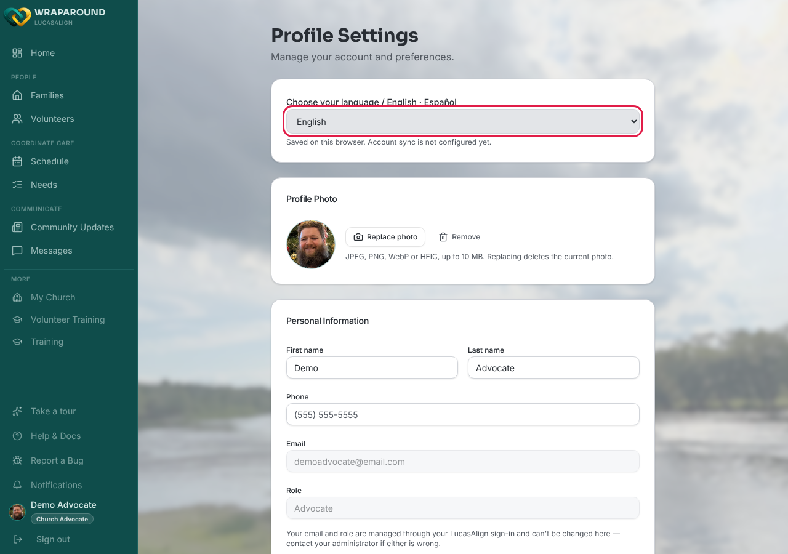
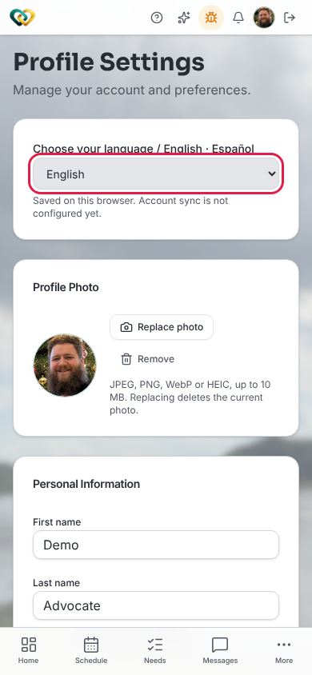

<!-- @frontend written 2026-11-11 from Align-FrontEnd main (701b73b):
     components/language-select.tsx (rendered on pages/profile.tsx with showPersistence,
     and on cognito-landing.tsx, onboarding.tsx, volunteer-register.tsx and
     family-signup.tsx without it), lib/i18n/language.ts (choice stored in localStorage),
     components/translated-text.tsx (per-org content translation). Profile Settings
     screenshot captured live on dev as the demo advocate. On dev the status line reads
     "Saved on this browser. Account sync is not configured yet." -->

<!-- @backend: account-level language sync (saveAccountLanguage) and content translation
     are per-org frontend flags (accountLanguageEnabled / contentTranslationEnabled).
     Confirm which orgs have them on before this page says more than "your organization
     may". -->

# Change the app's language

**Who this is for:** Everyone: volunteers, families, advocates, and program staff.
**When to use it:** You'd rather use WrapAround in Spanish (or switch back to English).
**Before you start:** Nothing. You can do this even before you sign in.

## Steps

1. Click your photo or initials in the sidebar (on a phone, at the top of the screen) to
   open **Profile Settings**. Program staff can also choose **Settings** in the sidebar.
2. At the top of the page, find **Choose your language / English · Español** and pick
   **Español** (or **English**).

    

    

## What you'll see

Menus, buttons, and messages switch to the language you picked right away. There's
nothing to save. The line under the picker tells you where your choice is kept:

- **Saved on this browser. Account sync is not configured yet.** Your choice applies on
  this browser only. Pick it again on another phone or computer.
- **Language saved to your account.** Your choice follows you to any device you sign in on.

!!! tip "Before you sign in"
    The sign-in page, the sign-up pages, and **Complete your profile** have the same
    **Choose your language** picker, so you can switch before you have an account.

!!! note "Posts and needs written by people"
    Switching the language changes WrapAround's own words. If your organization has turned
    on translation, text that people wrote (such as a need's title or description) is
    translated too. A **View original** link below it shows the text as it was written.

## Related

- [Update your profile](update-profile.md)
- [Sign up as a volunteer](volunteer-self-signup.md)
