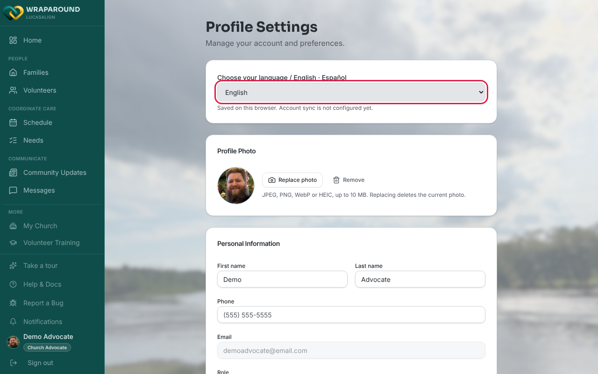
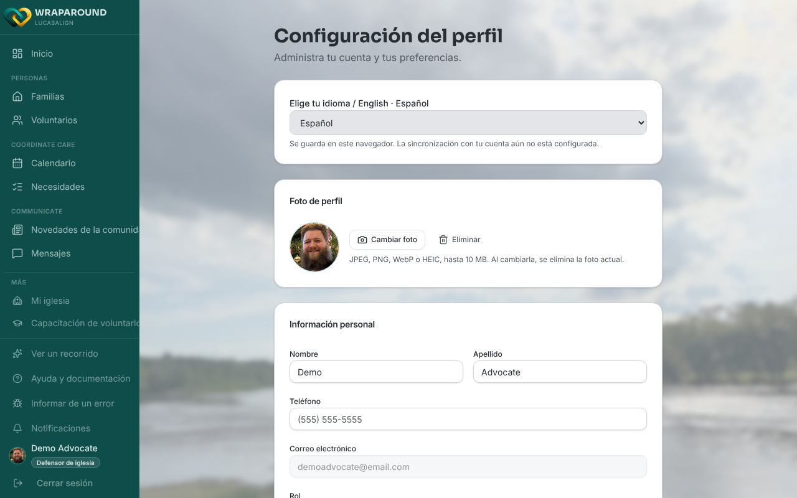
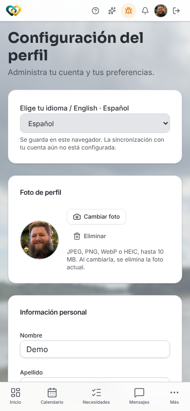

# Change your language

**Who this is for:** Everyone with a WrapAround account.
**When to use it:** To use WrapAround in Spanish instead of English, or to switch back.
**Before you start:** Nothing. You can also pick a language on the sign-in screen before you
sign in.

## Steps

1. Open **Profile Settings**: select your name and picture at the bottom of the sidebar on a
   computer, or tap your profile picture in the top-right corner on a phone.
2. At the top of the page, find **Choose your language / English · Español**.
3. Open the menu and choose **English** or **Español**.

    

    { width="320" }

There's no save button. The change takes effect as soon as you pick a language.

## What you'll see

Menus, buttons, and page text switch to the language you chose right away.

{ width="320" }

A short line under the menu says where your choice is kept:

- **Saved on this browser. Account sync is not configured yet.** Your choice is kept on
  this device and browser only. Pick it again if you sign in somewhere else.
- **Your language preference follows your account.** Your choice is saved to your account
  and follows you to other devices. When you change it, you'll see **Language saved to your
  account.**

!!! note "Some content stays as it was written"
    The language setting translates WrapAround's own menus and labels. Things people type,
    such as need descriptions, posts, and messages, may still appear in the language they
    were written in.

## Related

- [Update your profile](update-profile.md)
- [Manage your notification emails](manage-notification-emails.md)
