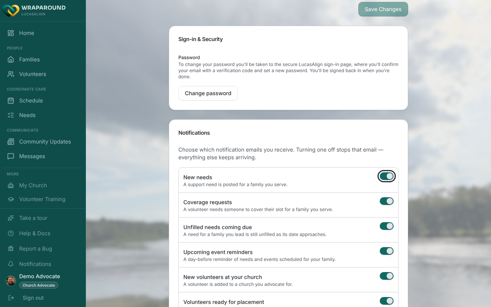
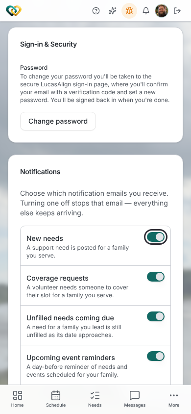
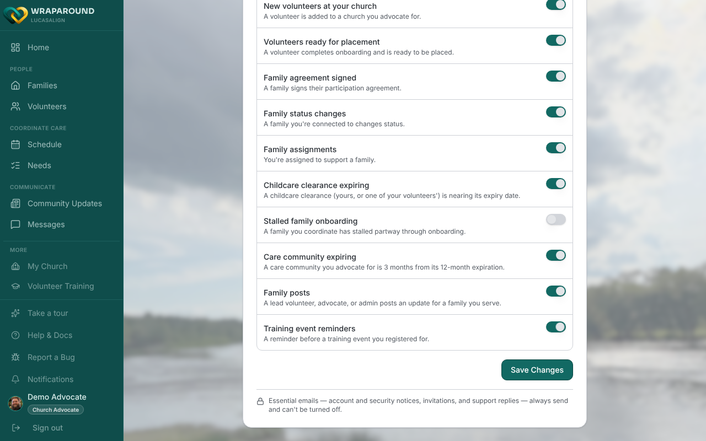
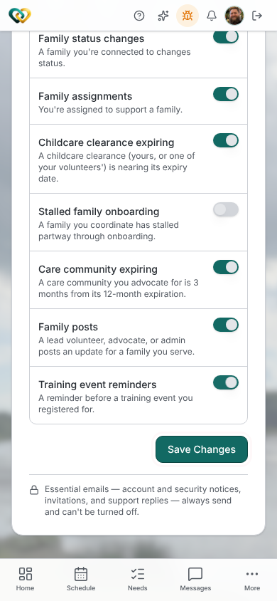
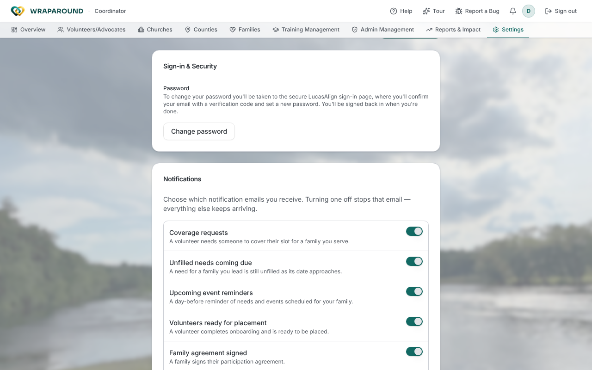

# Manage your notification emails

**Who this is for:** Everyone with a WrapAround account — volunteers, lead volunteers, advocates, program staff, and families.
**When to use it:** Any time you're getting too many (or too few) emails, or when your role changes what you're notified about.
**Before you start:** You've [accepted your invite and signed in](accept-invite.md).

WrapAround sends you an email when something happens that you might want to act on — a
new need is posted, a volunteer finishes onboarding, a family's status changes. You
control which of these emails you receive from your account settings. Turning one off
stops **only** that email; everything else keeps arriving.

## Open your Profile Settings

Everyone manages notifications from the same **Profile Settings** screen, but how you get
there depends on your role.

### Volunteers, advocates, and families

- **On a computer:** move your pointer over the **left sidebar** to expand it, then select
  **your name and profile picture** at the bottom of the sidebar.
- **On a phone:** tap your **profile picture** in the top-right corner.

### Coordinators and administrators

- In the **top navigation bar**, select **Settings** (the gear icon).
- Or, from any screen, select your **profile picture** in the top-right corner.

Either way, you land on **Profile Settings**. Scroll down to the **Notifications** card.

## Turn notification emails on or off

1. In the **Notifications** card, use the **toggle** next to each notification type to turn
   its email **on** (green) or **off** (grey).

    

    { width="320" }

2. Select **Save Changes** at the bottom of the card to apply them. The button stays greyed
   out until you've actually changed something, so if it's inactive you have nothing left
   to save.

    

    { width="320" }

!!! note "Two Save Changes buttons"
    Profile Settings has another **Save Changes** button higher up, under your address. That
    one saves your personal details only. Use the one inside the **Notifications** card for
    your email choices.

## What you'll see

A **Notification preferences saved.** message appears once your changes are saved, and they
stick — reload the page or sign in again later and your choices are still there. Any email
you switched off simply stops arriving.

## Every notification type

These are all the notification emails you can control. Your card shows a selection of
them (see the next section).

| Toggle | When it's sent |
|---|---|
| **New needs** | A support need is posted for a family you serve. |
| **Need sign-ups** | Someone signs up to help with a need for your family. |
| **Assignment changes** | You're added to or removed from a need someone else manages. |
| **Coverage requests** | A volunteer needs someone to cover their slot for a family you serve. |
| **Unfilled needs coming due** | A need for a family you lead is still unfilled as its date approaches. |
| **Upcoming event reminders** | A day-before reminder of needs and events scheduled for your family. |
| **New volunteers at your church** | A volunteer is added to a church you advocate for. |
| **Volunteers ready for placement** | A volunteer completes onboarding and is ready to be placed. |
| **Family agreement signed** | A family signs their participation agreement. |
| **Family status changes** | A family you're connected to changes status. |
| **Family assignments** | You're assigned to support a family. |
| **Childcare clearance expiring** | A childcare clearance (yours, or one of your volunteers') is nearing its expiry date. |
| **Stalled family onboarding** | A family you coordinate has stalled partway through onboarding. |
| **Care community expiring** | A care community you advocate for is 3 months from its 12-month expiration. |
| **Family posts** | A lead volunteer, advocate, or admin posts an update for a family you serve. |

!!! info "New needs that already have a volunteer"
    When someone posts a need and assigns a volunteer to it right away, the **New needs**
    email isn't sent for it. The need is already covered, so there's nothing to ask for.

!!! info "Stalled family onboarding is off until you turn it on"
    Every toggle starts **on**, except **Stalled family onboarding**. It starts **off**, and
    you only get it after you switch it on and save.

## Which toggles you'll see

The card starts with the notifications meant for your role:

- **Volunteers:** **New needs**, **Assignment changes**, **Family status changes**.
- **Lead volunteers:** **New needs**, **Need sign-ups**, **Assignment changes**,
  **Family status changes**.
- **Advocates:** **New needs**, **New volunteers at your church**, **Volunteers ready for
  placement**, **Family agreement signed**, **Family status changes**.
- **Coordinators and administrators:** **Volunteers ready for placement**, **Family
  agreement signed**, **Family status changes**.
- **Families:** **Need sign-ups**, **Family status changes**.

Every role also sees the newer toggles: **Coverage requests**, **Unfilled needs coming
due**, **Upcoming event reminders**, **Family assignments**, **Childcare clearance
expiring**, **Stalled family onboarding**, **Care community expiring**, and **Family
posts**. Some of these rarely or never apply to your role. Leaving one on when it doesn't
apply to you does nothing.

## Emails you can't turn off

Some emails are essential and always send, so they don't appear as toggles. A locked note
at the bottom of the card spells this out:

> Essential emails — account and security notices, invitations, and support replies —
> always send and can't be turned off.

This keeps you from missing a sign-in alert, an invitation, or a reply from support.

!!! tip "Getting too much email? Start with the noisiest toggle"
    If your inbox feels busy, turn off the one notification you act on least and keep the
    rest. You can come back and re-enable it any time.

## Related

- [Update your profile](update-profile.md)
- [Upload your photo](upload-photo.md)
- [Messaging notifications](../messaging/notifications.md)
