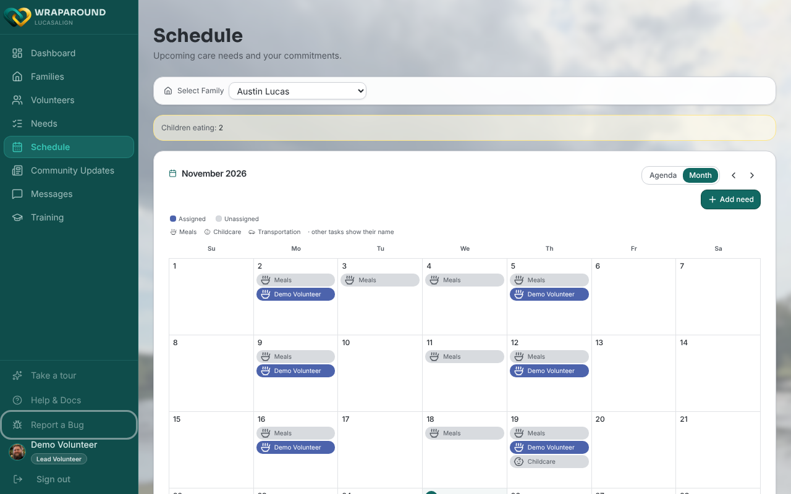
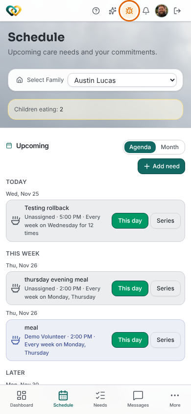
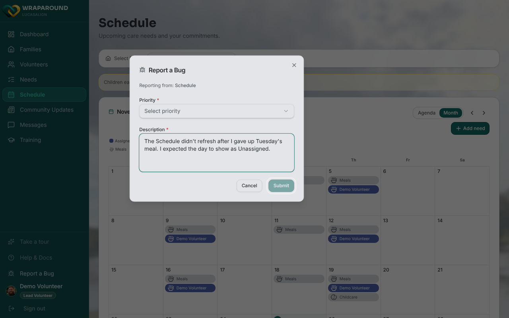
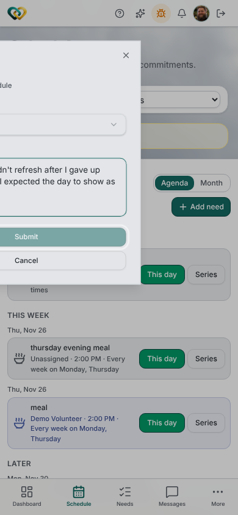

<!-- @frontend verified 2026-11-25 against Align-FrontEnd components/bug-report-button.tsx and
     components/layout.tsx: the Report a Bug button is rendered in every signed-in layout
     (top bar on phones and in the staff layout, sidebar footer on the desktop sidebar). -->
<!-- @backend: confirm who receives POST /bug-reports and whether the reporter hears back, so
     "What happens next" can say more than the in-app confirmation. -->

# Report a bug

**Who this is for:** Anyone signed in to WrapAround.
**When to use it:** Something in the app isn't working the way you expect, and you want the
WrapAround team to know.
**Before you start:** Go to the screen where the problem happened. The report records which
page you sent it from.

## Steps

1. Open **Report a Bug**:
    - **On a computer**, click **Report a Bug** at the bottom of the left sidebar (the bug icon
      when the sidebar is collapsed) or in the top bar.
    - **On a phone**, tap the small amber bug icon in the top bar.
    

    

2. The **Report a Bug** box opens and shows **Reporting from:** with the name of the page
   you're on.
3. Under **Priority**, choose **Low**, **Medium** or **High**.
4. Under **Description**, say what happened and what you expected instead. Include the steps
   you took, if you can.
5. Click **Submit**.

    

    

## What you'll see

A **Thanks for the report!** message confirms it was sent. Click **Close** to go back to
what you were doing.

If it couldn't be sent, you'll see **Couldn't send report**. Your text is still in the box,
so try **Submit** again.

!!! tip "Keep personal details out"
    Describe the problem without typing private family information (names, addresses,
    case details) into the report.

## Related

- [Troubleshooting](../../reference/troubleshooting.md)
- [FAQ](../../reference/faq.md)
