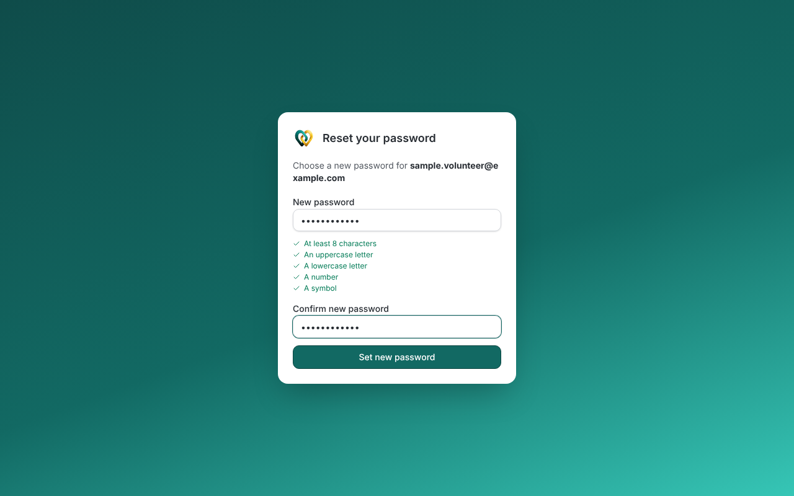
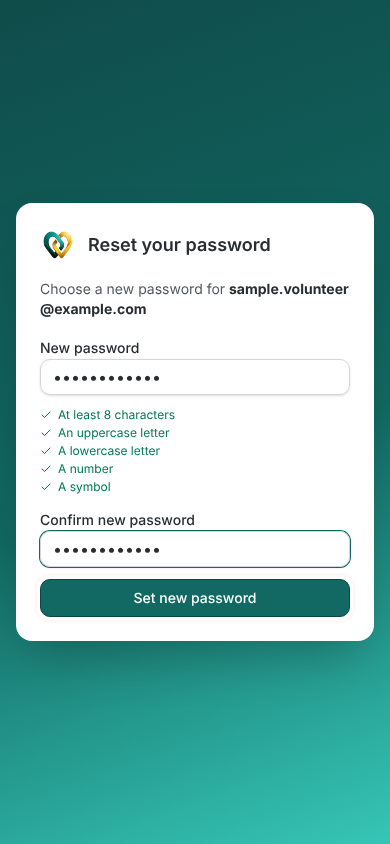

<!-- @frontend verified 2026-11-24 against Align-FrontEnd #838/#839 (pages/reset-password.tsx,
components/email-link-shell.tsx, lib/cognito-email-links.ts PASSWORD_RULES) and #842
(profile Change password). Email copy verified against Align-Core #555
(utils/email.ts: subject "Your WrapAround password reset code", fallback button
"Reset your password", link expires in 1 hour). -->

<!-- @backend verified 2026-11-24 against Align-Core #555: the Custom Email Sender adds
the /reset-password link to every CustomEmailSender_ForgotPassword email, so the sign-in
screen's "Forgot your password?" flow and Profile → Change password both get it. -->

# Reset your password from an email

**Who this is for:** Everyone with a WrapAround account.
**When to use it:** You asked to change or reset your password and got an email with a
code and a **Reset your password** button.
**Before you start:** Request the email, either from
[Profile Settings → Change password](update-profile.md#change-your-password) or with
**Forgot your password?** on the sign-in screen.

## Steps

1. Open the email **Your WrapAround password reset code**.
2. If you started from **Forgot your password?** and the sign-in screen is waiting for a
   code, you can type the code there. Otherwise, select the **Reset your password** button
   under "If you're unable to enter the code, use this link instead". The link expires in
   **1 hour**.
3. On the **Reset your password** page, check that the email after **Choose a new password
   for** is yours.
4. Type a **New password**. Each requirement turns green as you meet it:
    - At least 8 characters
    - An uppercase letter
    - A lowercase letter
    - A number
    - A symbol
5. Type it again in **Confirm new password**.
6. Select **Set new password**.

    

    { width="320" }

## What you'll see

A **Password updated** page says "Password updated. Sign in with your new password."
Select **Sign in** and use your new password.

## If something goes wrong

- **This link has expired.** Select **Send a new reset email** to get a fresh link and code.
- **This link is no longer valid. It may have already been used.** Each link works once.
  Start the reset again from Profile Settings or the sign-in screen.
- **This link is incomplete.** Part of the link was cut off. Select **Reset password** to
  start over.
- **Too many attempts, try again later.** Wait a few minutes before you try again.
- **Passwords don't match.** Retype the password in **Confirm new password**.

!!! tip "Didn't get the email?"
    Check your spam folder. On Profile Settings you can also select **Resend email**.

## Related

- [Update your profile](update-profile.md)
- [Troubleshooting](../../reference/troubleshooting.md)
