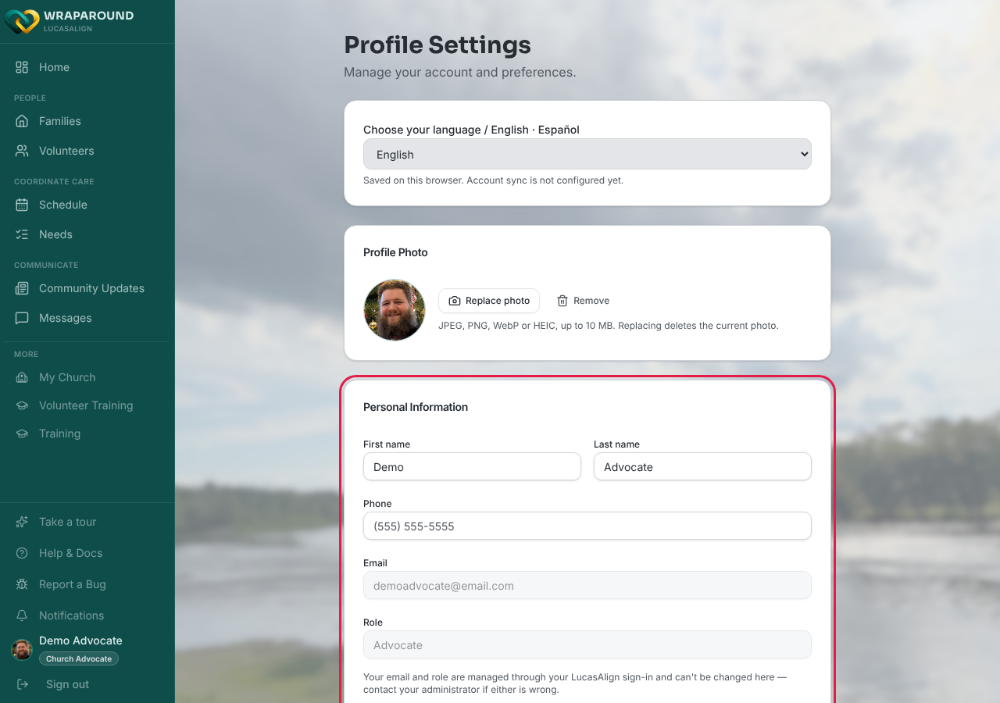
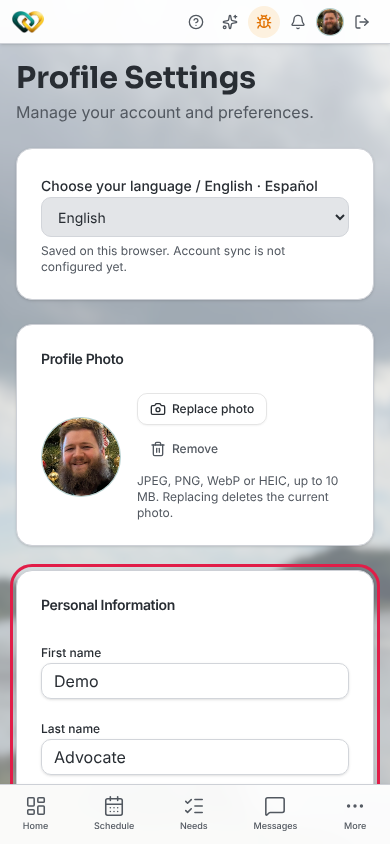

<!-- @frontend verified 2026-11-11 against Align-FrontEnd main (701b73b), pages/profile.tsx,
     and live on dev as the demo advocate. Correcting the earlier draft: First name, Last
     name, and Phone ARE now editable (saved via PUT /users/me); only Email and Role are
     read-only. The Address block shows only for someone with a volunteer record
     (volunteers, lead volunteers, advocates). Password changes go through the hosted
     sign-in page ("Change password", #543). -->

<!-- @backend: confirm PUT /users/me lets every role change its own first_name, last_name
     and phone, and that a volunteer may update their own address through
     PUT /volunteers/{id}. -->

# Update your profile

**Who this is for:** Everyone with a WrapAround account.
**When to use it:** To fix your name, phone number, or mailing address, change your
password, or check the details WrapAround has on file for you.
**Before you start:** You've [accepted your invite and signed in](accept-invite.md).

## Steps

1. Click your photo or initials in the sidebar (on a phone, at the top of the screen).
   Program staff can also choose **Settings** in the sidebar. **Profile Settings** opens.
2. Under **Personal Information**, change your **First name**, **Last name**, or **Phone**.

    

    

3. Volunteers and advocates: under **Address**, update your **Street**, **City**, **State**,
   and **ZIP**.
4. Click **Save Changes**. The button stays greyed out until you've changed something.

## What you'll see

A **Profile updated** message. If you changed your name, the new name shows across
WrapAround the next time you sign in.

!!! note "Email and role can't be changed here"
    Your **Email** and **Role** are managed through your sign-in account. If either is
    wrong, contact your administrator or coordinator.

## Change your password

Under **Sign-in & Security**, click **Change password**. You're taken to the secure sign-in
page, where you confirm your email with a verification code and set a new password. You're
signed back in when you're done.

## Related

- [Upload your photo](upload-photo.md)
- [Manage your notification emails](manage-notification-emails.md)
- [Change the app's language](change-your-language.md)
