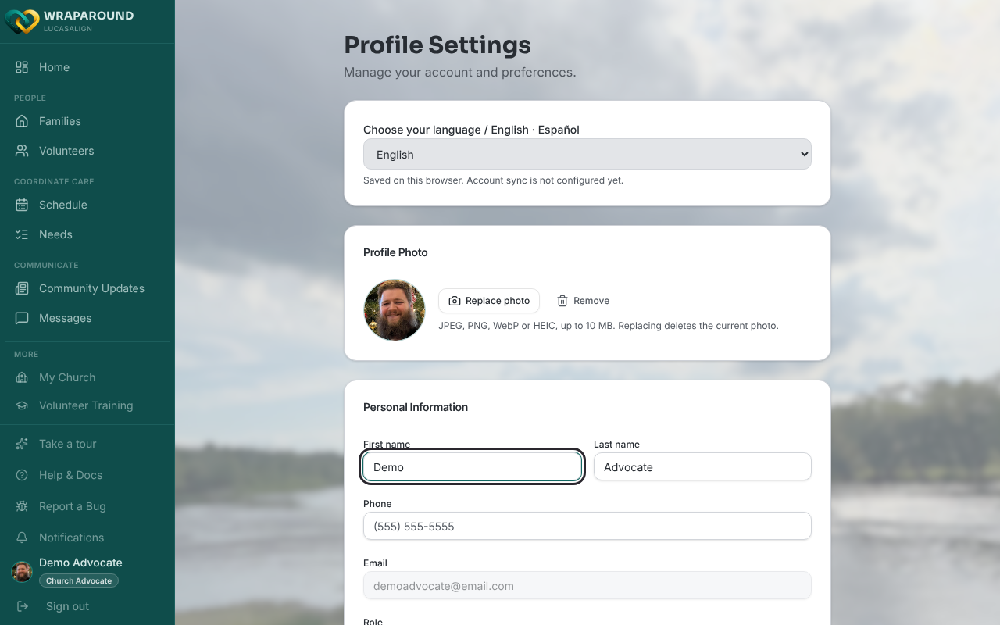
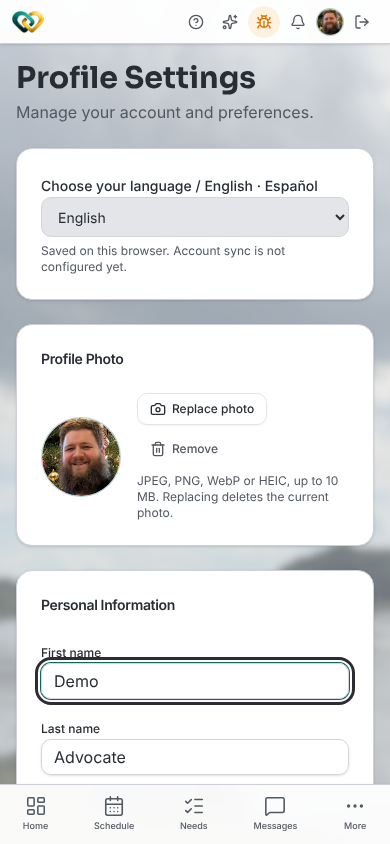
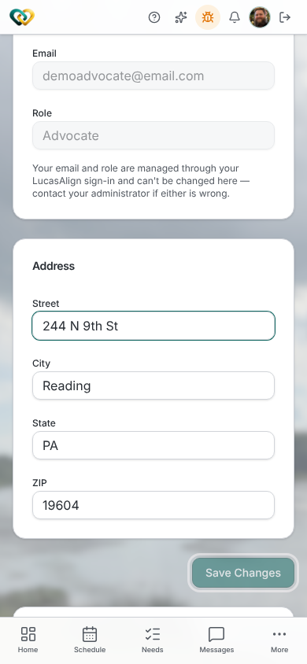
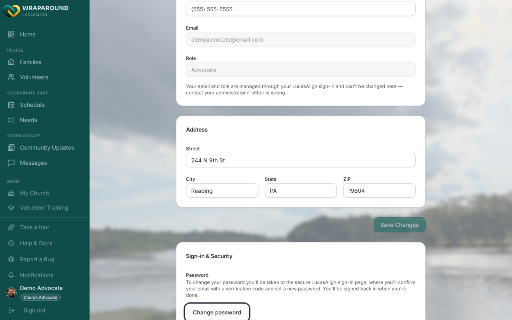
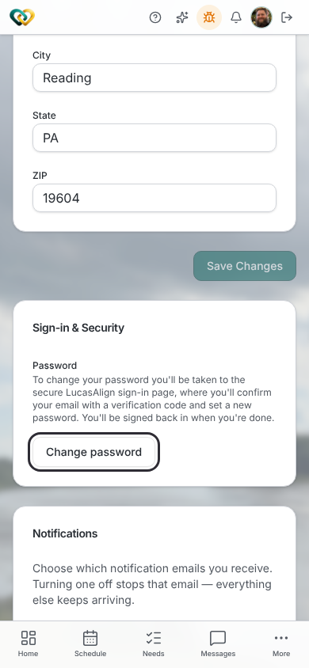

<!-- @frontend verified 2026-11-24 against Align-FrontEnd #842 (pages/profile.tsx): Change
password no longer redirects to the Hosted UI. It emails a code + /reset-password link,
shows a "Check your email" toast and an instructions card, and the button becomes
"Resend email". The link expires in 1 hour (Align-Core #555, PASSWORD_RESET_LINK_EXPIRY). -->

# Update your profile

**Who this is for:** Everyone with a WrapAround account.
**When to use it:** To change your name, phone number, or address, or to change your password.
**Before you start:** You've [accepted your invite and signed in](accept-invite.md).

## Open Profile Settings

- **On a computer:** select **your name and profile picture** at the bottom of the left
  sidebar.
- **On a phone:** tap your **profile picture** in the top-right corner.

## Change your name or phone number

1. Under **Personal Information**, edit **First name**, **Last name**, or **Phone**.

    

    { width="320" }

2. If you see an **Address** card, you can also edit **Street**, **City**, **State**, and
   **ZIP** there.
3. Select **Save Changes** below the address. The button stays greyed out until you've
   changed something.

    

    { width="320" }

!!! note "Email and role can't be changed here"
    **Email** and **Role** are greyed out. They come from your sign-in account. If either is
    wrong, contact your administrator.

!!! info "Who sees the Address card"
    The **Address** card appears only for people with a volunteer record, such as
    volunteers and advocates. Family accounts don't have it.

## Change your password

1. Scroll to **Sign-in & Security** and select **Change password**.

    

    { width="320" }

2. WrapAround emails you a reset link and a code, and a **Check your email** message
   appears. The card lists what to do next.
3. Open the email and select **Reset your password** (or enter the code on the page it
   opens). The link expires in 1 hour.
4. Choose your new password and save it, then sign in again. See
   [Reset your password from an email](reset-your-password-from-an-email.md) for the
   details of that page.

If the email doesn't arrive, check your spam folder, or select **Resend email** on the
card.

## What you'll see

After you save, a **Profile updated** message appears. If you changed your name, the
message tells you your new name appears across WrapAround the next time you sign in.
After you change your password, sign in again with the new one.

## Related

- [Upload your photo](upload-photo.md)
- [Reset your password from an email](reset-your-password-from-an-email.md)
- [Change your language](change-your-language.md)
- [Manage your notification emails](manage-notification-emails.md)
