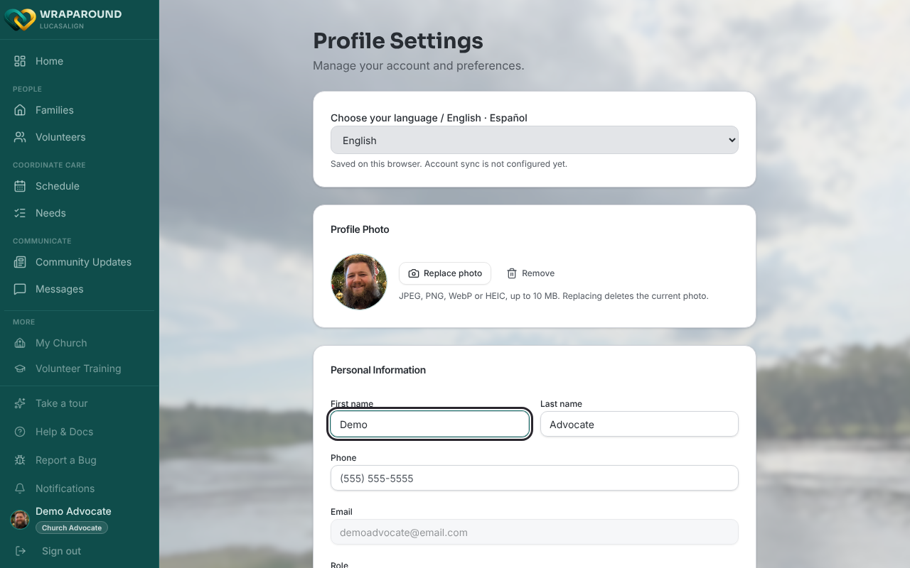
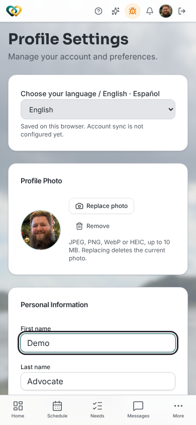
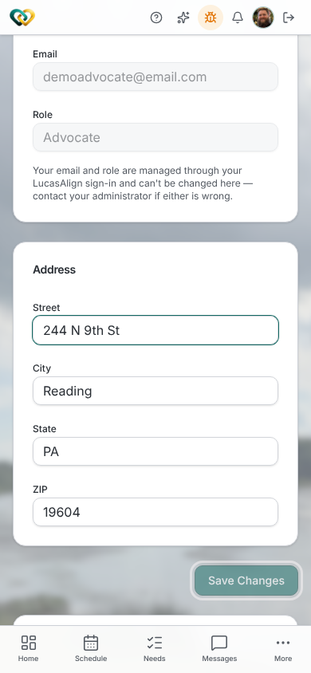
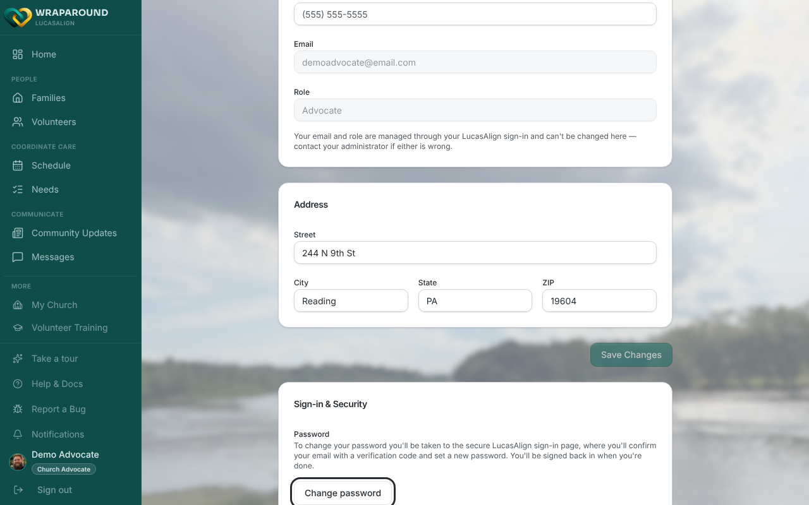
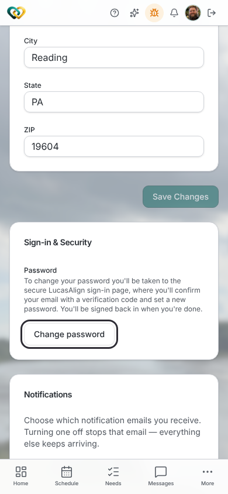

# Update your profile

**Who this is for:** Everyone with a WrapAround account.
**When to use it:** To change your name, phone number, or address, or to change your password.
**Before you start:** You've [accepted your invite and signed in](accept-invite.md).

## Open Profile Settings

- **On a computer:** select **your name and profile picture** at the bottom of the left
  sidebar.
- **On a phone:** tap your **profile picture** in the top-right corner.

## Change your name or phone number

1. Under **Personal Information**, edit **First name**, **Last name**, or **Phone**.

    

    { width="320" }

2. If you see an **Address** card, you can also edit **Street**, **City**, **State**, and
   **ZIP** there.
3. Select **Save Changes** below the address. The button stays greyed out until you've
   changed something.

    

    { width="320" }

!!! note "Email and role can't be changed here"
    **Email** and **Role** are greyed out. They come from your sign-in account. If either is
    wrong, contact your administrator.

!!! info "Who sees the Address card"
    The **Address** card appears only for people with a volunteer record, such as
    volunteers and advocates. Family accounts don't have it.

## Change your password

1. Scroll to **Sign-in & Security** and select **Change password**.

    

    { width="320" }

2. You're taken to the secure sign-in page. Confirm your email with the verification code
   it sends you, then set a new password.

## What you'll see

After you save, a **Profile updated** message appears. If you changed your name, the
message tells you your new name appears across WrapAround the next time you sign in.
After you change your password, you're signed back in to WrapAround.

## Related

- [Upload your photo](upload-photo.md)
- [Change your language](change-your-language.md)
- [Manage your notification emails](manage-notification-emails.md)
