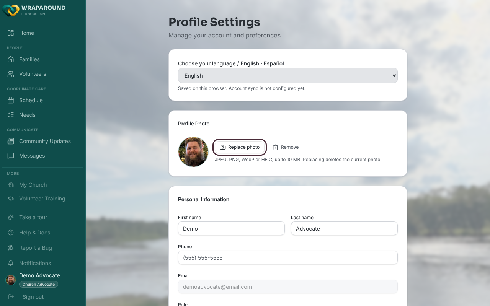
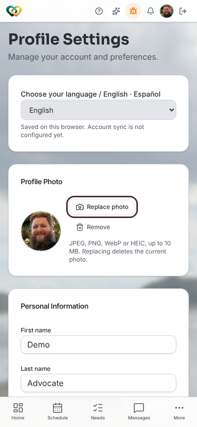

# Upload your photo

**Who this is for:** Everyone with a WrapAround account.
**When to use it:** To put a face to your name so your care circle recognizes you.
**Before you start:** You've [accepted your invite and signed in](accept-invite.md), and
you have a photo on the device you're using.

## Steps

1. Open **Profile Settings**: select your name and picture at the bottom of the sidebar on
   a computer, or tap your profile picture in the top-right corner on a phone.
2. Under **Profile Photo**, select **Upload photo** (or **Replace photo** if you already
   have one).

    

    { width="320" }

3. Choose a photo from your device: **JPEG, PNG, WebP, or HEIC**, up to **10 MB**.
4. Your photo uploads and a **Profile photo updated.** message appears. There's no separate
   confirm step and no cropping — the photo you pick is the photo that's used.

To take your photo down without adding a new one, select **Remove**, then **Remove photo**
to confirm. The image is deleted and can't be restored.

## What you'll see

Your new photo appears next to your name across WrapAround, so the team can recognize you.

!!! warning "Replacing deletes the old photo"
    The card says it plainly: "Replacing deletes the current photo." There's no way to go
    back to it, so pick a photo you're happy keeping.

!!! tip "Pick a clear, friendly photo"
    A simple headshot works best. Avoid group photos so people can tell which face is yours.

## Related

- [Update your profile](update-profile.md)
