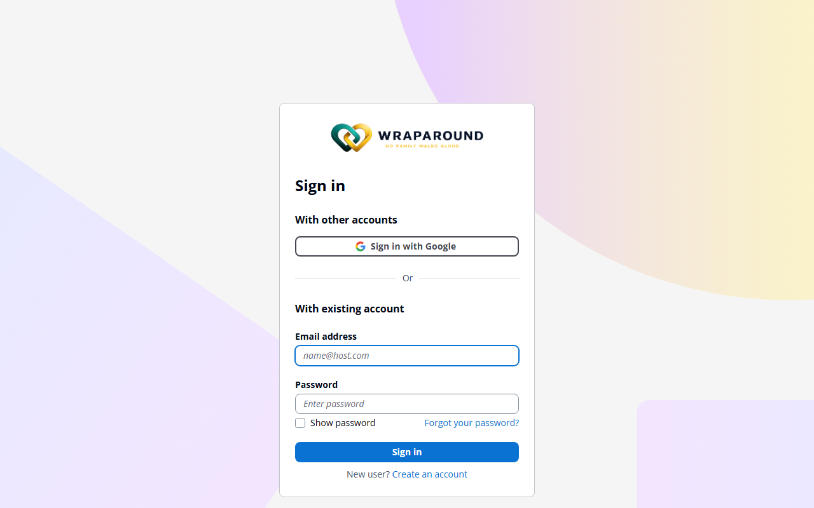
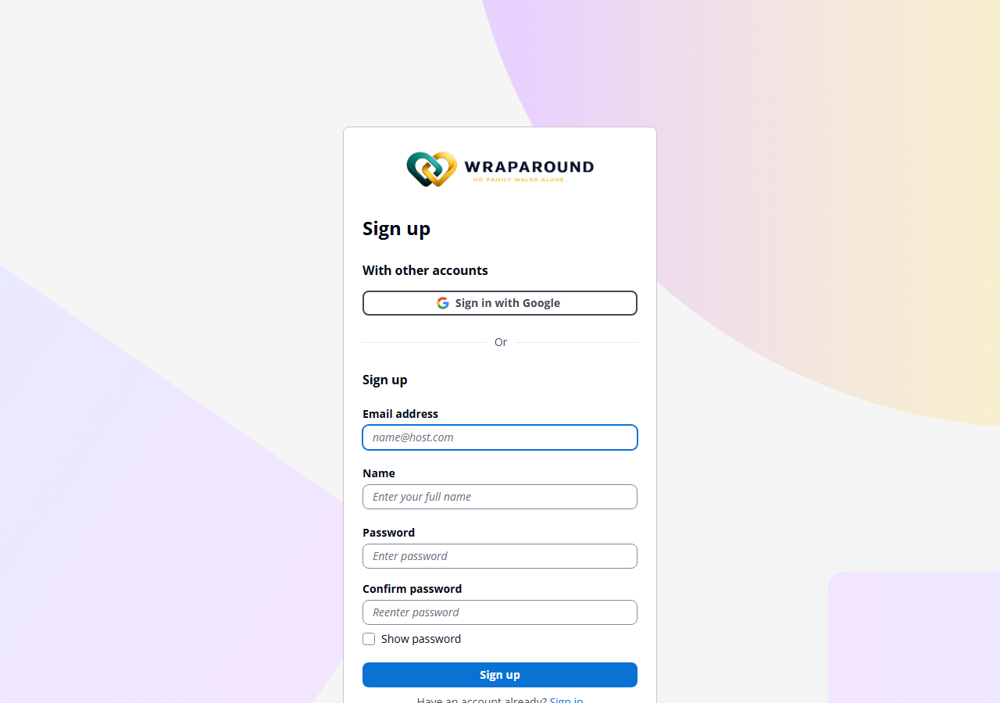
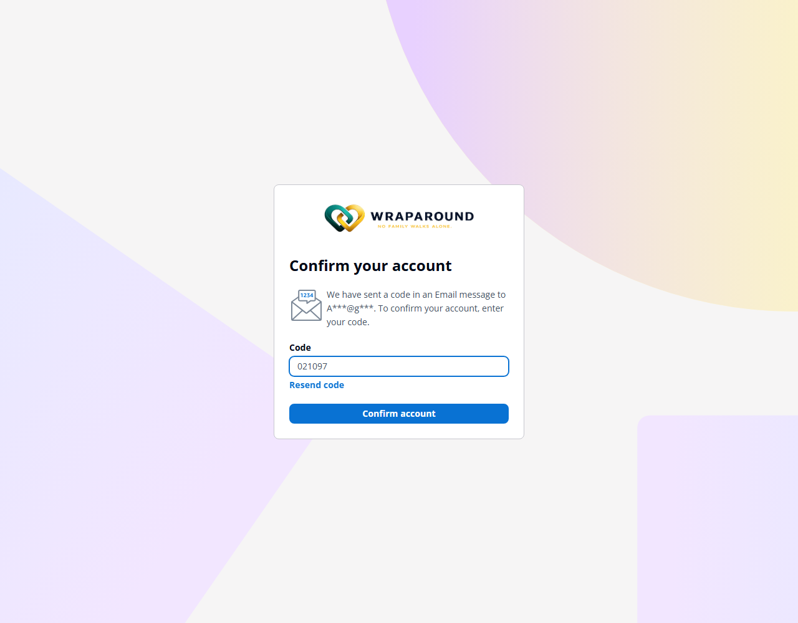
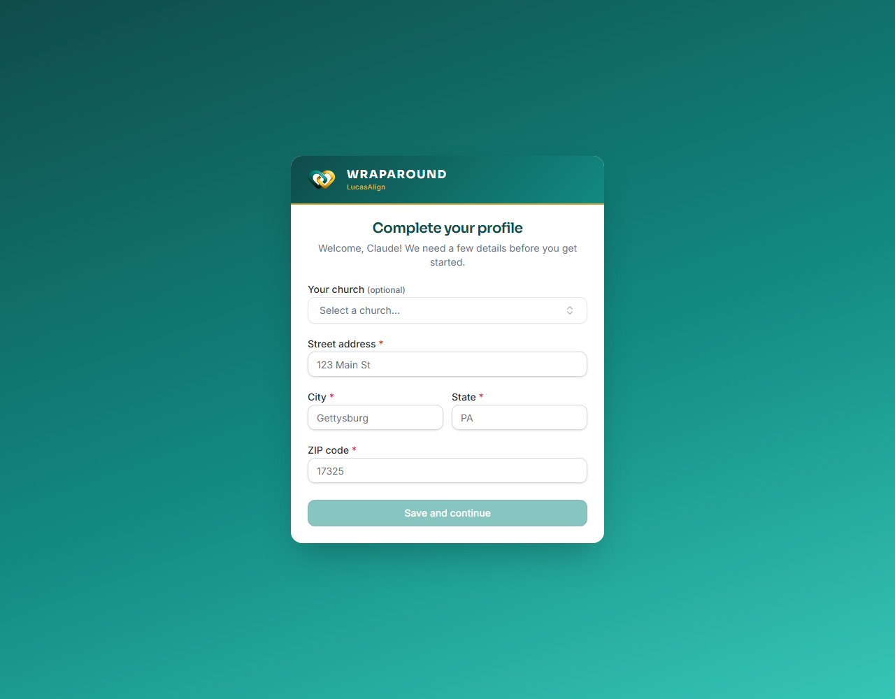
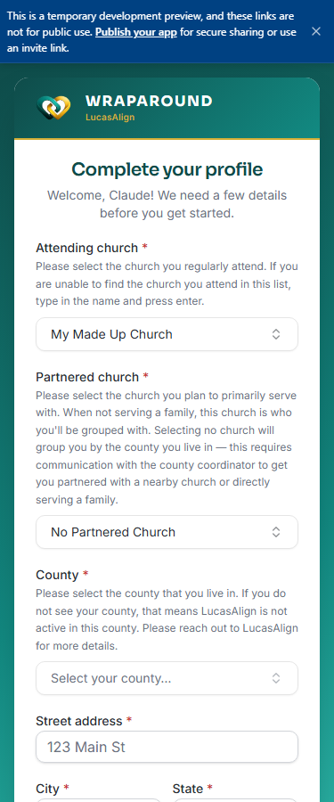

<!-- @frontend verified live end-to-end 2026-08-27, using two real throwaway accounts
carried all the way through signup, email verification, and profile completion:

- Cognito's native "New user? Create an account" link, sign-up form, and live
  password-rule validation — confirmed on demo.wraparound.lucasalign.com.
- Email verification code + the post-verification "Complete your profile" screen —
  confirmed by actually receiving and entering a real code, twice.

Re-verified 2026-11-11 against Align-FrontEnd main (701b73b): App.tsx gates run in the
order provisioning ("Setting up your account") → volunteer agreement (/volunteer/agreement,
only when the tenant has an active volunteer agreement; Align-Core #413) → onboarding
("Complete your profile") → training (only when onboarding_status is training_assigned).
pages/onboarding.tsx shows "Your mailing address" before "Your church". Not re-captured
live: it needs a fresh Cognito account. -->

# Sign up as a volunteer

**Who this is for:** Anyone who wants to volunteer with WrapAround, without waiting for
an invite.
**When to use it:** You want to create your own volunteer account right away.
**Before you start:** Nothing — but if a church or program already has a relationship
with WrapAround, using an email your church leaders can recognize helps them place you.

## Steps

1. Go to your organization's WrapAround sign-in page (e.g. `demo.wraparound.lucasalign.com`) and choose **Sign in**.
2. At the very bottom of the sign-in form, choose **New user? Create an account**.

    

3. On the **Sign up** form, enter your **email address**, **full name**, and a password, then confirm it.

    

    Your password needs to be at least 8 characters and include a number, an uppercase letter, and a special character — the form validates each requirement as you type.

4. Choose **Sign up**. You'll be sent an email with a verification code. Enter it on the **Confirm your account** screen and choose **Confirm account**.

    

5. You may see **Setting up your account** for a few seconds while WrapAround finishes your registration.
6. If your program uses a volunteer agreement, the **Volunteer agreement** page opens next. Read it, choose **Review & sign**, check your details on **Confirm your signature**, and choose **I agree & sign**.
7. You land on **Complete your profile**. Under **Your mailing address**, fill in your **street address**, **city**, **state**, and **ZIP code**. Then, under **Your church**, select your **attending church** from the list.

    

8. Choose **Save and continue**. If the button is greyed out, look just above it: a red **Still needed:** line lists every required field you haven't filled in yet. A required field you've left empty is also outlined in red.

## If your church isn't in the list

Don't pick the closest match — type your church's actual name and a **Use "‹what you typed›"** option appears below the field; select it.

Adding a church this way opens a second required field, **Partnered church** — the church you'll primarily serve with when you're not placed with a family. Pick one from the list, or choose **No Partnered Church** if none fits. **No Partnered Church** stays at the top of the list even while you search.

Choosing **No Partnered Church** opens a third required field, **County** — the county you live in. If your county isn't listed, WrapAround isn't active there yet; the form tells you to contact the program directly rather than letting you continue.

!!! tip "Prefer Spanish?"
    The sign-in page and **Complete your profile** both have a **Choose your language**
    picker. See [Change the app's language](change-your-language.md).

## What you'll see

You're taken into WrapAround. If training has been assigned to you, you go straight to
[training](../training/modules-and-progress.md). Complete your modules before program
staff can place you with a family.

!!! tip "Already have an invite instead?"
    If a program or advocate already invited you by email, don't sign up here — follow
    [Accept your invite & sign in](accept-invite.md) instead, using the same email the
    invite was sent to.

## Related

- [Accept your invite & sign in](accept-invite.md)
- [Get started as a Volunteer](../../get-started/volunteers.md)
- [Find your modules & track progress](../training/modules-and-progress.md)
