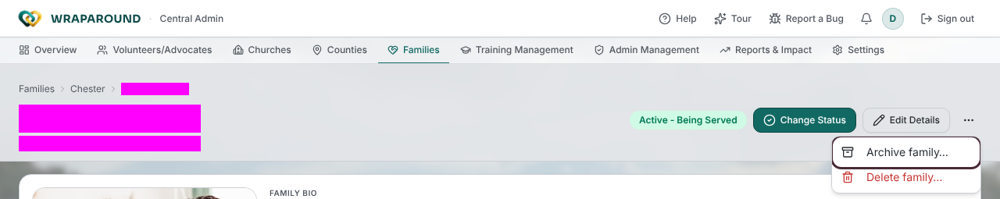
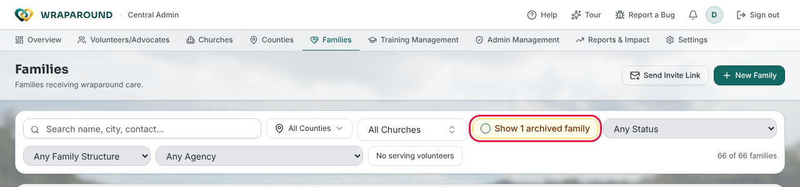

# Archive a family or child

**Who this is for:** Admins and Coordinators archive and restore families. Advocates can
request that a family be archived, and can archive and restore a child in a family their
church serves.
**When to use it:** A family has moved away or no longer needs care, and you want it out
of everyday lists without losing its history.
**Before you start:** Archiving keeps the records for reports. It is not the same as
**Delete family…**, which removes the family's data permanently.

## Archive a family (Admin/Coordinator)

1. Open the family from **Families**.
2. Click the **More actions** (⋯) button next to the family's name.
3. Choose **Archive family…**.

4. Read the confirmation, then click **Archive Family**.

## What you'll see

A **<family name> archived** message appears and the family page shows an **Archived**
banner with the date. Archiving:

- sets the family to inactive and hides it from advocates, volunteers and the family
  themselves;
- stops all email to or about the family while it is archived;
- keeps the records for reports.

## Find and restore an archived family

1. Open **Families**.
2. Turn on **Show archived** (it reads **Show 1 archived family** or
   **Show N archived families** when some match your filters). The list switches to
   archived families only.

3. Open the family and click **Restore family** in the banner.

A **<family name> restored** message appears. The family is still inactive: change its
status to reactivate it.

## Request an archive (Advocate)

Advocates can't archive a family directly.

1. Open the family and click **More actions** (⋯).
2. Choose **Request archival…**.
3. Enter a **Reason** (for example, "The family has moved out of the area.") and click
   **Send request**.

Your county's coordinators get an email with your name and the reason, and decide whether
to archive. You'll see **Archive request sent**.

## Archive a child

In the family's **Household** section, click **Archive <child name>** next to the child
and confirm with **Archive**. Archived children move to an **Archived children (N)**
list under the household. Admins, Coordinators and Advocates can bring a child back with
**Restore**; everyone else sees "To restore a child, reach out to a coordinator."

## Related

- [Manage families & people](families-and-people.md)
- [Roles & who sees what](../../concepts/roles-and-visibility.md)
