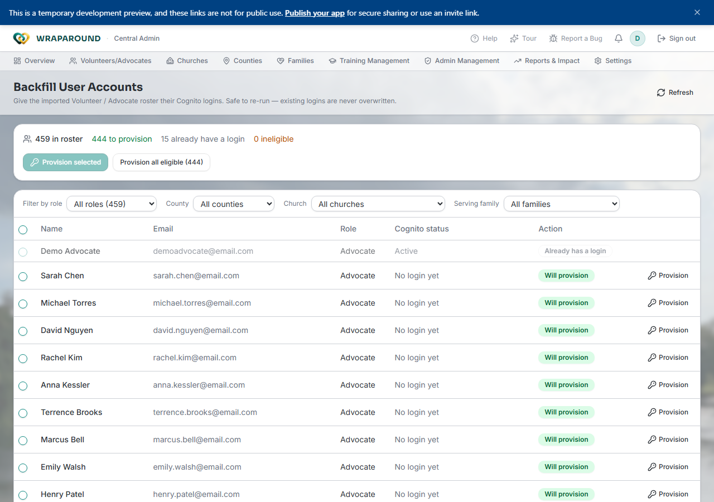

<!-- @frontend verified 2026-09-15 live on the dev instance, signed in as the demo
Central Admin at /admin-backfilluseraccounts, and against
Align-FrontEnd/pages/admin-backfill-user-accounts.tsx: summary tiles, filters, table
columns, and both provision paths confirmed live with real roster data (459 rows).
Access gating (isAdmin = central_admin or county_admin) and the URL-only routing (no nav
link, both `/Admin-BackfillUserAccounts` and `/admin-backfilluseraccounts` work) confirmed
from App.tsx and app-context.tsx. Provisioning itself was NOT exercised live — the
described behavior (temp-password email, idempotent re-run, batch chunking, the
"Provision all eligible" polling loop) is read directly from the component's request
logic and its own code comments, not from a live provision run. -->

# Backfill user accounts

**Who this is for:** Central Admin, Coordinator.
**When to use it:** After an import brings in a Volunteer/Advocate roster that has
records in WrapAround but no way to sign in yet — for example, migrating a partner
organization's existing spreadsheet of volunteers.
**Before you start:** You're signed in with staff access, and volunteer/advocate records
already exist (from a CSV import or manual entry) but haven't been invited individually.

!!! note "Not in the main navigation"
    This is a one-off migration tool, not part of anyone's daily work, so there's no menu
    link to it. Go directly to **`/admin-backfilluseraccounts`** on your organization's
    WrapAround URL (for example
    `https://your-org.wraparound.example.com/admin-backfilluseraccounts`).

## What this does

Everyone in the **Volunteers/Advocates** roster needs a Cognito login before they can
sign in. Normally that happens one at a time, through
[Invite a volunteer or advocate](volunteers-and-advocates.md#invite-a-volunteer-or-advocate).
This page does the same thing in bulk, for a roster that was imported (or otherwise
created) without going through that invite flow.

It's read-only against the family/volunteer data — it only creates Cognito logins and
sends invite emails. **It's safe to re-run**: anyone who already has a login is reported
as such and is never touched again.

## Steps

1. Go to **`/admin-backfilluseraccounts`**. The page loads the full Volunteer/Advocate
   roster and shows four counts: how many are **in roster**, how many are **to
   provision**, how many **already have a login**, and how many are **ineligible**.
2. Narrow the list if you want, using **Filter by role**, **County**, **Church**, and
   **Serving family** — these filters combine, and they scope both the table and
   whichever bulk action you use next.
3. Choose how to provision:
    - **One row at a time** — click **Provision** on that row.
    - **A selected batch** — check the rows you want (the header checkbox selects every
      provisionable row currently shown), then click **Provision selected (N)**.
    - **Everyone eligible** — click **Provision all eligible (N)**. This ignores your
      filters and works through the entire roster, in batches, until nothing's left.
4. Watch the progress bar while it runs. When it finishes, a summary shows how many were
   **provisioned**, how many **already existed**, and how many were **skipped**.

## What you'll see

Each provisioned person is emailed a temporary password and a sign-in link — the same
first-sign-in flow as any other invite. → [Accept your invite & sign in](../account/accept-invite.md)

!!! warning "If an email can't be delivered"
    When an email fails to send, that person's **temporary password is shown directly on
    this page** instead, with a note to copy it and share it with them by hand, then
    discard it — it isn't saved anywhere. Copy it before you navigate away.

## Why some rows are skipped

A row won't be provisioned, and its **Action** column shows a reason instead:

| Reason shown | What it means |
|---|---|
| Already has a login | Nothing to do — check the **Cognito status** column for detail. |
| Invalid / placeholder email | The roster's email address isn't usable — fix it at the source and re-run. |
| Duplicate email in roster | More than one row shares this email — resolve the duplicate first. |
| Deactivated | This person's record is deactivated. |
| Missing name | No name on the record. |
| Missing email | No email on the record — required to invite anyone. |

**Cognito status** tells you more about an "Already has a login" row: **Active** means
they've signed in; **Invited (awaiting first sign-in)** means they got a temporary
password but never used it. For that second case, a **Resend** button appears in place
of Provision — click it to issue a fresh temporary password (the same
[Send New Temp Password](onboarding.md#resend-an-invite) dialog used elsewhere).

## Related

- [Manage volunteers & advocates](volunteers-and-advocates.md)
- [Onboard a family & invite people](onboarding.md)
- [Accept your invite & sign in](../account/accept-invite.md)
