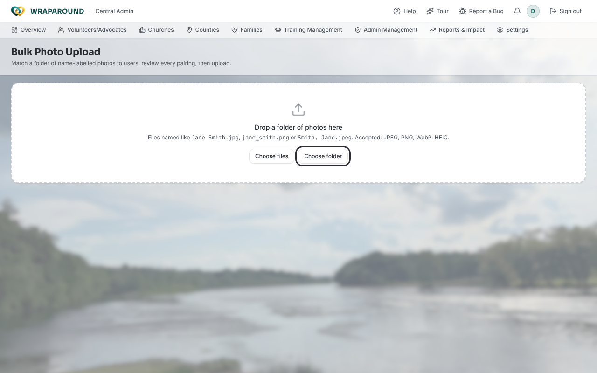

<!-- @frontend verified 2026-10-30 against Align-FrontEnd pages/admin-bulk-photo-upload.tsx and
lib/route-access.ts, and the start screen live in dev as Admin. The review and upload
states need a photo folder and weren't captured. -->

# Bulk upload profile photos

**Who this is for:** Program staff (Admin, Coordinator).
**When to use it:** When you have a folder of photos labelled with people's names and want to
attach them to existing user accounts in one go, instead of
[uploading photos one at a time](../account/upload-photo.md).
**Before you start:** The people already have accounts, and each photo file is named after the
person, such as `Jane Smith.jpg`, `jane_smith.png` or `Smith, Jane.jpeg`. Accepted formats are
JPEG, PNG, WebP and HEIC.

!!! note "Not in the main navigation"
    This is a one-off import tool, so there's no menu link to it. Go directly to
    **`/admin-bulkphotoupload`** on your organization's WrapAround URL. Anyone without
    staff access is turned away.

## Steps

1. Open `/admin-bulkphotoupload`. The page is titled **Bulk Photo Upload**.

    

2. Drop a folder of photos onto **Drop a folder of photos here**, or click **Choose folder**
   (a whole folder) or **Choose files** (individual photos). The buttons read **Loading
   roster…** until the list of users has loaded.
3. Review the summary: how many photos are **confident**, **need review**, or **unmatched**,
   and how many **will upload**. Unsupported files are skipped and listed.
4. Work through the sections:
    - **Confident matches** — one user matches the full name. These upload unless you skip them.
    - **Needs review** — the name is ambiguous. Pick the right person from the **Suggested**
      list, or choose **Skip this photo**. Nothing here uploads until you decide.
    - **No match** — search the roster by name with **Search the roster…**, or skip the file.
5. Check the status beside each row: **Ready**, **Replaces a photo** (the person already has
   one), **Has a photo · skipped**, **Skipped** or **Unresolved**.
6. Leave **Only upload new photos — skip users who already have one** ticked to keep existing
   photos, or untick it to replace them.
7. Click **Upload N photos**. Nothing uploads until you click this.

## What you'll see

A progress bar shows **Uploading X of Y…** and then **Attaching photos…**. When it finishes,
the page shows how many photos were **attached**.

!!! warning "Two photos for one person"
    If two photos are assigned to the same person, the page blocks the upload until you
    resolve it, because the server rejects the whole batch on a duplicate.

!!! tip "If some uploads fail"
    Nothing is attached when a photo fails to upload. The page lists the failures and offers
    **Retry all**, or **Attach the N that worked** to keep the successful ones.

## Related

- [Upload a profile photo](../account/upload-photo.md)
- [Backfill user accounts](backfill-user-accounts.md)
