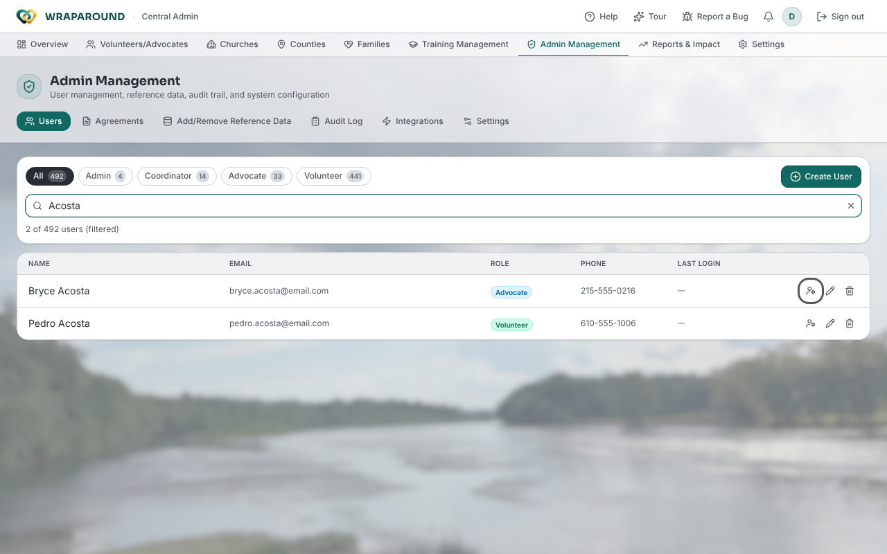
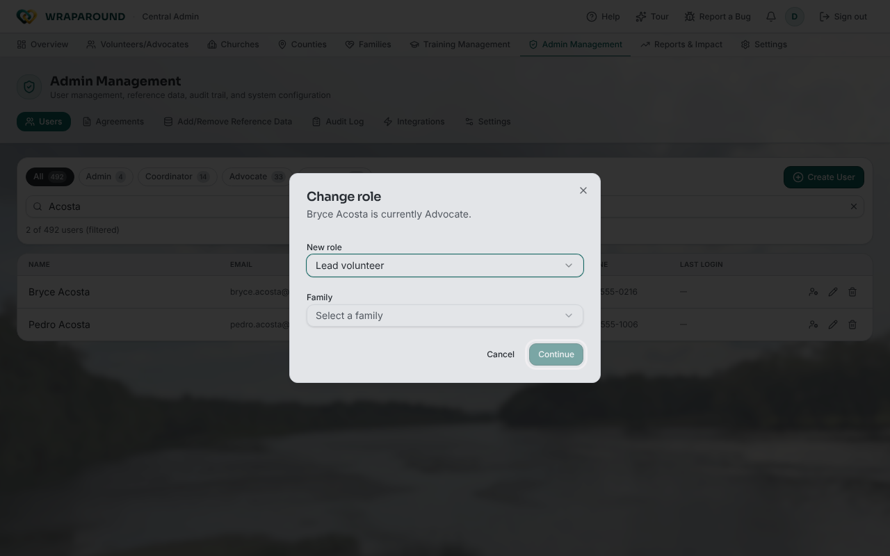

# Change a user's role

**Who this is for:** Admins and Coordinators.
**When to use it:** Someone's job has changed, for example a Coordinator becoming an
Admin, or a Volunteer becoming an Advocate or a family's Lead volunteer.
**Before you start:** The person already has a WrapAround account.

## Steps

1. Open **Admin Management** from the top nav. The **Users** tab opens.
2. Find the person, then select the **Change role** icon (a person with a gear) on their
   row.

    
3. Under **New role**, pick their new role. Some roles ask for one more thing:
    - **Coordinator**: check one or more **Counties**. The first county you select becomes
      their home county.
    - **Advocate**: pick their **Church**.
    - **Lead volunteer**: pick the **Family** they'll lead.

    
4. Select **Continue**, check the summary, then select **Change role**.

## What you'll see

A **Role changed** message. The person is signed out, loses the access their old role
gave them, and sees their new access the next time they sign in. If they couldn't be
signed out automatically, the message says so; the change still applies at their next
sign-in.

## Which changes are allowed

Roles only change within the same group:

- **Staff:** **Admin** ↔ **Coordinator**.
- **Volunteer roles:** **Advocate**, **Lead volunteer** and **Volunteer**.

You can't move someone between staff and volunteer roles, and family accounts can't change
role. You also can't change your own role, and only an Admin can make someone an Admin or
change an Admin's role. The **Change role** icon only appears on rows you're allowed to
change.

<!-- @backend: confirm the full rule set (tiers, self-change, Admin-only for central_admin,
any last-admin guard) against utils/user-role-change.ts before this page reaches ready. -->

## Related

- [Manage volunteers & advocates](volunteers-and-advocates.md)
- [Assign a Lead Volunteer](../advocate/assign-a-lead-volunteer.md)
- [Roles & who sees what](../../concepts/roles-and-visibility.md)
