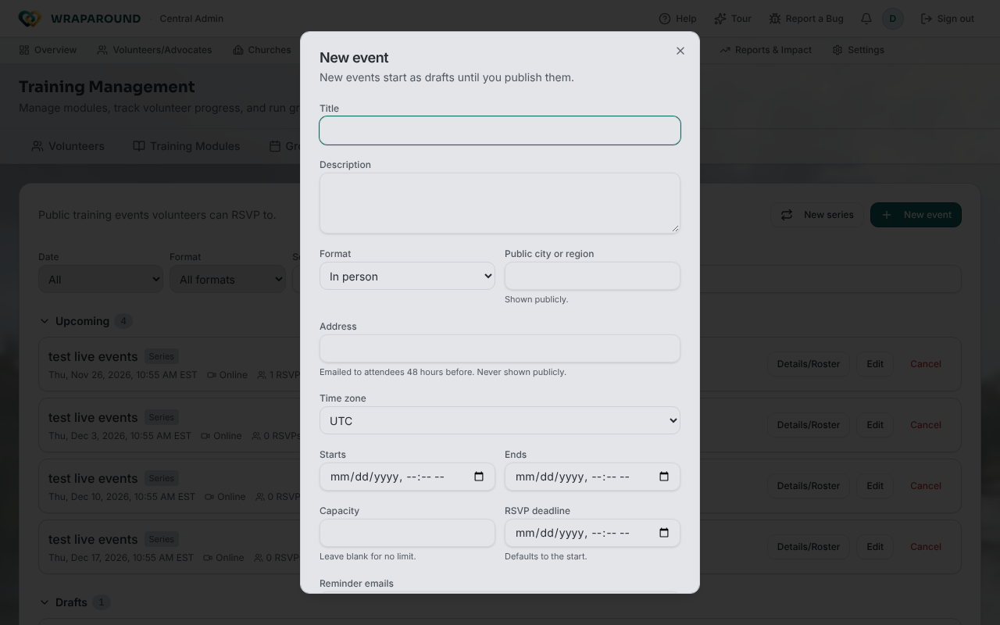

# Create a training event

**Who this is for:** Central Admins.
**When to use it:** You're running a training date (in person or online) and want
volunteers, and people who aren't volunteers yet, to RSVP for it from a public page.
**Before you start:** You know the date, time and place (or meeting link) for the event.

<!-- @backend: the API (/training/events) also accepts Coordinators, but the frontend
shows the Events tab to Central Admins only (canManageTrainingEvents). Confirm that's the
intended product rule before this page reaches ready. -->

## Steps

1. Open **Training Management** from the top nav, then select the **Events** tab.
2. Select **New event**.

    
3. Fill in the event:
    - **Title** and **Description**.
    - **Format**: **In person** or **Virtual**.
    - **Public city or region**: shown on the public event page.
    - **Address** (in person): emailed to attendees 48 hours before. It's never shown
      publicly.
    - **Meeting link** (virtual): emailed to attendees 15 minutes before the start.
    - **Time zone**, **Starts** and **Ends**.
    - **Capacity**: leave it blank for no limit.
    - **RSVP deadline**: defaults to the start time.
    - **Reminder emails**: how long before the start to send a reminder, for example
      `24h` or `2d, 2h`. Leave it blank to use the default (24 hours).
4. Select **Create draft**. The event appears under **Drafts**. New events stay drafts
   until you publish them, so nobody can see or RSVP to it yet.
5. When it's ready, select **Publish** on the event's row. You'll see **Event published**,
   and the event moves to **Upcoming**.

!!! note "An address or meeting link is needed to publish"
    An in-person event can't be published without an **Address**, and a virtual one can't
    be published without a **Meeting link**.

## What you'll see

The published event shows on the public **Upcoming training** page and in volunteers'
**Scheduled training events** list on their **Training** page. Each row shows its date,
location and how many **RSVPs** it has. Select **Details/Roster** to see who's coming,
their **Partner church** and **Attendance**, cancel an RSVP for someone, or **Export CSV**.

## Repeat an event on a schedule

To run the same training on several dates, select **New series** instead. Pick
**Repeats** (**Every week**, **Every N weeks** or **Same weekday each month**) and when it
**Ends** (**After a number of dates** or **On a date**), then select **Create draft
dates**. You're shown every date as a draft under **Review the dates**: choose **Publish
all dates**, or **Keep as drafts** to adjust them first.

## Change or cancel an event

- Select **Edit** on a date to change it. If the change moves when or where the event
  happens and people have already RSVP'd, you're asked **Notify attendees?**: choose
  **Save and notify** (it shows how many people) to email them an updated invite, or **Save without emailing**.
- Select **Cancel** to cancel a date. Add an optional **Message to attendees** and select
  **Cancel event**. Attendees are emailed your message and the series' other dates. This
  can't be undone.

## Related

- [Manage training modules](training-management.md)
- [RSVP to a training event](../training/rsvp-to-a-training-event.md)
- [Manage your notification emails](../account/manage-notification-emails.md)
