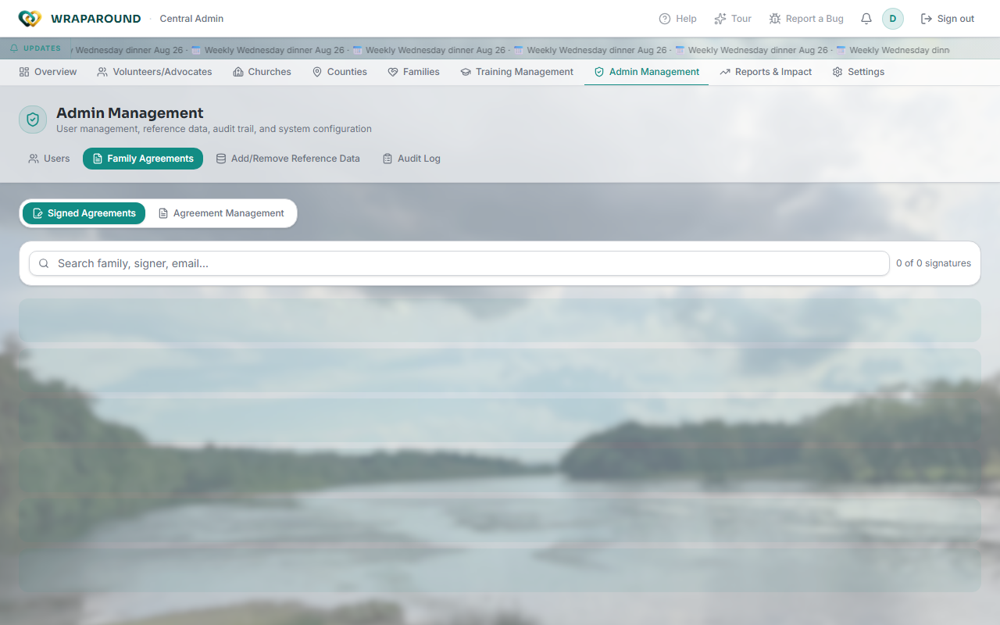
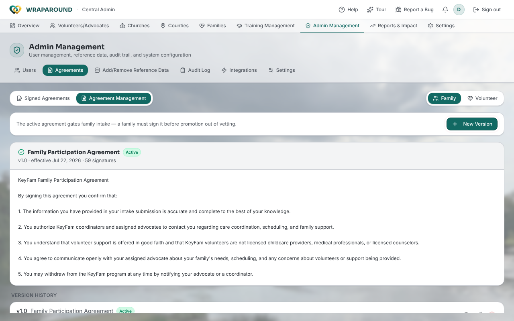

<!-- @frontend verified 2026-11-24 against Align-FrontEnd pages/admin-management.tsx: the
Admin Management tab is "Agreements" (TAB_CONFIG), with "Signed Agreements" / "Agreement
Management" sub-tabs and a "Family" / "Volunteer" audience switcher. Coordinators
(county_admin) get the Signed Agreements sub-tab only; Central Admins get both
(agreementSubTabs in admin-management-access.ts). The editor is titled "New Family
Agreement Version", with Version, Title, Agreement Text and a "Make this the active
agreement immediately" checkbox; the row icons are View / Make active / Edit / Delete. -->

<!-- @backend verified 2026-11-24 against Align-Core #552: the family agreement gate fires
when a family moves into care (from an intake or inactive status into active, building or
an uncategorized status). Moving a family to inactive never needs a signature. Families
already in care when the gate was added are not affected. -->

<!-- @frontend: the Agreement Management banner still reads "a family must sign it before
promotion out of vetting", which no longer matches the backend rule after Align-Core #552.
Worth updating the copy. -->

# Manage family agreements

**Who this is for:** Central Admin (all steps); Coordinator (viewing signed agreements only).
**When to use it:** To view signed participation agreements, or to write or update the
agreement text families sign when they register.
**Before you start:** Nothing.

## Steps

1. Open **Admin Management** from the main menu, then select the **Agreements** tab.
2. Make sure **Family** is selected in the switcher at the top right. (**Volunteer** shows
   the volunteer agreement instead.)

    

3. Pick a sub-tab:
    - **Signed Agreements** — a read-only, searchable list of every family's signature:
      who signed, when, which agreement version, and their county. Filter with
      **All Versions** and **All Counties**, or search with **Search family, signer, email…**.
    - **Agreement Management** (Central Admins only) — the current active agreement plus
      its **Version History**.

    

4. To change the agreement text, select **New Version**. In the **New Family Agreement
   Version** dialog, fill in **Version**, **Title** and **Agreement Text**. Leave **Make
   this the active agreement immediately** checked if families should sign this version
   from now on. Select **Create**.
5. To make an older version the one families sign, select its **Make active** icon in
   **Version History**. A version that already has signatures is **locked**: you can view
   it but can't edit or delete it (that would change what families already agreed to).
   Create a new version instead.
6. To read a version's full text, select its **View** (eye) icon.

## What you'll see

- The **active agreement** gates a family's move into care. A family in an intake or
  inactive status can't be moved into an active or building status until a parent has
  signed the currently active version. You
  can still move an unsigned family to an inactive status, for example when they drop out
  of intake.
- Signing happens as part of [family self-registration](../../get-started/families.md).
  This page covers the admin side (writing and versioning the text and reviewing who's
  signed), not signing it yourself.

!!! tip "One agreement is active at a time"
    A new version only replaces the active one if you activate it. Families who signed an
    earlier version keep that signature on record.

## Related

- [Getting started for families](../../get-started/families.md)
- [Onboard a family & invite people](onboarding.md)
- [Manage families & people](families-and-people.md)
- [Sign the volunteer agreement](../account/sign-the-volunteer-agreement.md)
