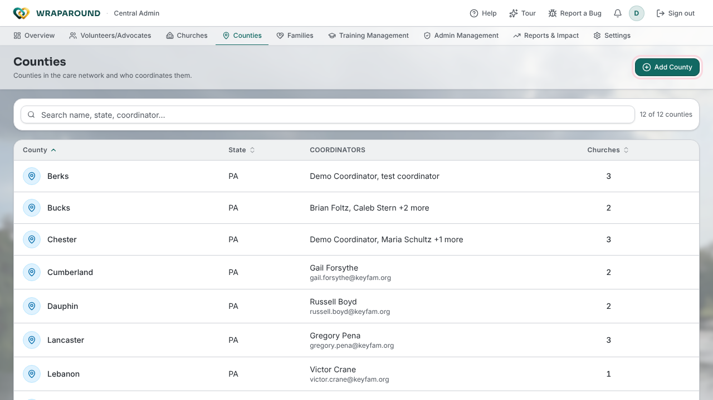

<!-- @backend: confirm that Coordinators (not only Central Admins) may create, rename and delete
     counties. The frontend shows the Counties page to both admin roles (route-access.ts) and the
     organizations handler allows POST/PUT/DELETE for callers where isAdmin is true; confirm that
     flag covers the Coordinators group. -->

# Manage counties

**Who this is for:** Program staff (Admins and Coordinators)
**When to use it:** You need to add or rename a county, or change which coordinators run it.
**Before you start:** You're signed in as an Admin or Coordinator. Coordinator accounts must already exist; invite one from **Admin Management** first.

## Steps

### Add a county

1. In the navigation bar, open **Counties**.
2. Select **Add County**.
3. Enter the **County Name** (for example, Montgomery) and the **State** (for example, PA). Both are required.
4. Optionally tick one or more coordinators under **Coordinators**. You can also add them later.
5. Select **Add County** to save. A **County added** message confirms it.

!!! tip "Duplicate warning"
    If a county with the same name already exists in that state, the form warns you. Creating another splits its churches and families across two records, so edit the existing county instead.

### Rename a county or change its state

1. On **Counties**, hover over the county's row and select the pencil (**Edit county**), or select the row and then **Edit**.
2. Change the **Name** or **State**.
3. Select **Save Changes**. A **County updated** message confirms it.

### Change who coordinates a county

1. On **Counties**, select the county's row.
2. Under **Coordinators**, select the **X** (**Remove from this county**) beside anyone who should no longer cover it.
3. To add people, tick them in the list and select **Add coordinators** (the button shows the count, such as **Add 2 coordinators**).

Adding a coordinator never removes them from another county they already cover; the list shows "also covers N others" for these people.

### Delete a county

1. On **Counties**, select the trash can on the county's row (**Delete county**).
2. Select **Delete** to confirm. This cannot be undone.

The trash can is greyed out while the county still has churches or coordinators. Move or remove those first; the county's detail panel says what is still attached.

## What you'll see

The **Counties** table lists each county with its **State**, **Coordinators** and number of **Churches**. Use the search box (**Search name, state, coordinator…**) or click a column heading to sort. A county with nobody assigned shows **No coordinator**, and a banner at the top counts how many counties are **without a coordinator**.

## Related

- [Manage churches & counties](organizations.md)
- [Manage volunteers & advocates](volunteers-and-advocates.md)
- [Roles & who sees what](../../concepts/roles-and-visibility.md)
