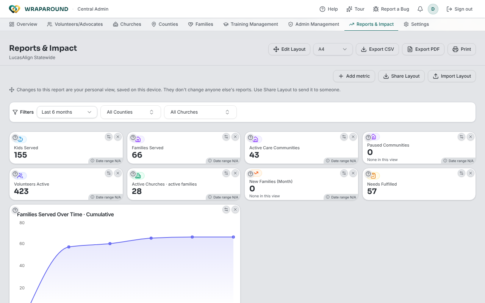
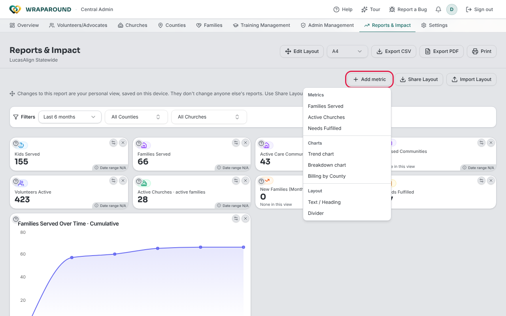
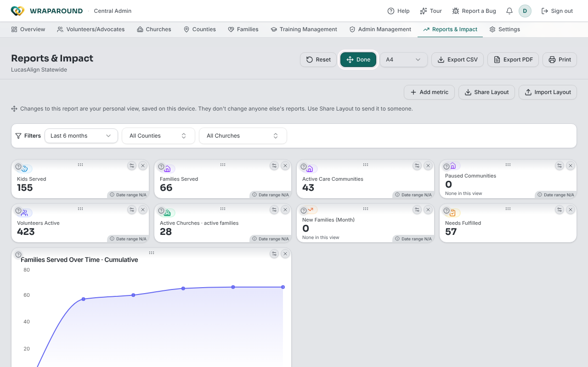
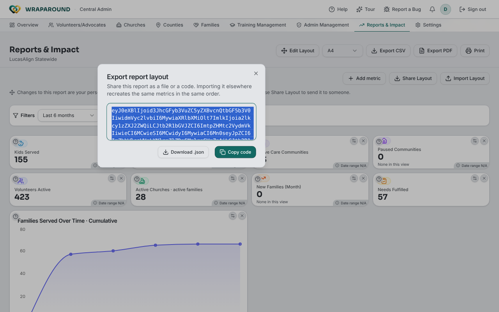

# Build a Reports & Impact report

**Who this is for:** Program staff (Admins and Coordinators).
**When to use it:** When you want to see your program's numbers, build a custom dashboard, or produce a shareable impact report (CSV, PDF, or print).
**Before you start:** You're signed in with staff access.

## Open Reports & Impact

1. From the top navigation, open **Reports & Impact**.
2. The page opens with a set of **metric tiles** (counters like *Kids Served*, *Families Served*) and **charts** (like *Families Served Over Time*), all reflecting live data.

Admins see figures across every county. Coordinators start filtered to their own county and can switch to another county or *All Counties* from the filters.

## Filter the report

A row of filters at the top controls every metric at once:

1. **Date range** — choose *Last 30 days*, *Last 3 months*, *Last 6 months*, or *Year to date*.
2. **County** — *All Counties* or a specific county. (Coordinators start on their own county.)
3. **Church** — *All Churches* or a specific church.

**County** and **church** apply to every metric. Every tile and chart updates to match.

### When the date range doesn't apply

The **date range** applies only to metrics that count something that happened on a date: *Needs Fulfilled*, the *Trend chart* (such as *Families Served Over Time* and *Monthly Support Activity Totals*), and *New Families* when it's set to follow the date range.

Some metrics describe **how things stand right now** (for example *Families Served*, *Active Churches*, and the *Breakdown chart*) or count **people without a recorded date** (the volunteer metrics, and *Kids Served*). A date range can't be applied to those, so instead of quietly ignoring it, the metric shows a small **"Date range N/A"** badge in its bottom-right corner. That's your cue that the number reflects current totals (filtered by county and church), not the selected time window.

!!! note "Why current-status metrics ignore the date range"
    We don't keep a history of when a family's status changed, so we can't say how many were "active" *during* a past period — only how many are active *now*. See [Statuses explained](../../reference/statuses.md).

## Customize your report

Your report is yours to shape. Some changes work at any time; moving and resizing panels needs **Edit Layout**.

### Add a metric

**Add metric** is always available, just below the page's action bar.

1. Select **Add metric**.
2. Pick a tile from **Metrics**, a chart from **Charts**, or a text block or divider from **Layout**. It's added to the bottom of the report.

Some metrics can be added **several times**, so you can track different statuses, need types, counties, or chart views side by side: **Families Served**, **Active Churches**, **Needs Fulfilled**, **Trend chart**, **Breakdown chart**, **Text / Heading**, and **Divider**.

The others (**Kids Served**, **Volunteers Active**, **New Families**, and **Billing by County**) can only be on a report once. They drop off the **Add metric** list while they're on your report and come back to it if you remove them.

### Change a metric's options

Many metrics can be tuned. You don't need **Edit Layout** for this.

1. Select **Options** (the gear icon) in the top-right corner of the panel.
2. Adjust its settings. Each metric's options are described on its own page under **Report Metrics**, for example [Needs Fulfilled](../reports/needs-count.md), [Families Served](../reports/families-served.md), or the [Breakdown chart](../reports/breakdown-chart.md).

The panel updates as you change its settings.

### Remove a metric

Select the **✕** in the top-right corner of a panel to take it off the report. A **Metric removed** message appears with an **Undo** button in case you change your mind.

### Move and resize

1. Select **Edit Layout** in the top-right. (Select **Done** when finished.)
2. **Drag** a panel by the handle along its top edge to reposition it.
3. **Resize** a panel by dragging its bottom-right corner. Panels never overlap; they stay where you place them.

!!! note "This is a desktop feature"
    **Edit Layout** isn't offered on phone-sized screens, where panels stack in reading order. Viewing the report, changing options, and adding or removing metrics still work on a phone.

### Start over

1. Select **Edit Layout**, then **Reset**.
2. In **Reset to the default view?**, select **Reset view**. This restores the default set of metrics and their default sizes and positions, and it can't be undone.

## Your layout is saved automatically

Your report is remembered **on this device**, so it's still there when you come back. It's your personal view: it doesn't change anyone else's reports. To give someone the same layout, share it as described below.

## Share a report layout

To give a teammate the same arrangement of metrics:

1. Select **Share Layout**, then either **Download .json** to save the layout file or **Copy code** to copy it.
2. Have your teammate select **Import Layout**, paste the code or select **Choose file…**, and then select **Import**. Importing replaces their current report with your layout.

## Export and print

You can turn the current report — its metrics, order, options, and filters — into a shareable document.

1. Choose a **page size** (A4, Letter, Legal, or A3) from the selector next to the export buttons. This applies to PDF and print.
2. Then choose:
    - **Export CSV** — downloads the report's data as a spreadsheet, one section per metric.
    - **Export PDF** — downloads a formatted PDF at your chosen page size.
    - **Print** — opens your browser's print dialog (where you can also save as PDF).

!!! tip "Metrics are never split across a page"
    When exporting to PDF or printing, each metric stays whole — a tile or chart is moved to the next page rather than being cut in half.

## What you'll see

A dashboard that matches the metrics, layout, and filters you chose — and CSV/PDF/print output that mirrors it exactly.

## Related

- [Oversight](oversight.md)
- [Statuses explained](../../reference/statuses.md)
- [Roles & permissions matrix](../../reference/permissions-matrix.md)
