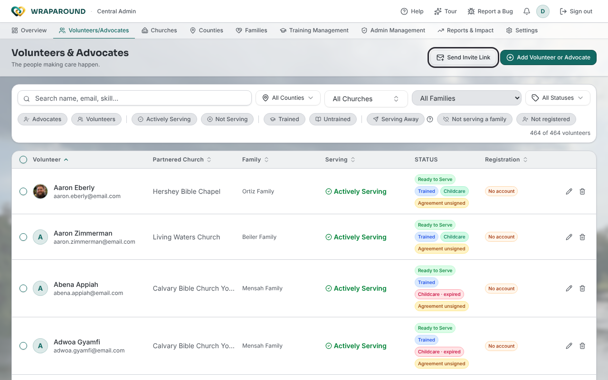
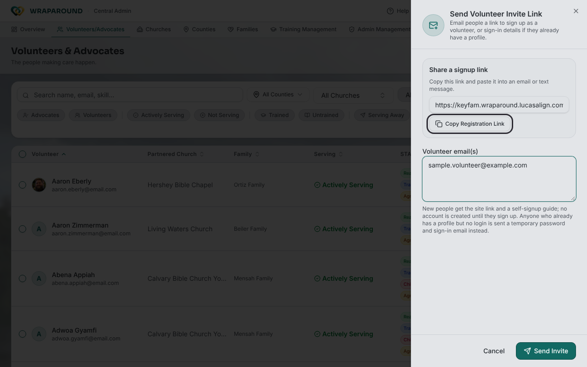
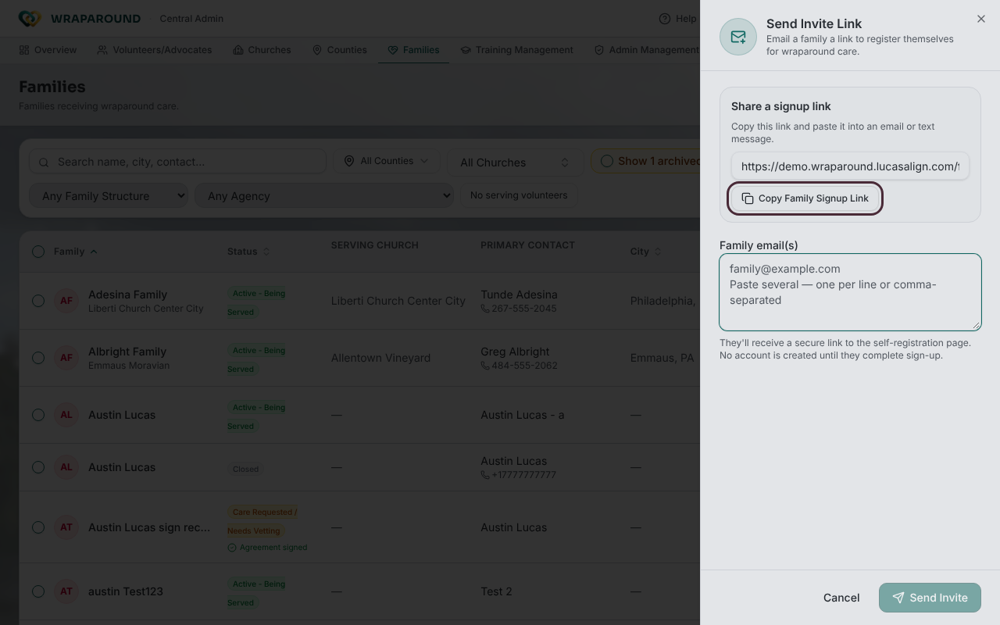

<!-- @frontend verified 2026-11-24 against Align-FrontEnd: the "Send Invite Link" button
sits in the header of Volunteers/Advocates (pages/volunteers.tsx, opens "Send Volunteer
Invite Link") and Families (pages/families.tsx, opens "Send Invite Link"), shown only
when isAdmin (central_admin or county_admin, lib/api/types.ts). Both dialogs share
components/batch-invite-link-modal.tsx; the "Share a signup link" box with "Copy
Registration Link" / "Copy Family Signup Link" was added in #820. -->

<!-- @backend verified 2026-11-24 against Align-Core handlers/onboarding/index.ts:
POST /onboarding/volunteers/invite (#400) emails a no-profile address the site link +
self-signup guide and creates nothing; an existing profile with no login is provisioned
with a temporary password; an existing login gets nothing. POST /onboarding/families/invite
(#66) emails the /family-signup link and creates nothing. Admins and Coordinators are
unscoped on both. -->

# Send an invite link

**Who this is for:** Central Admin, Coordinator.
**When to use it:** To invite prospective volunteers or families to create their own
WrapAround account, by email or with a link you share yourself.
**Before you start:** Have the email addresses ready, or decide where you'll paste the link
(an email, a text message or a newsletter).

## Steps

1. Open **Volunteers/Advocates** to invite volunteers, or **Families** to invite families.
2. Select **Send Invite Link** at the top right. The **Send Volunteer Invite Link** (or
   **Send Invite Link**) dialog opens.

    
3. To share the link yourself, look at **Share a signup link** and select **Copy
   Registration Link** (volunteers) or **Copy Family Signup Link** (families). A
   **Signup link copied!** message appears. Paste it into an email or text message.

    

    
4. To have WrapAround send the email, type one or more addresses in **Volunteer email(s)**
   or **Family email(s)**. Put one per line, or separate them with commas. Any address
   that isn't valid is listed under the box as **Not a valid email:**.
5. Select **Send Invite** (or **Send N Invites** for several addresses).

## What you'll see

When every address goes through, an **Invite sent** (or **N invites sent**) message appears
and the dialog closes.

If some addresses need attention, the dialog stays open. Addresses that didn't go through
are put back in the box so you can try again, and an **Invite results** list explains each
one, for example **Already has an account — nothing sent.**

## What each person gets

- **Volunteers:** someone with no profile yet gets a link to the WrapAround site and a
  self-signup guide. No account is created until they
  [sign up](../account/volunteer-self-signup.md). Someone who already has a profile but no
  login gets a temporary password and sign-in email instead.
- **Families:** each address gets a secure link to the family self-registration page. No
  account is created until the family completes sign-up, and the family then starts in
  intake.

!!! tip "Sign-in email didn't send?"
    If a volunteer's account was created but the sign-in email failed, the results list
    shows a temporary password with a **Copy** button so you can send it to them yourself.

## Related

- [Onboard a family & invite people](onboarding.md)
- [Sign up as a volunteer](../account/volunteer-self-signup.md)
- [Getting started for families](../../get-started/families.md)
