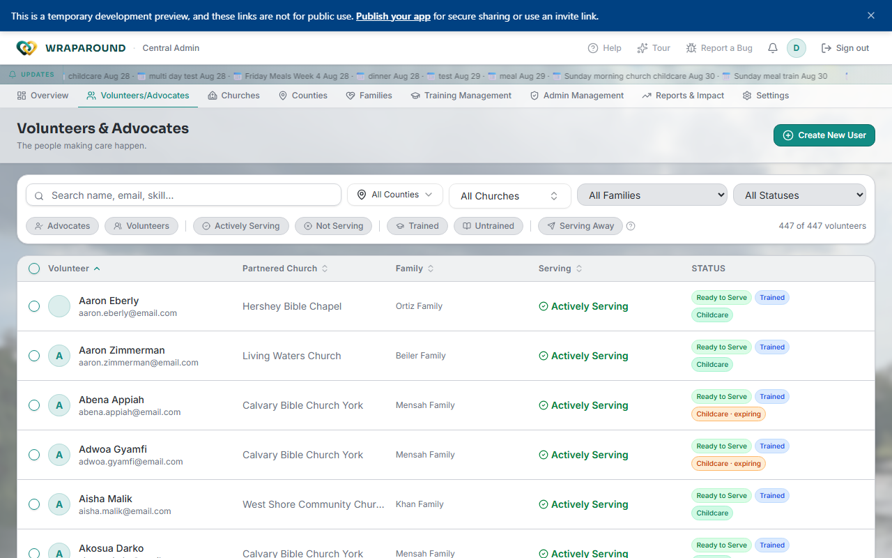

<!-- @backend verified 2026-11-17 (Align-Core #180, volunteer_families): a volunteer can be
     assigned to zero, one or many families; assignment is what grants access, and lead-ness is
     per family (volunteer_families.is_lead). Advocates are scoped to their serving church. -->

<!-- @frontend verified 2026-08-27 against the dev instance, signed in as the demo
Central Admin: Volunteers & Advocates directory columns (Volunteer, Partnered Church,
Family, Serving, Status) and filters (county/church/family/status) confirmed live. -->

# Manage volunteers & advocates

**Who this is for:** Program staff (Admins and Coordinators); advocates within their church.
**When to use it:** When you bring on a new volunteer or advocate, place them with a family,
or update their role or status.
**Before you start:** You're signed in with staff access, and the family you'll assign to
exists.

## Invite a volunteer or advocate

1. Open **Volunteers/Advocates** and choose **Add Volunteer or Advocate** to open the
   **Invite New User** form. (Advocates see **Add a Volunteer** instead and can only add
   volunteers.)
2. Enter their **Full Name**, **Email**, and the **Role** they'll have, plus optionally a
   **Partnered Church** and **Family**.
3. Choose **Create User**. They receive an email to
   [accept and set a password](../account/accept-invite.md). Invites expire (typically
   after 7 days).

## Assign a volunteer to a family

A volunteer can see **only the families they're assigned to**, so the assignment is what
gives them access. A volunteer can serve more than one family.

1. Open the volunteer's record.
2. Set the **Family** field. Changing it moves the volunteer from their current family to
   the new one; clearing it unassigns them. To add a volunteer to another family without
   removing the first, use that family's care team instead — see
   [Manage a family's care team](../advocate/manage-a-familys-care-team.md).
3. Save. They can now see that family's needs, schedule, and messages, and nothing from
   families they don't serve.

## Set roles & statuses

1. Open the person's profile.
2. Set their **Volunteer Status** (where they are in their journey; your organization
   names these) and any details like support type or **Childcare Status**.
   → [Statuses explained](../../reference/statuses.md)
3. To give a volunteer extra abilities within a family, make them that family's **Lead
   Volunteer**. A lead can do more (such as create or remove needs) but only for the
   families they lead — see [Assign a Lead Volunteer](../advocate/assign-a-lead-volunteer.md).
4. To move someone to a different role, such as Volunteer to Advocate, use
   [Change a user's role](change-a-users-role.md).

## Activate a trained volunteer

When someone finishes their training they become **trained but not yet active**. To let
them start serving:

1. On the **Volunteers/Advocates** page, expand the **In Training** section to find trainees.
   <!-- @frontend: no "In Training" / "Awaiting Activation" section found in
   pages/volunteers.tsx as of 2026-11-17 (only training.tsx still references
   trained_not_active). Confirm how a trained volunteer is activated today. -->
2. Open someone who has finished training and **activate** them.
3. Assign them to a family if you haven't already.

## Related

- [Onboard a family & invite people](onboarding.md)
- [Manage families & people](families-and-people.md)
- [Change a user's role](change-a-users-role.md)
- [Backfill user accounts](backfill-user-accounts.md) — bulk-invite an imported roster
- [Roles & permissions matrix](../../reference/permissions-matrix.md)
