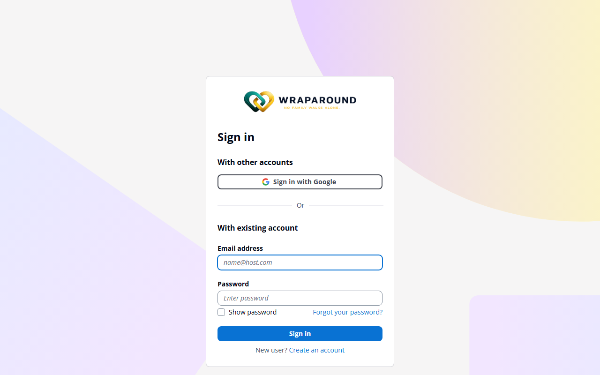

# Accept your invite

**Who this is for:** Advocate (also applies to Volunteers invited directly by an Admin or Advocate)
**When to use it:** The first time you sign in, after program staff or an advocate has created your account.
**Before you start:** You need the invite email sent to the address staff used to create your account.

<!-- Verified 2026-11-27 against Align-Core lib/stacks/auth-stack.ts: tempPasswordValidity is
45 days (#354), and Cognito's ForgotPassword does not work for an account that has never
signed in (FORCE_CHANGE_PASSWORD). Staff re-issue with "Send New Temp Password". -->

!!! note "Use your temporary password within 45 days"
    The temporary password in your invite email expires after **45 days**. **Forgot your
    password?** on the sign-in screen can't reset a password you've never used, so if
    it's expired, ask the person who invited you to send you a new temporary password.

## Steps

1. Open the invite/welcome email and find your **temporary password**.
2. Go to your organization's WrapAround sign-in page and choose **Sign in**.

    

3. Enter the email address the invite was sent to, and the temporary password.
4. When prompted, set a new permanent password: at least 8 characters, including a number, an uppercase letter, and a special character.
5. Sign in again with your new password.

## What you'll see

Before you reach your dashboard, WrapAround walks you through anything still outstanding, in this order:

1. signing the volunteer agreement, if your organization has one;
2. filling in your personal information (onboarding);
3. completing your assigned training, on **Training**.

After that you land on your normal dashboard. For an Advocate, this is **Managed Families**, showing the families you serve.

!!! tip "Not sure which email to use?"
    Invites always go to the exact address staff entered when creating your account. If sign-in fails, check you're using that address, not a different personal one.

## Related

- [How to complete personal training](../training/modules-and-progress.md)
- [Troubleshooting](../../reference/troubleshooting.md)
