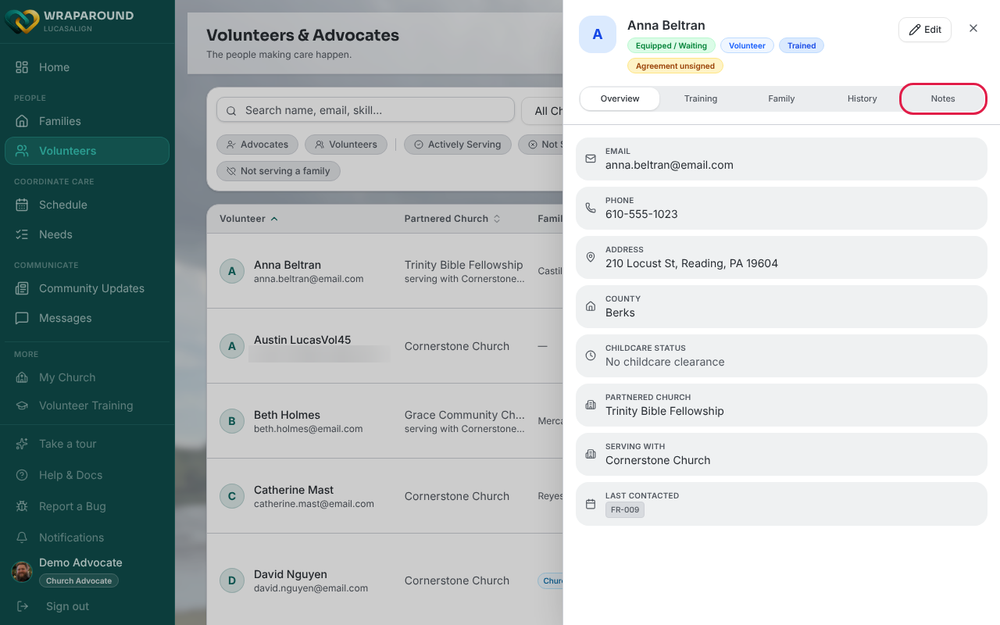
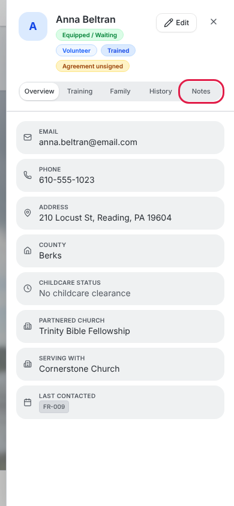
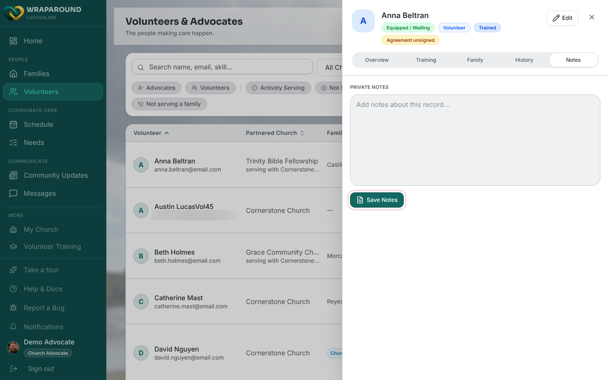
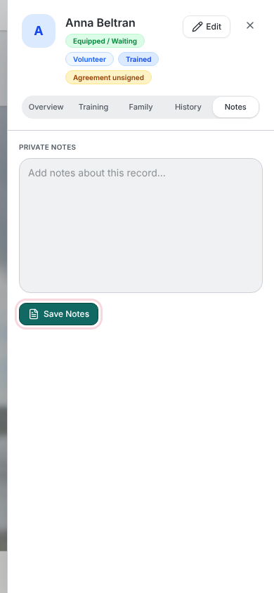

# Add notes to a volunteer's profile

**Who this is for:** Advocate
**When to use it:** To keep a written note on a volunteer, such as their availability or something to follow up on.
**Before you start:** Nothing — you can add notes to any volunteer on your **Volunteers** page.

<!-- @backend: the tab is labelled "Private Notes", but a volunteer's notes are stored in
     volunteers.notes, which is in the self-editable tier (VOLUNTEER_SELF_FIELDS in
     src/aligncore/handlers/volunteers/index.ts). Confirm whether the volunteer can read
     their own notes. If they can, keep the warning below and consider renaming the label. -->

## Steps

1. Go to **Volunteers** (under **People** in the menu).
2. Click the volunteer's row to open their profile panel.
3. Click the **Notes** tab.

    

    

4. Type your note in the box under **Private Notes**.
5. Click **Save Notes**.

    

    

## What you'll see

A **Notes saved** message. The next time anyone with access opens this volunteer's **Notes** tab, they'll see what you wrote. Saving replaces the whole note, so edit the existing text rather than clearing it.

!!! warning "Don't treat these notes as hidden"
    Despite the **Private Notes** label, these notes are stored on the volunteer's own record. Don't write anything you wouldn't want the volunteer to see.

## Related

- [View volunteer details](view-volunteer-details.md)
- [Roles & who sees what](../../concepts/roles-and-visibility.md)
