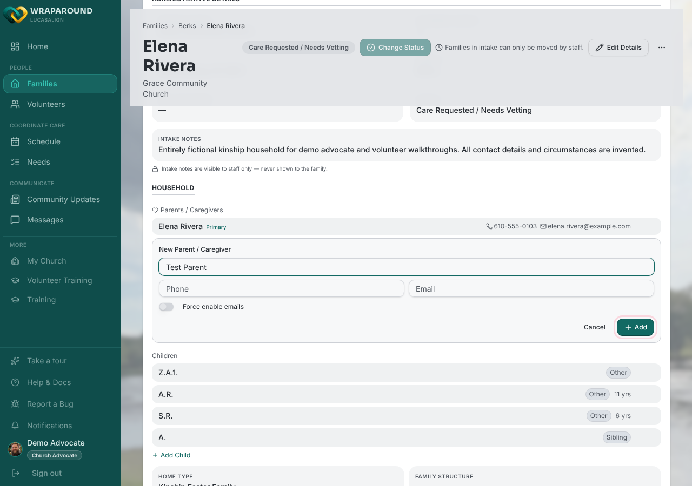
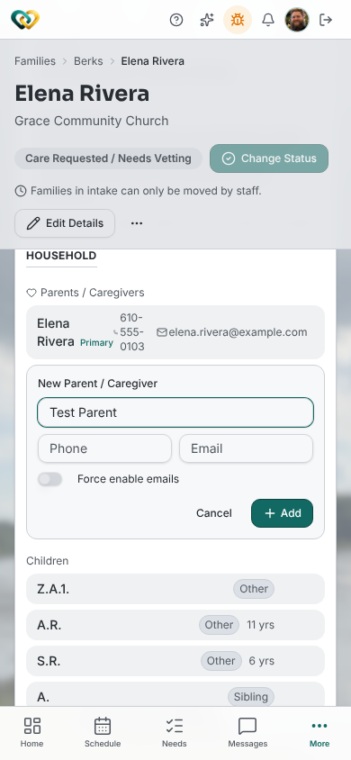

<!-- @backend: confirm the scope rule for Advocates adding/removing parents and adding/editing
children (Align-Core #491: families their church serves; child DELETE stays admin-only;
primary_contact is ignored on an Advocate's parent create). Frontend side verified against
family-detail.tsx and families-modals.tsx (Align-FrontEnd #768). -->

# Add parent or child information

**Who this is for:** Advocates (Admins and Coordinators do the same thing).
**When to use it:** A parent or child is missing from a family's Household, or their details
are out of date.
**Before you start:** The family must be one your church serves.

## Steps

1. Open the family and scroll to its **Household** section.
2. To add a parent, click **Add Parent** below the list of parents. In the **New Parent /
   Caregiver** form, enter **Full name** (required), and optionally **Phone** and **Email**.
   Click **Add**. (The **Force enable emails** switch lets a parent without a login receive
   family emails; leave it off unless the family asked for them.)

    

    

3. To add a child, click **Add Child** below the list of children. In the **New Child** form,
   enter **Full name** (required), and optionally **Birthdate** and **Relationship**. Click
   **Add**.
4. To change someone, hover over their row and click the pencil (**Edit** *name*), change
   the details, then click **Save**.

## What you'll see

The new person appears in the Household list straight away.

## What you can't do

- **Set the primary contact when adding a parent.** The **Primary contact** checkbox isn't
  shown to Advocates; ask an Admin or Coordinator.
- **Remove a child.** Advocates can edit and archive a child (the archive icon), but the
  remove (trash) icon is Admin/Coordinator-only.
- **Remove the primary contact** until another parent is made the primary contact; the
  confirmation explains what to do.

## Related

- [Manage families & people](../admin/families-and-people.md) (Admin/Coordinator)
- [Invite a family's parents](invite-a-familys-parents.md)
- [View child information](view-child-information.md)
