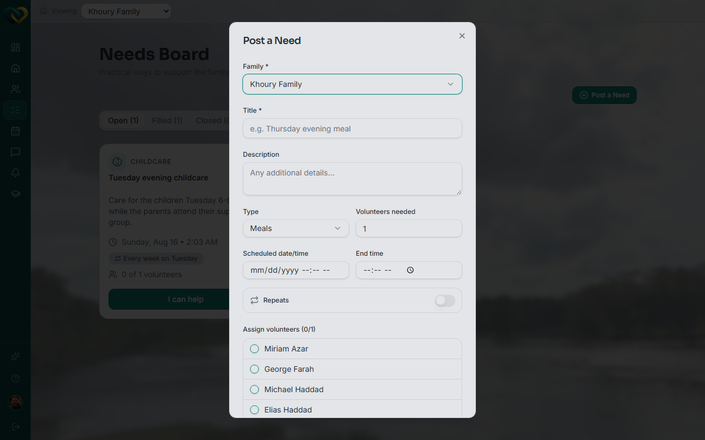

# Assign a volunteer to a need

**Who this is for:** Advocate, Lead Volunteer
**When to use it:** To place a specific volunteer on an open need directly, rather than waiting for someone to claim it.
**Before you start:** The need must exist and still have an open slot. The volunteer must be on that family's care team.

## Steps

1. Open **Needs** and click the need.
2. Under **Assigned volunteers**, use the **Assign volunteer (N slot left)** dropdown to pick a volunteer.

    To assign from the editor instead, click **Edit need** at the bottom of the dialog, tick a name under **Assign volunteers**, and click **Save Changes**.

    

For one date of a recurring need, see [Assign a volunteer to cover a single day of a recurring need](cover-a-single-day.md).

## What you'll see

The volunteer's name appears under **Assigned volunteers**, and the need shows their name instead of **Unassigned**.

!!! note "Who you can pick"
    - Only volunteers on that family's care team are listed. To assign someone new, [add them to the care team](manage-a-familys-care-team.md) first.
    - Paused or disabled volunteers can't be assigned.
    - For a need that requires childcare approval, only volunteers with current childcare approval can be picked.
    - Once every slot is taken, the dropdown disappears. Remove someone, or raise **Volunteers needed** in the editor, to open a slot.

## Related

- [Manage a family's care team](manage-a-familys-care-team.md)
- [Create a one-time need](create-a-one-time-need.md)
- [Assign a volunteer to cover a single day of a recurring need](cover-a-single-day.md)
