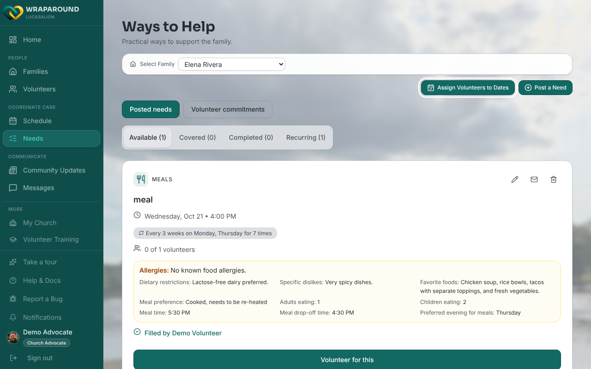
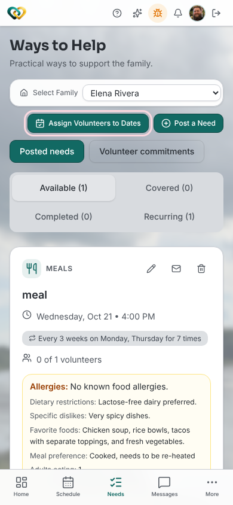
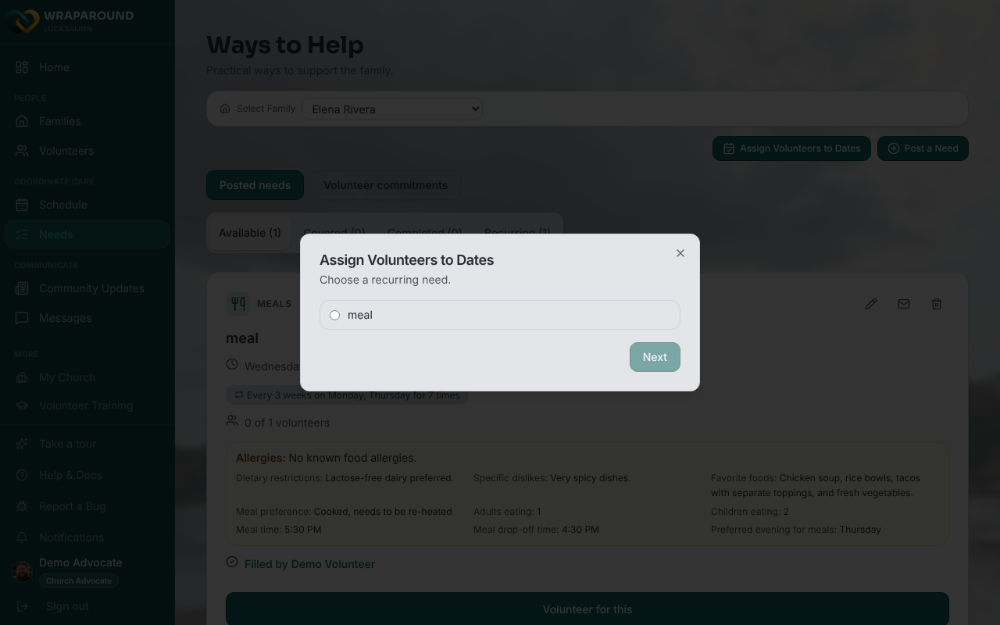
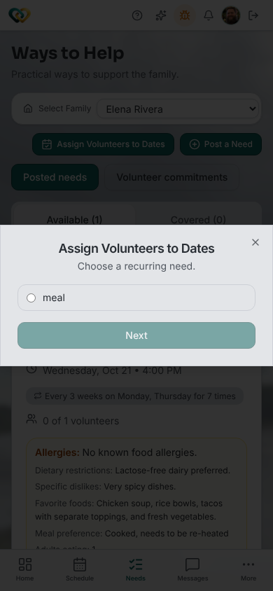

# Assign volunteers to several dates of a recurring need

**Who this is for:** Advocates and lead volunteers
**When to use it:** When you want to put one or more care-team volunteers on many dates of a recurring need in one pass, instead of covering one day at a time.
**Before you start:** The family needs a recurring need with open dates in the next 120 days, and the volunteers must already be on the family's care team. Pick the family in **Select Family** on the **Needs** page.

<!-- @backend: the frontend shows the button to advocates and lead volunteers only and tries POST /wraparound/need-claims/batch, falling back to one claim per date. Align-Core main has no batch handler, so confirm who may create claims for other volunteers and that the fallback follows the same rules. -->

## Steps

1. Open **Needs** from the navigation and choose the family in **Select Family**.
2. Click **Assign Volunteers to Dates**, next to **Post a Need**.

    
    

3. Under **Choose a recurring need.**, select the need and click **Next**. A need with no open dates shows **No open dates** and can't be selected.

    
    

4. Choose the volunteers who will cover the need, then click **Next**.
5. Tick the dates to assign, or click **Select all open dates** (**Clear all** undoes it). Dates that are already covered are greyed out and show how many people are signed up, for example "1 of 1 covered".
6. Click **Assign N dates** (or **Assign 1 date**).
7. Review the results list, then click **Done**.

## What you'll see

Each volunteer and date pair gets one result: **Assigned**, **Already assigned**, **Skipped: already covered** or **Failed**. Existing assignments are never overwritten. Use **Back** at any step to change your choices before you assign.

## Related

- [Assign a volunteer to a need](assign-a-volunteer-to-a-need.md)
- [Cover a single day of a recurring need](cover-a-single-day.md)
- [Change recurring assignments](change-recurring-assignments.md)
