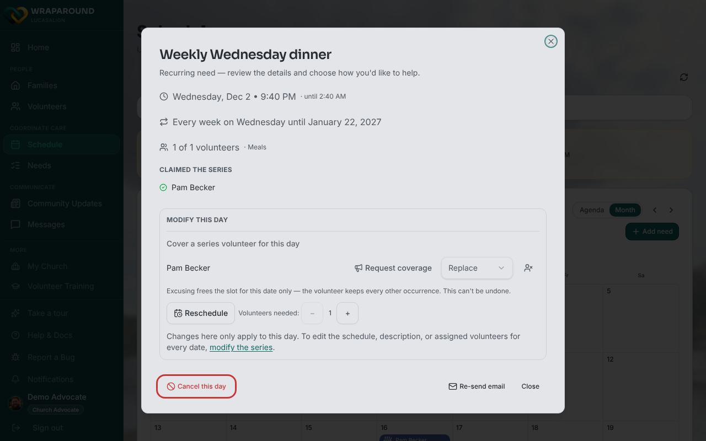
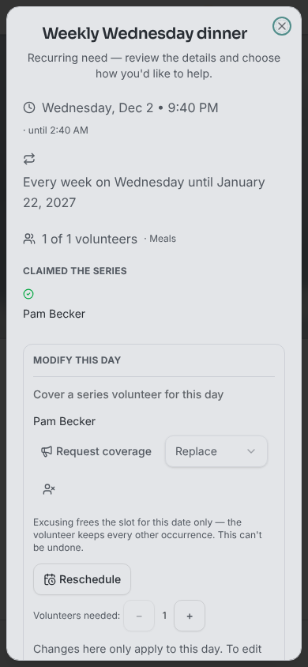
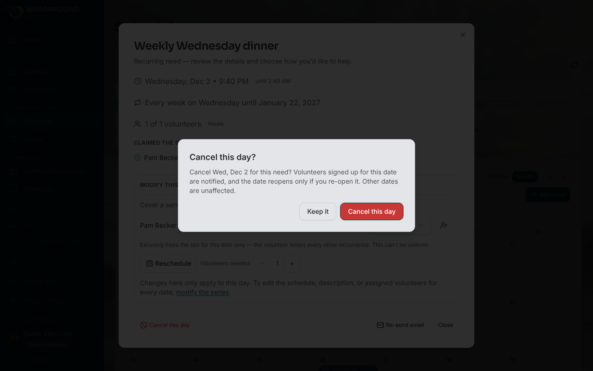
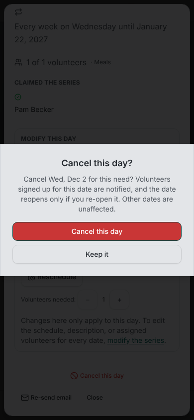

# Cancel or re-open one day of a recurring need

**Who this is for:** Advocate, Lead Volunteer
**When to use it:** When one date of a recurring need isn't happening, for example the family is away that week, but every other date stays on.
**Before you start:** The recurring need must already exist.

## Steps

1. Open **Schedule** and click the day you want to cancel.
2. In the day's list, click **This day** on the recurring need. On a phone, the schedule opens as an **Agenda** list, so tap **This day** on the date directly.
3. At the bottom of the dialog, click **Cancel this day**.

    

    

4. In **Cancel this day?**, click **Cancel this day** to confirm, or **Keep it** to back out.

    

    

To undo it, open the same date again (cancelled dates stay on your schedule, marked **Cancelled**), click **This day**, then click **Re-open this day**.

## What you'll see

The dialog shows **This day is cancelled**, and the date appears struck through as **Cancelled** on the schedule. Every other date in the series is unaffected.

!!! warning "Cancelling takes volunteers off that date"
    Volunteers who signed up for just that date are removed from it and notified. Volunteers who cover the whole series stay signed up for the series and are told the date is off. Re-opening the day does **not** sign anyone back up, so the date reopens with empty slots for volunteers to claim.

!!! tip "Cancel one date, not the whole need"
    **Cancel this day** only ever affects the date you opened. To stop the recurring need altogether, open the series editor instead (**Series** in the day's list).

## Related

- [Reschedule one day of a recurring need](reschedule-a-single-day.md)
- [Change volunteer assignments on recurring needs](change-recurring-assignments.md)
- [View the schedule](view-schedule.md)
