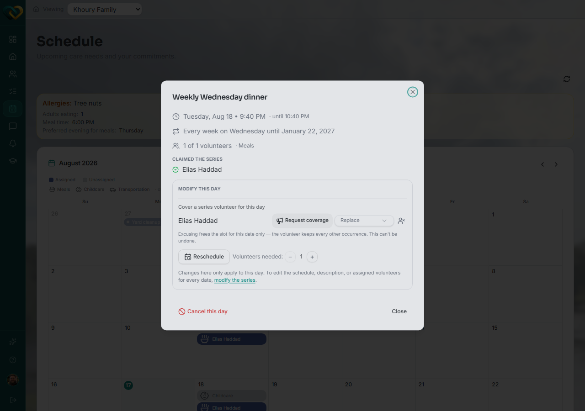
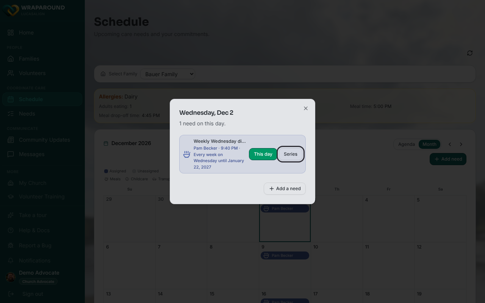
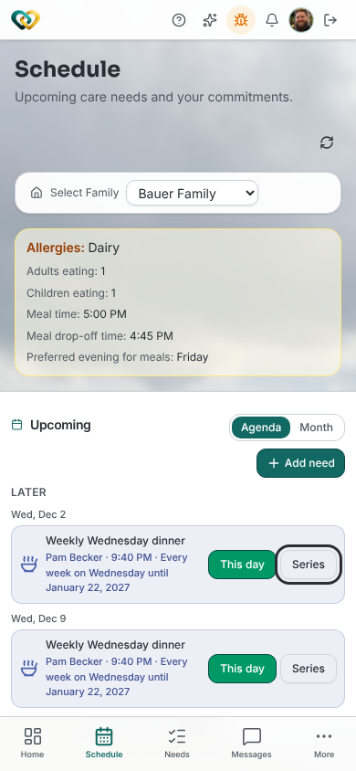

# Change volunteer assignments on recurring needs

**Who this is for:** Advocate, Lead Volunteer
**When to use it:** To change who covers a recurring need: either on one date, or for every date going forward.
**Before you start:** The recurring need must already exist.

## Change one date

1. Open **Schedule**, click the day, then click **This day** on the recurring need.
2. In the **Modify this day** card, under **Cover a series volunteer for this day**:
    - use **Replace** next to the series volunteer to swap in someone else for that date, or
    - click the excuse icon (a person with an x, labelled **Excuse from this day**) to free the slot for that date without picking a replacement. The date stays open for someone to claim.
3. For a volunteer who signed up for just that date, use **Reassign** to swap them, or the **x** (**Remove from this day**) to take them off.

    

## Change every date

1. Open **Schedule**, click the day, then click **Series** on the recurring need. (From inside the one-date dialog, the **modify the series** link at the bottom of the **Modify this day** card does the same thing.)

    

    

2. Under **Assign volunteers**, tick or untick names, then click **Save Changes**.

## What you'll see

Changes made in the **Modify this day** card apply to that date only. Changes made in the series editor apply to every date of the recurring need. Anyone you tick there is signed up for every date.

!!! tip "Not sure which one you want?"
    **Replace** and **Excuse from this day** both take the series volunteer off that date, and neither can be undone. To flag that a volunteer might need someone to cover without taking them off the date yet, use [Request coverage on behalf of a volunteer](request-coverage.md) instead.

## Related

- [Assign a volunteer to cover a single day of a recurring need](cover-a-single-day.md)
- [Reschedule one day of a recurring need](reschedule-a-single-day.md)
- [Request coverage on behalf of a volunteer](request-coverage.md)
