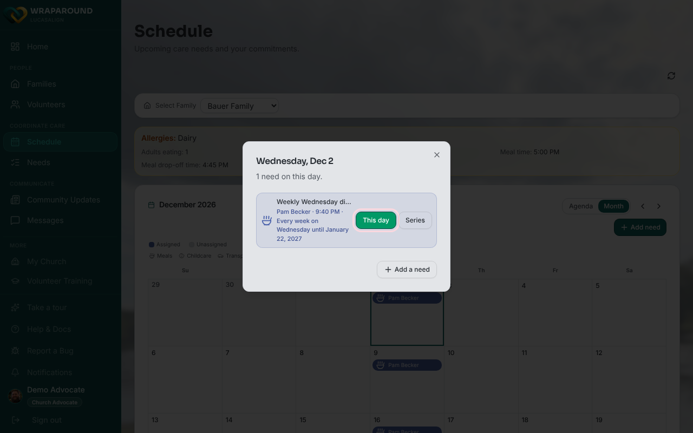
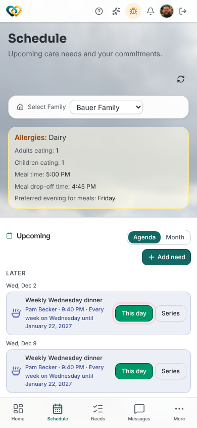
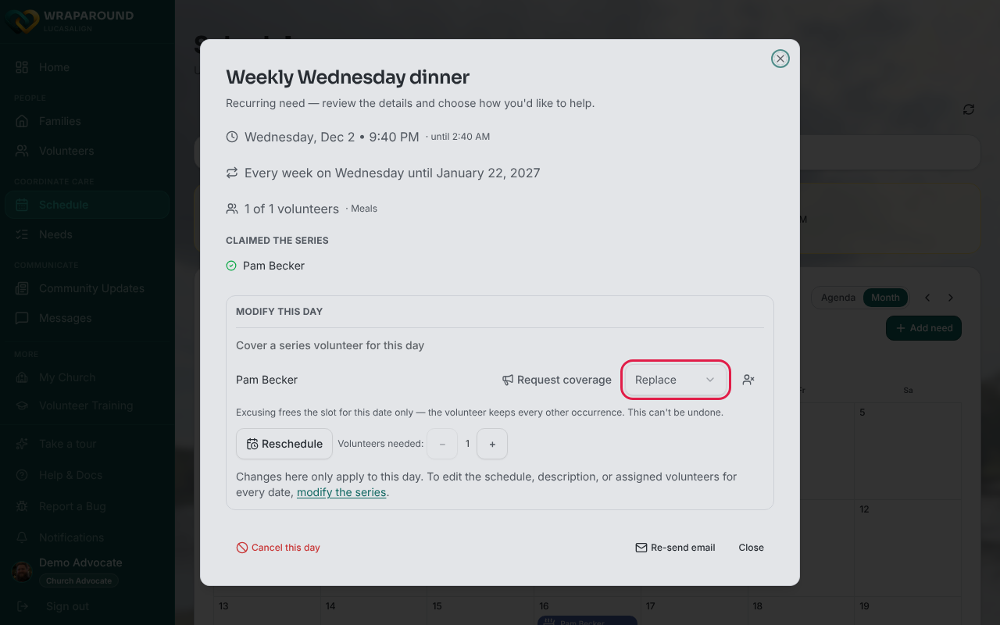
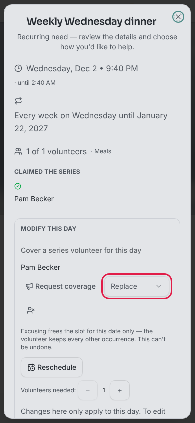

# Assign a volunteer to cover a single day of a recurring need

**Who this is for:** Advocate, Lead Volunteer
**When to use it:** When one occurrence of a recurring need still needs a volunteer, without changing who's assigned to the rest of the series.
**Before you start:** The recurring need must already exist, and the volunteer you want must be on the family's care team.

## Steps

1. Open **Schedule** and click the day that needs coverage.
2. In the day's list, click **This day** on the recurring need. (**Series** opens the editor for every date instead.) On a phone, the schedule opens as an **Agenda** list, so tap **This day** on the date directly.

    

    

3. In the need's dialog, find the **Modify this day** card and pick the option that fits:
    - **The date has an open slot:** use the **Assign to this day (N slot left)** dropdown to pick a volunteer.
    - **The volunteer who covers the whole series can't make it:** under **Cover a series volunteer for this day**, use **Replace** next to their name to pick someone to cover for them on this date only.

    

    

## What you'll see

Only the selected date shows the new volunteer. Every other date in the series keeps its existing assignment, or stays **Unassigned**. If you used **Replace**, the series volunteer is shown struck through and marked **off this day** for that date only.

!!! note "Who you can pick"
    The dropdowns only list volunteers on this family's care team. Paused or disabled volunteers can't be assigned. For a need that requires childcare approval, the volunteer must have current childcare approval too.

!!! warning "Replace can't be undone"
    **Replace** excuses the series volunteer from that one date, and there's no way to un-excuse them. They keep every other date.

## Related

- [Change volunteer assignments on recurring needs](change-recurring-assignments.md)
- [Cancel or re-open one day of a recurring need](cancel-a-single-day.md)
- [Request coverage on behalf of a volunteer](request-coverage.md)
