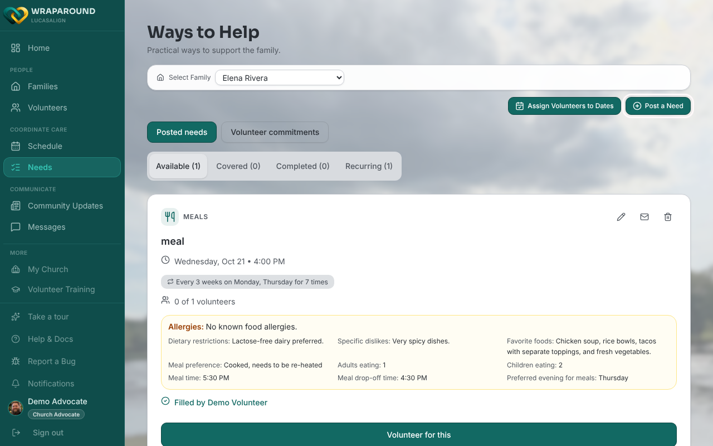
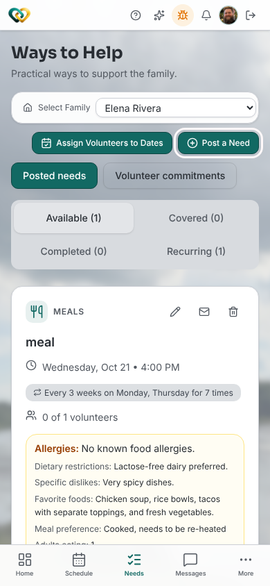
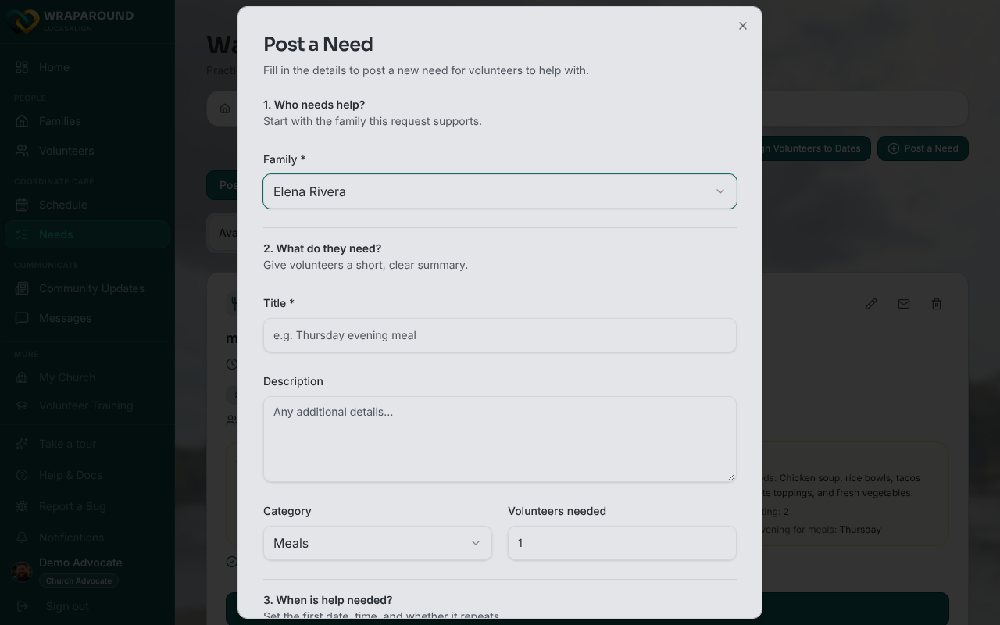
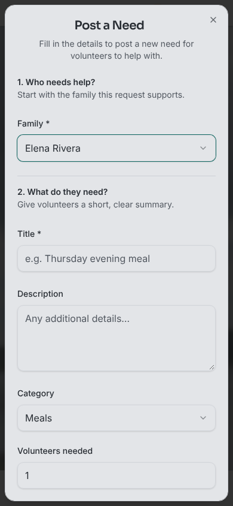
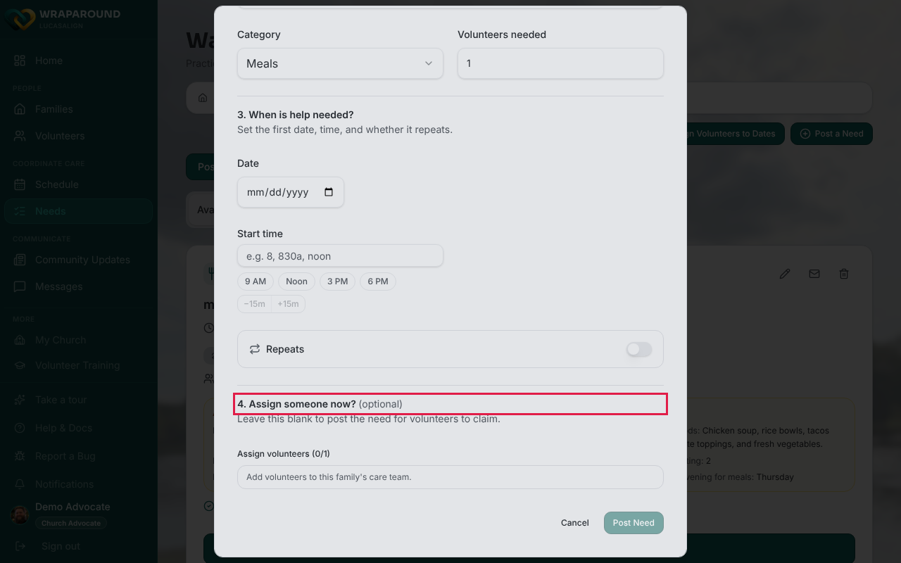
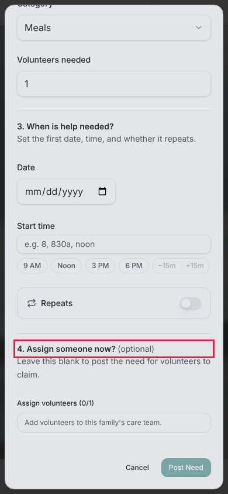

# Create a one-time need

**Who this is for:** Advocate, Lead Volunteer, Program staff
**When to use it:** To ask for help with a specific, non-repeating task — a meal, a ride, supplies.
**Before you start:** Nothing — you can post a need for any family you serve.

## Steps

1. Go to **Needs** in the menu (or open the family and go to its **Needs** tab), then select
   **Post a Need**.

    

    { width="320" }

2. Under **1. Who needs help?**, pick the **Family** the need is for.
3. Under **2. What do they need?**, enter a **Title** (for example, "Thursday evening meal").
   Optionally add a **Description**, then choose a **Category** and set **Volunteers needed**.

    

    { width="320" }

4. Under **3. When is help needed?**, pick the **Date** and a **Start time**. You can type a
   time or tap a shortcut (**9 AM**, **Noon**, **3 PM**, **6 PM**). An **End time** is
   optional. Leave **Repeats** off for a one-time need.
5. Under **4. Assign someone now?**, either leave **Assign volunteers** blank so volunteers can
   claim the need, or add volunteers from the family's care team.

    

    { width="320" }

6. Select **Post Need**.

## What you'll see

A **Need posted successfully** message appears. If you left **Assign volunteers** blank, the
need shows as open on the needs board until someone claims it. See
[Claim a need](../needs/claim-a-need.md).

!!! info "Who gets an email"
    If you leave **Assign volunteers** blank, the volunteers who serve the family get a
    **New needs** email asking for help. If you assign someone when you post the need, that email isn't
    sent, because the need is already covered.

## Related

- [Create a recurring need](create-a-recurring-need.md)
- [Assign a volunteer to a need](assign-a-volunteer-to-a-need.md)
- [Manage your notification emails](../account/manage-notification-emails.md)
