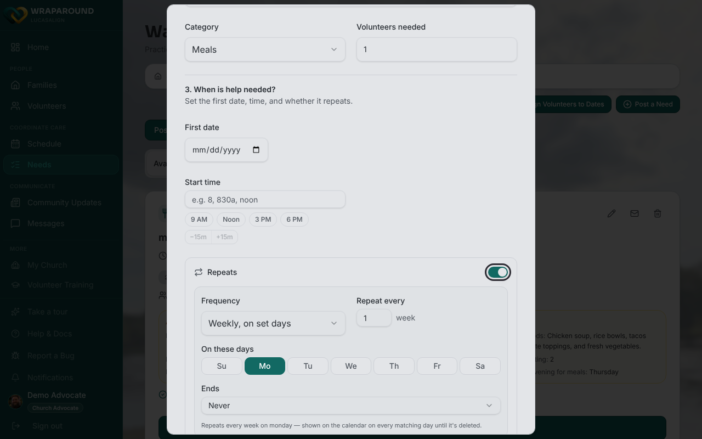
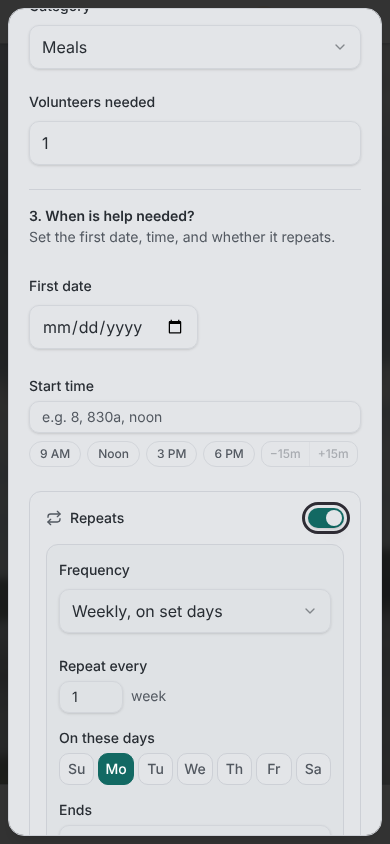

# Create a recurring need

**Who this is for:** Advocate, Lead Volunteer, Program staff
**When to use it:** To ask for ongoing help that repeats on a schedule — a weekly meal, a standing ride, regular childcare.
**Before you start:** Nothing — you can post a need for any family you serve.

## Steps

1. Go to **Needs** and select **Post a Need**.
2. Fill in **Family**, **Title**, **Category**, and the rest of the fields as you would for a
   [one-time need](create-a-one-time-need.md). The date field is called **First date**
   once the need repeats. It's the date the series starts from.
3. Turn on the **Repeats** switch. This shows the repeat settings.

    

    { width="320" }

4. Choose a **Frequency**: **Daily**, **Weekly, on set days**, **Monthly, on a date**,
   **Monthly, on a weekday**, or **Yearly**.
5. Set **Repeat every** (for example, every 1 week), then pick the days. For
   **Weekly, on set days**, tap the days under **On these days** (Su–Sa).
6. Set **Ends**: **Never**, **After a number of times**, or **On a date**.
7. Select **Post Need**.

!!! warning "Assigning someone now signs them up for every date"
    If you add a volunteer under **4. Assign someone now?**, they're signed up for every date
    the need repeats. To cover only certain dates, leave it blank, post the need, then open a
    specific date on the schedule and assign someone just for that day.

## What you'll see

A plain-language summary appears under the repeat settings as you work. For example:
"Repeats every week on monday — shown on the calendar on every matching day until it's
deleted." After you post, the need appears on the calendar on every date it repeats, and
each date can be covered separately.

!!! tip "Changing one occurrence later"
    You don't need to recreate the series to cover a single date differently — see [Assign a volunteer to cover a single day of a recurring need](cover-a-single-day.md).

## Related

- [Create a one-time need](create-a-one-time-need.md)
- [Change volunteer assignments on recurring needs](change-recurring-assignments.md)
