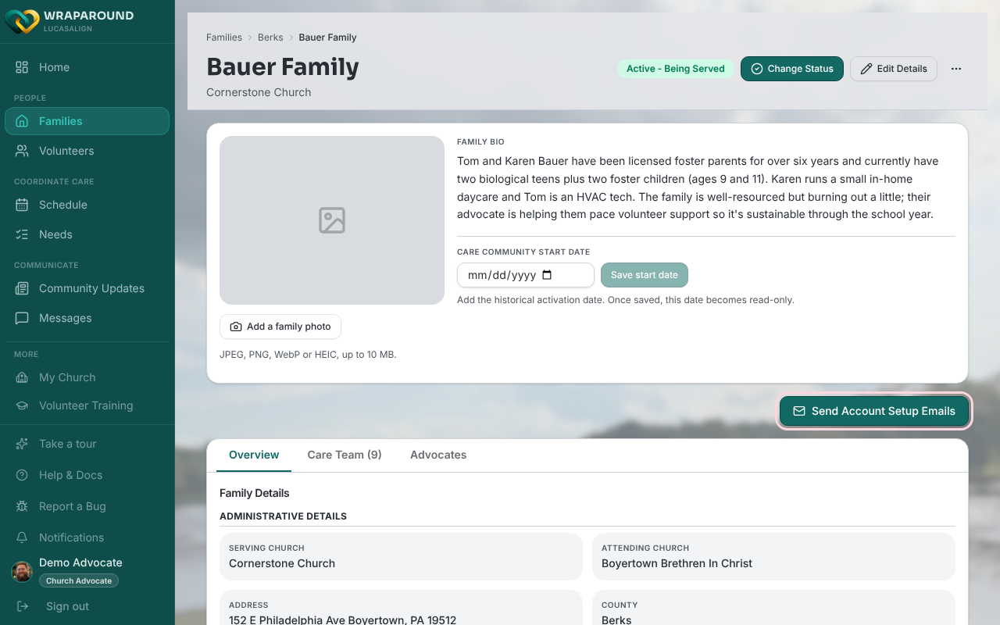
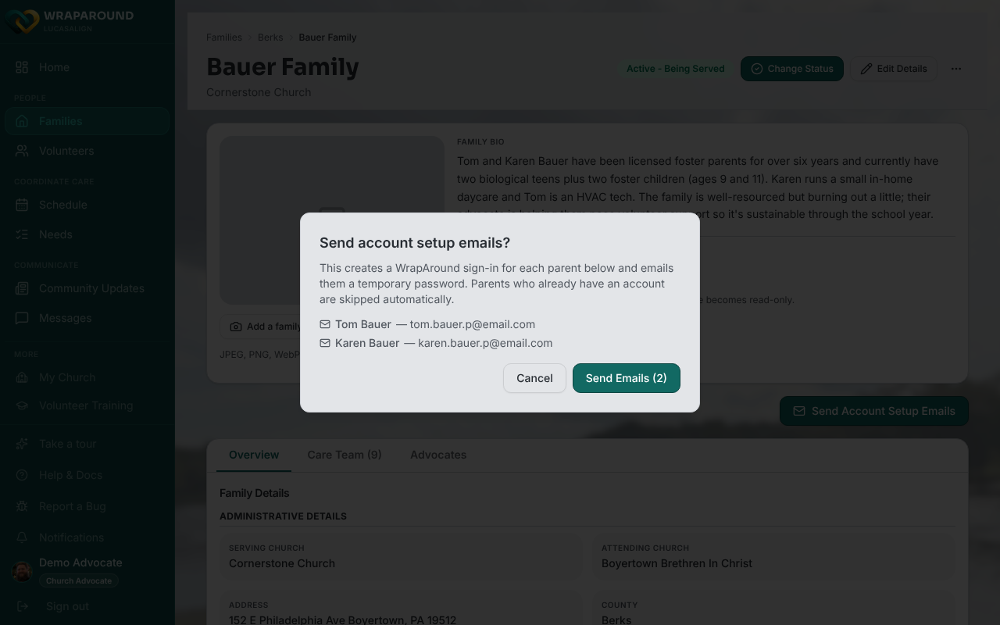
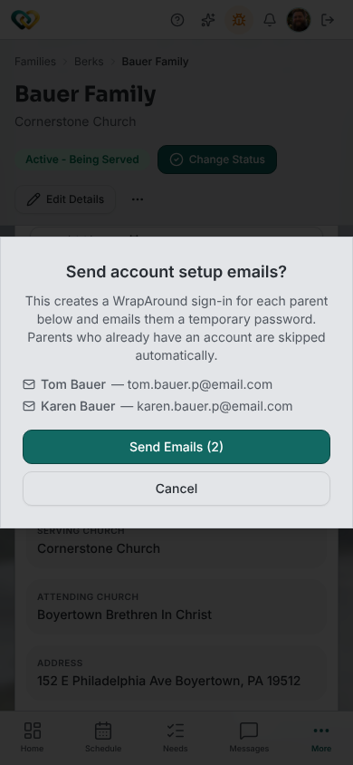

# Invite a family's parents

**Who this is for:** Advocate
**When to use it:** To give a family's parents their own WrapAround sign-in, so they can view their needs, schedule, and messages directly.
**Before you start:** The parent must already be added to the family's Household with an email address on file. See [Add parent or child information](add-parent-or-child-info.md).

## Steps

1. Open the family.
2. Click **Send Account Setup Emails**. It sits near the top of the page, just under the family's bio and above the tabs. It's greyed out if no parent on the family has an email address on file.

    

3. In **Send account setup emails?**, check the list of parents and their email addresses. Parents with no email are listed under **No email on file (will be skipped)**. Parents who already have an account are skipped automatically.
4. Click **Send Email(s) (N)** to confirm.

    

    

5. In **Account setup results**, check each parent's result: **Email sent**, **Email failed**, **Already has an account**, or **No email on file**. Then click **Done**.

## What you'll see

Each parent whose email went through receives a temporary password and can sign in themselves. See [Accept your invite](accept-your-invite.md). This creates a WrapAround sign-in for the family. It doesn't change any care-team assignments.

!!! tip "If an email fails"
    When a parent shows **Email failed**, their account was still created. Click **Copy Message** next to their name to copy the sign-in details, then send that message to the parent yourself.

## Related

- [Add parent or child information](add-parent-or-child-info.md)
- [Accept your invite](accept-your-invite.md)
