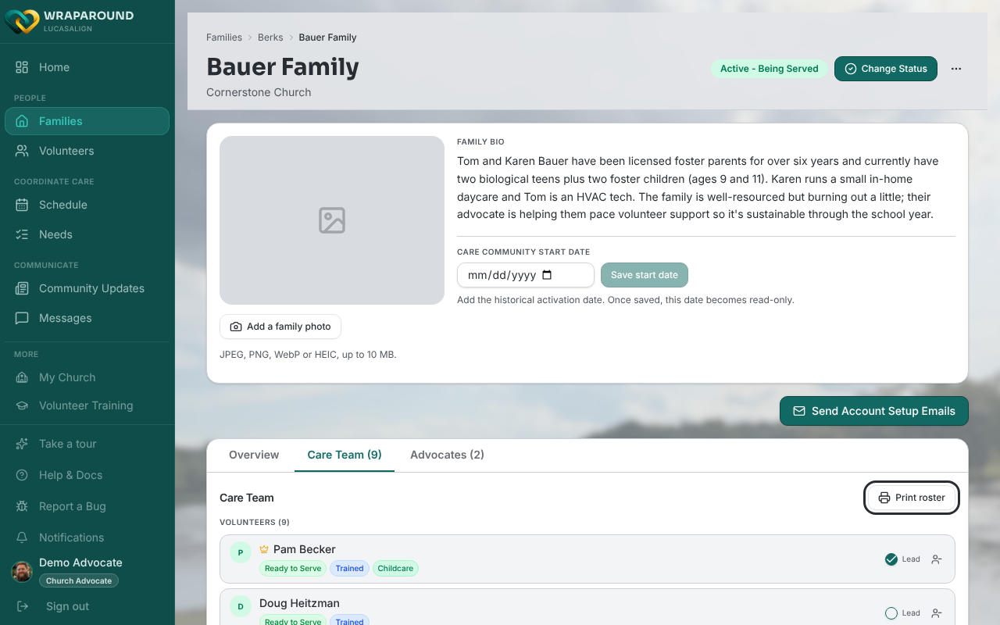
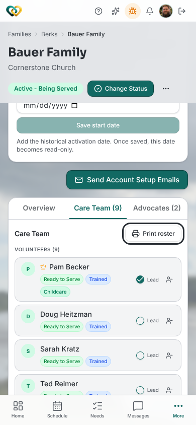

<!-- @frontend verified 2026-11-25 against Align-FrontEnd pages/family-detail.tsx (Care Team tab,
     Print roster button) and components/care-team-roster-print.tsx (printed layout). -->
<!-- @backend: confirm which roles can open a family's Care Team tab (the button itself has no
     role check beyond reaching the family detail page). -->

# Print a family's care team roster

**Who this is for:** Advocates and program staff.
**When to use it:** To hand a family, or their care team, a printed page showing everyone who
supports them and how to reach them.
**Before you start:** The family has at least one advocate or volunteer on its care team.
The **Print roster** button doesn't appear until someone is assigned.

## Steps

1. From the main menu, open **Families**, then open the family.
2. Go to the **Care Team** tab.
3. Click **Print roster** at the top right of the **Care Team** card.
    

    

4. Your browser's print window opens. Choose a printer, or **Save as PDF**, and print.

## What you'll see

A one-page roster, in black and white, with:

- the family's name and photo, plus the primary contact's phone number and the family's
  address when they're on file;
- an **Advocates** section and a **Volunteers** section, each person with their photo (or
  initials) and phone number. Someone who is both an advocate and a volunteer on this team is
  listed once, under **Advocates**. An empty section reads **None assigned.**

Only the roster prints. The rest of the screen is left off the page.

!!! note "Handle printed rosters with care"
    A roster lists phone numbers and the family's address. Give it only to people in the
    family's care circle.

## Related

- [Manage a family's care team](manage-a-familys-care-team.md)
- [Assign a Lead Volunteer](assign-a-lead-volunteer.md)
