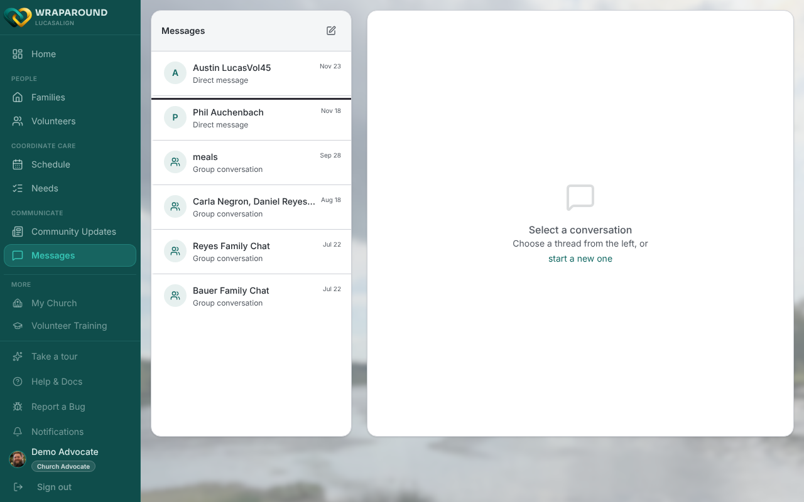
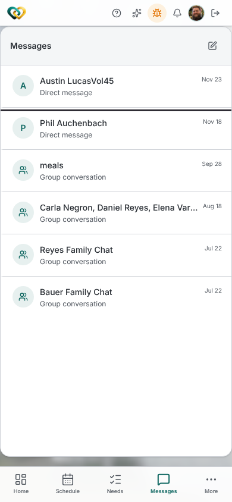
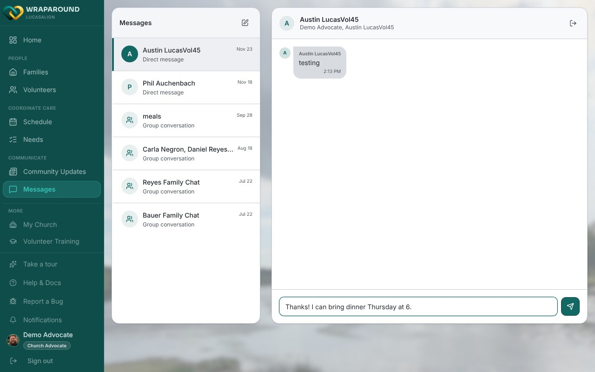
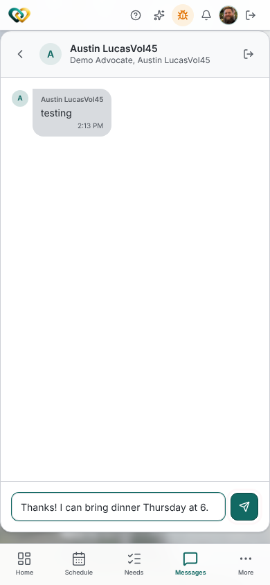

# Reply to a message & read receipts

**Who this is for:** Advocate
**When to use it:** To respond in an existing conversation and see which conversations have new messages.
**Before you start:** You need an existing conversation — see [Start a message thread](start-a-message-thread.md) if you don't have one yet.

## Steps

1. Go to **Messages** and select the conversation from your list. A conversation with messages you haven't read shows its name in bold with a red count badge.

    

    

2. Type your reply in the **Send a message…** box.
3. Click the send button (the paper-plane icon), or press **Enter**.

    

    

## What you'll see

Your reply appears at the bottom of the conversation. If there were messages you hadn't read, a red **New** line marks where they start. Opening a conversation marks it as read, so its badge clears.

The **Messages** item in the menu shows your total number of unread messages, so you can spot new messages from any page.

!!! warning "Read receipts aren't available"
    WrapAround doesn't show whether anyone has read your message — there's no "Seen" label or checkmark. If you're waiting on a task to be covered, wait for a clear reply or a claim/sign-up.

## Related

- [Start a message thread](start-a-message-thread.md)
- [Replies & read receipts (Volunteer)](../messaging/reply-read-receipts.md)
