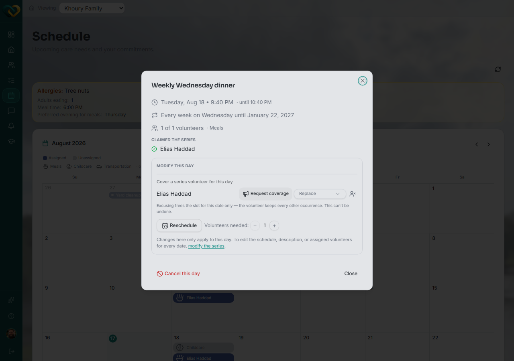

# Request coverage on behalf of a volunteer

**Who this is for:** Advocate, Lead Volunteer (also available to the volunteer themself, on their own claim)
**When to use it:** When a volunteer holding a slot may not be able to make it, and you want to ask the care community for a replacement — without pulling the volunteer off the slot yet.
**Before you start:** The need or occurrence must already have a volunteer assigned.

## Steps

1. Go to **Schedule**.
2. Click the day with the occurrence in question. A list of that day's items opens — click **This day** on the specific occurrence (or **Modify** for a one-time need) to open its full detail dialog.
3. Find the volunteer's name. On a recurring need, it's inside the **Modify this day** box: someone who holds every date of the series is listed under **Cover a series volunteer for this day**. On a one-time need, look under **Assigned volunteers**.
4. Click **Request coverage** next to their name.

## What you'll see

The care community is emailed that this slot needs a different volunteer, and **coverage requested** appears next to the volunteer's name. The current volunteer **stays assigned** — this only asks for backup, it doesn't remove them. Compare this to the other controls in the same dialog:

- **Replace** (dropdown, series volunteers) — swap in a specific volunteer for this date only, removing the current one from it. You're asked to confirm, and it can't be undone.
- The small person-with-x icon next to Replace (**Excuse from this day**) — excuses the volunteer and frees the slot for this date only; can't be undone.
- **Reassign** (dropdown) and the **×** button — for a volunteer signed up for just this date, swap them for someone else or remove them.
- **Reschedule** — move this occurrence to a different date/time.

All of these apply to the single date you opened — for a change to every occurrence in the series, use the **modify the series** link at the bottom of the same dialog.

!!! tip "This is scoped to one day"
    Requesting coverage on a recurring need only affects the date you clicked. The volunteer's assignment on every other occurrence is untouched.

## Related

- [Change volunteer assignments on recurring needs](change-recurring-assignments.md)
- [Assign a volunteer to cover a single day of a recurring need](cover-a-single-day.md)
