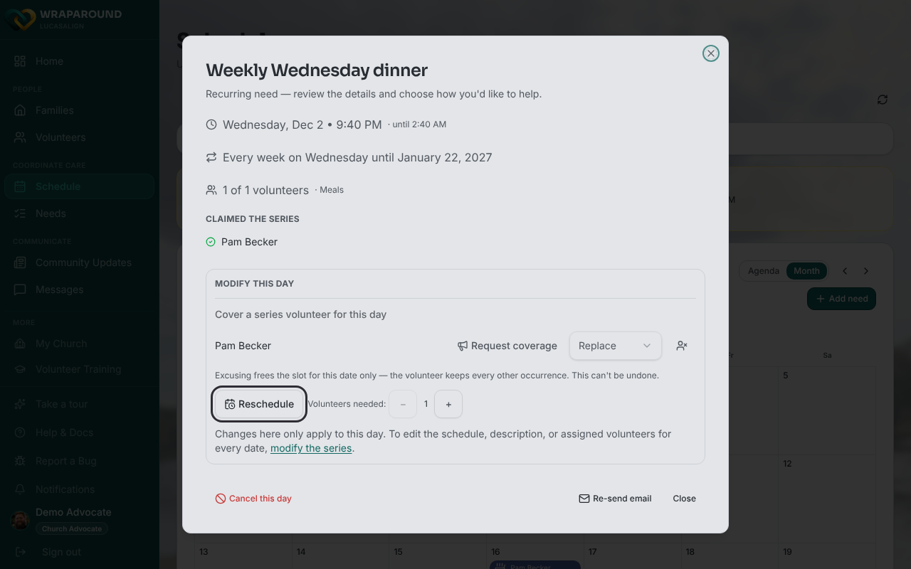
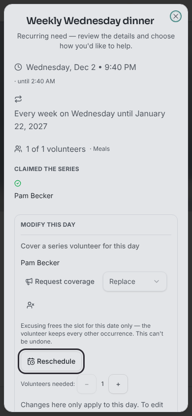
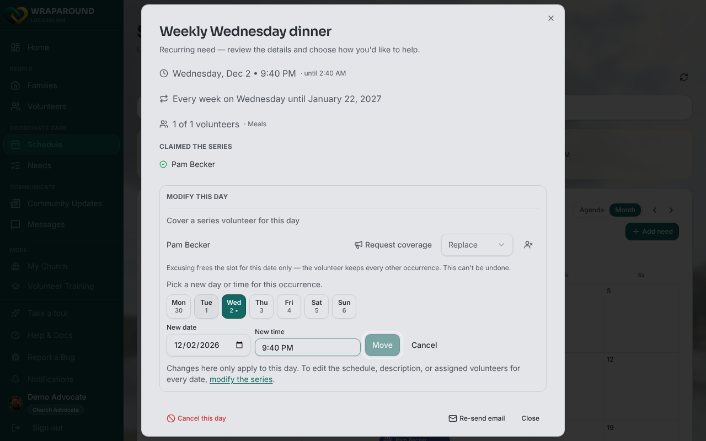
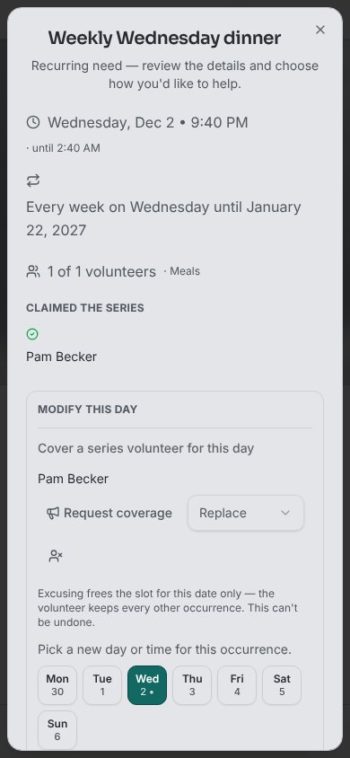

# Reschedule one day of a recurring need

**Who this is for:** Advocate, Lead Volunteer
**When to use it:** To move a single date of a recurring need to another day or time, such as moving this week's Tuesday dinner to Thursday, without changing the rest of the series.
**Before you start:** The recurring need must already exist, and the date must not be cancelled.

## Steps

1. Open **Schedule** and click the day you want to move.
2. In the day's list, click **This day** on the recurring need. On a phone, the schedule opens as an **Agenda** list, so tap **This day** on the date directly.
3. In the **Modify this day** card, click **Reschedule**.

    

    

4. Pick the new date: tap a day in that week's row of quick picks, or enter one in **New date**.
5. Set **New time** if the time is changing too.
6. Click **Move**.

    

    

7. In **Move this day?**, check the new date and time, then click **Move** to confirm.

## What you'll see

The date moves to its new day and time on the schedule. The rest of the series keeps its usual schedule. Volunteers signed up for that date are notified of the new time.

!!! tip "Changing the whole schedule?"
    **Reschedule** only moves the one date you opened. To change the day or time for every date, use the **modify the series** link at the bottom of the **Modify this day** card.

## Related

- [Cancel or re-open one day of a recurring need](cancel-a-single-day.md)
- [Change volunteer assignments on recurring needs](change-recurring-assignments.md)
- [View the schedule](view-schedule.md)
