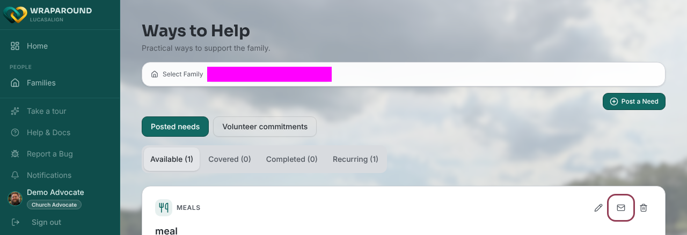

# Re-send a need's email

**Who this is for:** Advocates, Admins and Coordinators, and lead volunteers for their own
family, anyone who can manage a family's needs.
**When to use it:** A need was posted but the care team missed the email, or the details
changed and you want to nudge people again.
**Before you start:** The need must be open. Closed needs can't be re-sent.

## Steps

1. Open **Needs**.
2. On the need's card, click the envelope button (hover text: "Re-send this need's email to
   the care team"). You can also open the need and click **Re-send email** at the bottom.

3. In the **Re-send email?** box, click **Re-send email**.

## What you'll see

An **Email re-sent** message shows **Sent to N people.** The care team gets the same notice
they got when the need was posted.

If you see **Couldn't re-send the email**, the need was probably re-sent in the last
15 minutes. Try again later.

## Related

- [Create a one-time need](create-a-one-time-need.md)
- [Assign a volunteer to a need](assign-a-volunteer-to-a-need.md)
