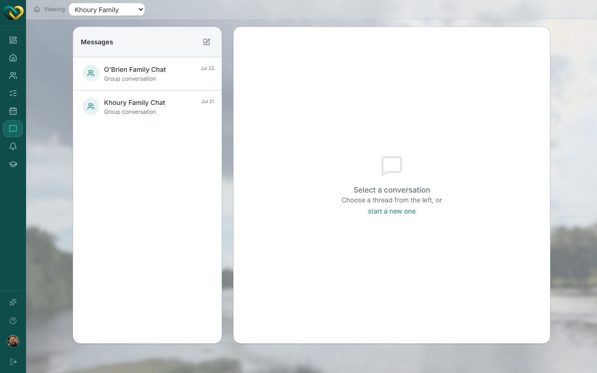
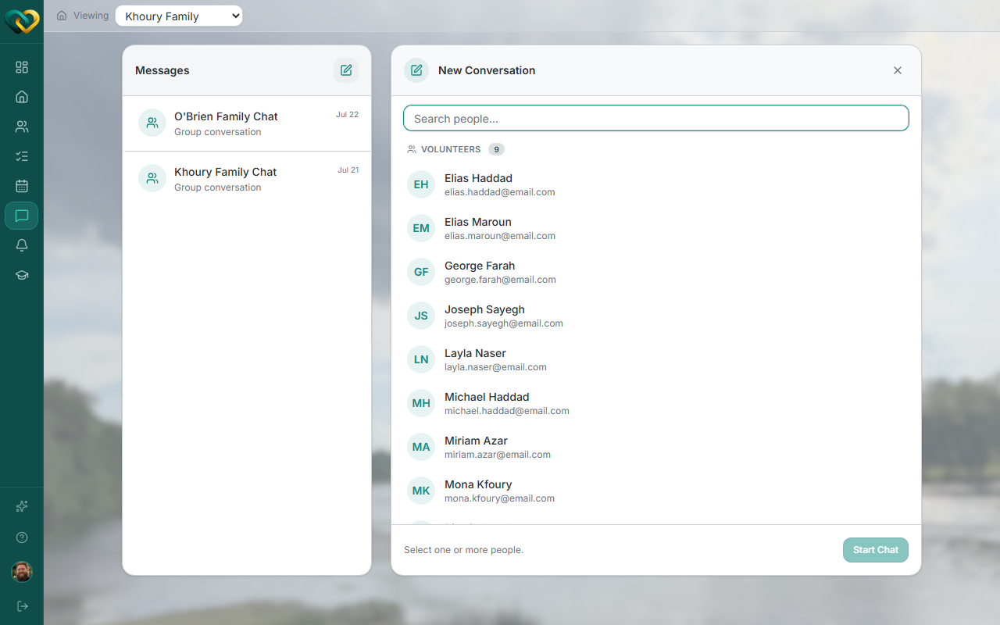

<!-- @backend verified 2026-11-24 against Align-Core #550 (getContactableUserIds in
utils/auth.ts): an advocate can start a thread with any volunteer partnered with their
church, placed on a family or not. -->

# Start a message thread

**Who this is for:** Advocate
**When to use it:** To message a volunteer, a family, or a group about a family you serve.
**Before you start:** Nothing. As an advocate you can message the people in the care circles of the families you serve, and any volunteer partnered with your church, even one not yet placed with a family.

## Steps

1. Go to **Messages**.

    

2. Click **New conversation**.
3. Choose **Direct message** (one person) or **Group conversation** (multiple people).
4. Select the recipient(s) from the **Volunteers** or **Family Members** list.

    

5. Click **Start Chat**.

## What you'll see

The new thread opens and you can start typing right away. It also appears in your conversation list for later.

## Related

- [Reply to a message & read receipts](reply-and-read-receipts.md)
