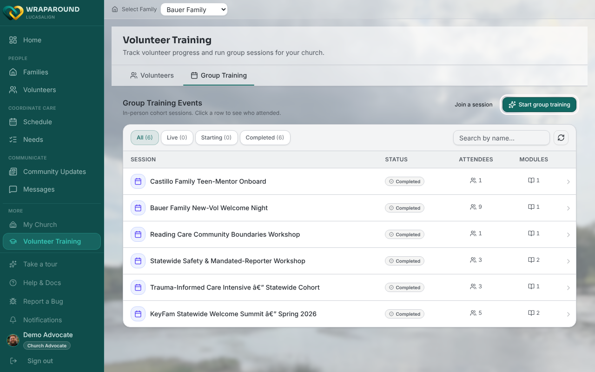
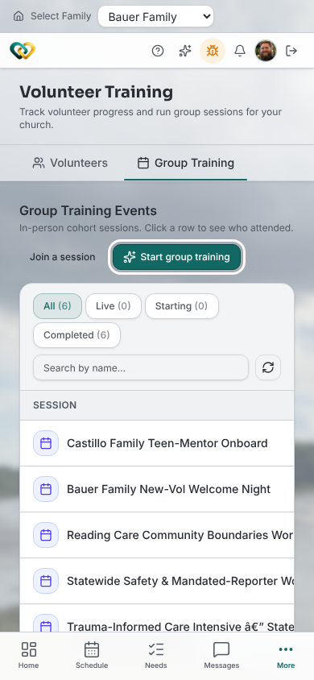
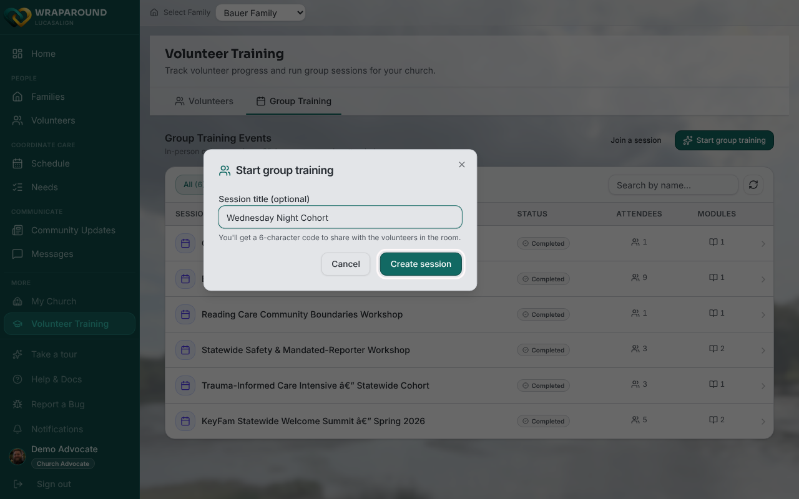
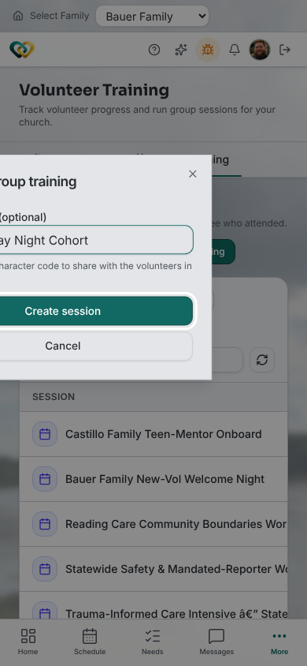

# Start a group training session

**Who this is for:** Advocate
**When to use it:** To lead a live training session for multiple volunteers at once, instead of each person completing modules on their own.
**Before you start:** Pick the family you're working with in **Select Family** at the top of the page. Group sessions belong to a family's care community, so you can't start one without a family selected.

<!-- @backend: confirm who may host a group session. The frontend shows the host controls to
     admins, coordinators and advocates (components/training/group-session-entry.tsx,
     isHostEligible); this page only covers advocates. -->

## Steps

1. Go to **Volunteer Training** (under **More** in the menu) and open the **Group Training** tab.
2. Click **Start group training** at the top right of the tab.

    

    

3. Optionally type a name in **Session title (optional)** — for example, "Wednesday Night Cohort".
4. Click **Create session**.

    

    

## What you'll see

The session's waiting room opens. It shows a 6-character code and a QR code under **Share this code** — volunteers in the room use either one to [join](manage-group-training.md). Click **Copy code** to copy it. As people join, they appear under **Joined**.

When everyone's in, click **Start session**. To call it off instead, click **Cancel session**.

!!! tip "Still finishing your own training?"
    Hosting doesn't require your own required modules to be complete. While you still have modules left, your **Training** page also has a **Group training** panel with the same **Start group training** button. Once you've finished all your training, that page shows **Training Complete!** instead, so use **Volunteer Training**.

!!! tip "Left the page?"
    While your session is still running, the **Group training** panel on your **Training** page shows **Resume hosting**. The session is also listed on the **Group Training** tab with its join code.

## Related

- [Join/manage a live group training](manage-group-training.md)
- [View attendees of a group training](view-training-attendees.md)
