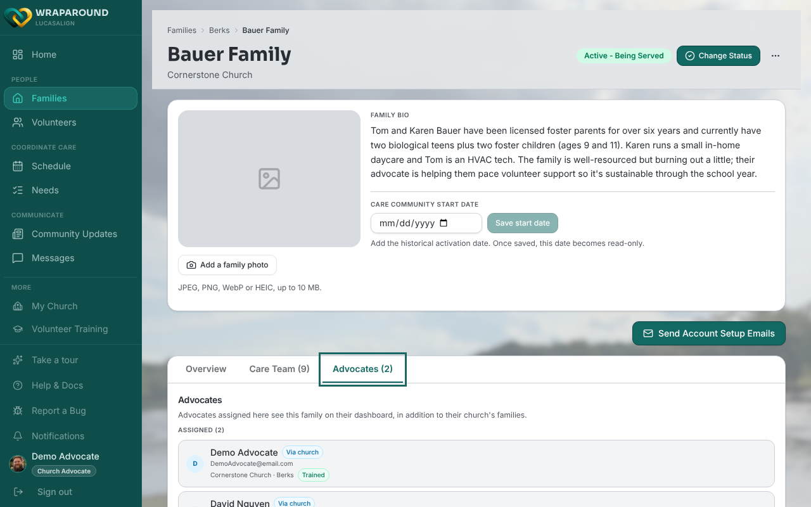
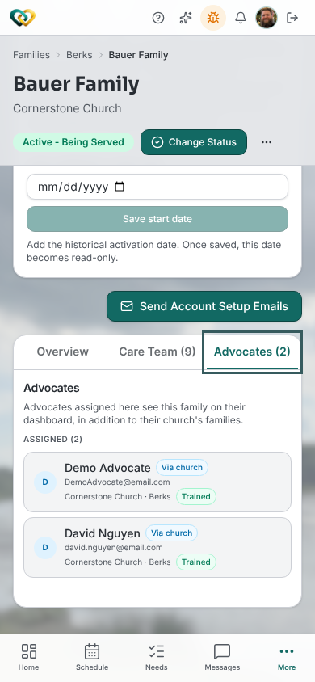

# View the advocates for a family

**Who this is for:** Advocate
**When to use it:** To see which advocates can see and support a family, either because they serve the family's church or because they were assigned to it individually.
**Before you start:** You must be able to see the family (for example, it's served by your church).

## Steps

1. Open the family and click its **Advocates** tab. The tab label shows how many advocates there are, for example **Advocates (2)**.
2. Review the **Assigned** list.

    

    

## What you'll see

Every advocate for the family, with their name, email, and avatar:

- Advocates tagged **Via church** serve the family's serving church, so they reach this family through the church.
- Advocates without the tag were assigned to this family individually. They see it on their dashboard in addition to their own church's families.

If the list is empty, you'll see **No advocates assigned yet.**

!!! note "Changing the list"
    Only Admins and Coordinators can assign or unassign advocates here. An advocate tagged **Via church** can't be unassigned from the family, because their access comes from the church.

## Related

- [Roles & who sees what](../../concepts/roles-and-visibility.md)
