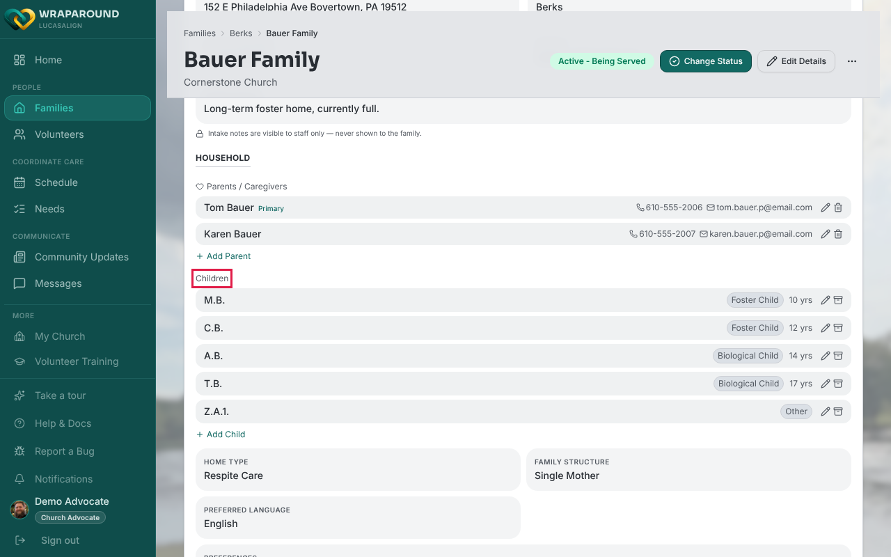
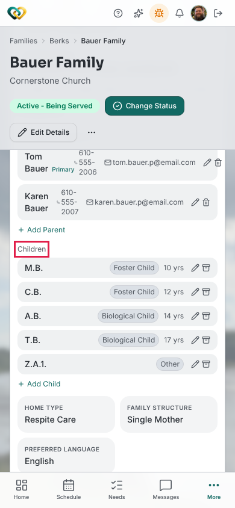

# View child information

**Who this is for:** Advocate
**When to use it:** To check details on a child in a family you serve — birthdate, relationship to the family, and similar.
**Before you start:** The family must be served by your church.

## Steps

1. From the main menu, open **Families**, then open the family.
2. On the **Overview** tab, scroll to the **Household** section.
3. Find the child under **Children**. (Parents and other caregivers are listed above, under
   **Parents / Caregivers**.)

## What you'll see

Children are listed by **initials** (not full name), with their relationship (e.g. Adopted Child) and age (for example **7 yrs**). A cake icon next to the age means the child's birthday is within the next week. If no children have been added yet, you'll see **No children recorded**. Advocates see the same level of detail on a child as an admin does; nothing is hidden or redacted for this role.

## Related

- [Add parent or child information](add-parent-or-child-info.md)
