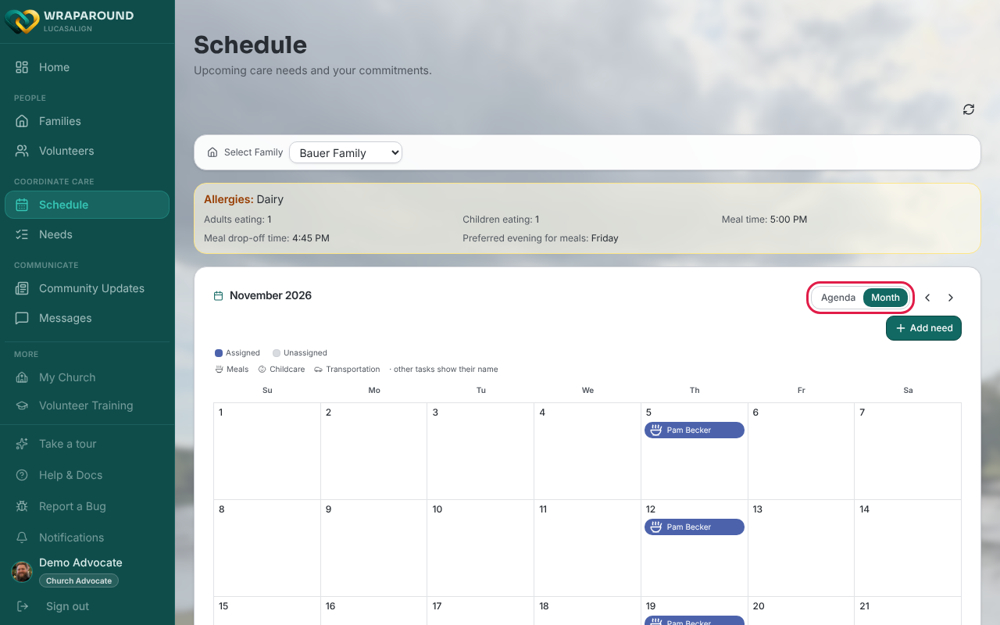
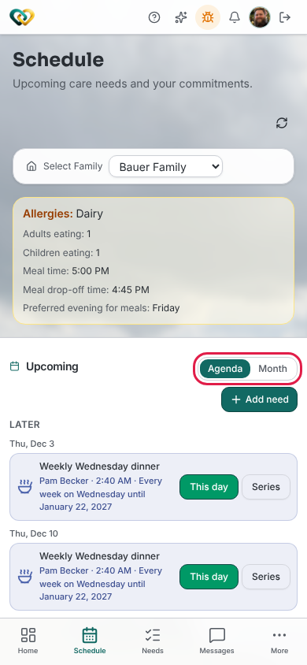

# View the schedule

**Who this is for:** Advocate
**When to use it:** To see a family's upcoming needs and commitments by day or month.
**Before you start:** The family must be served by your church.

## Steps

1. Pick the family in **Select Family** at the top of the page.
2. Click **Schedule** in the left menu.
3. Choose **Month** or **Agenda** at the top of the calendar. **Month** is the default on a computer, **Agenda** on a phone.

    

    

4. In **Month** view, use the arrows next to the month name to move forward or back.
5. Click a day to see what's on it. Each item has a **Modify** button, or **This day** and **Series** if the need repeats.

!!! tip "On a phone"
    The **Agenda** view lists the same items grouped into today, this week and later, with the same buttons on each row. Switch to **Month** if you want the grid.

## What you'll see

A calendar where each need is shown in color for **Assigned** or grey for **Unassigned**. The icon key above the grid shows which icon stands for each support type. Other tasks show their name instead of an icon.

Click **This day** (or **Modify** for a one-time need) to open that date's details. From there you can reassign, request coverage, reschedule, or cancel that date. **Series** edits every date of a recurring need.

Below the calendar, open **Recurring needs** to see the family's repeating needs in one list.

!!! warning "Items in red"
    A need held by a paused or disabled volunteer shows in red, with a banner above the calendar. Reassign it or remove that volunteer so the family is covered.

## Related

- [Request coverage on behalf of a volunteer](request-coverage.md)
- [Assign a volunteer to cover a single day of a recurring need](cover-a-single-day.md)
