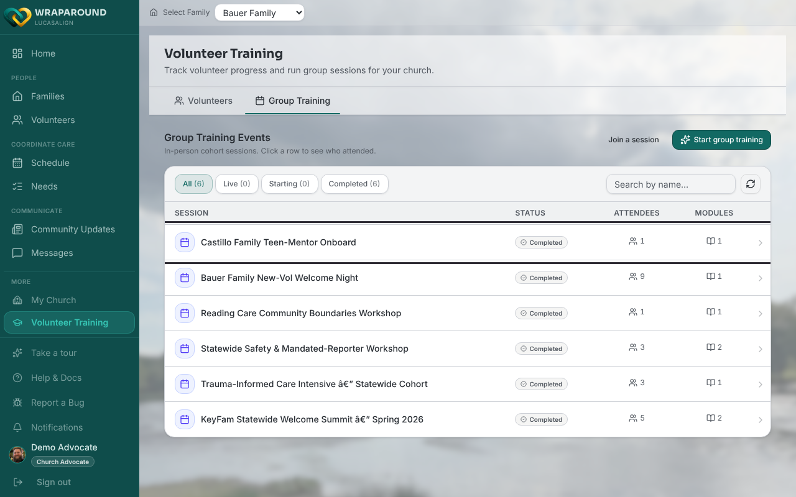
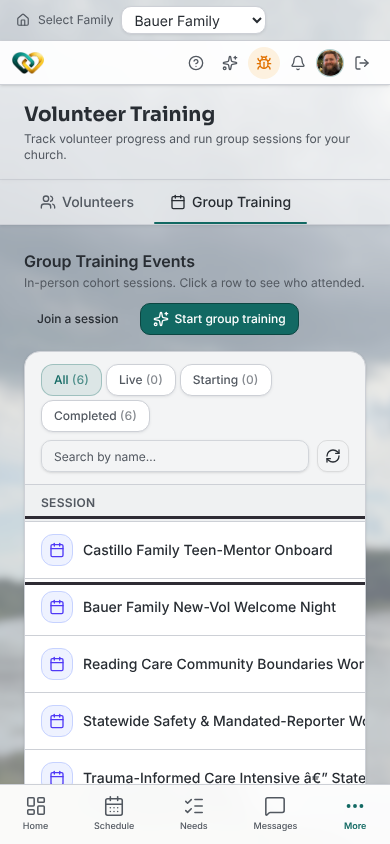
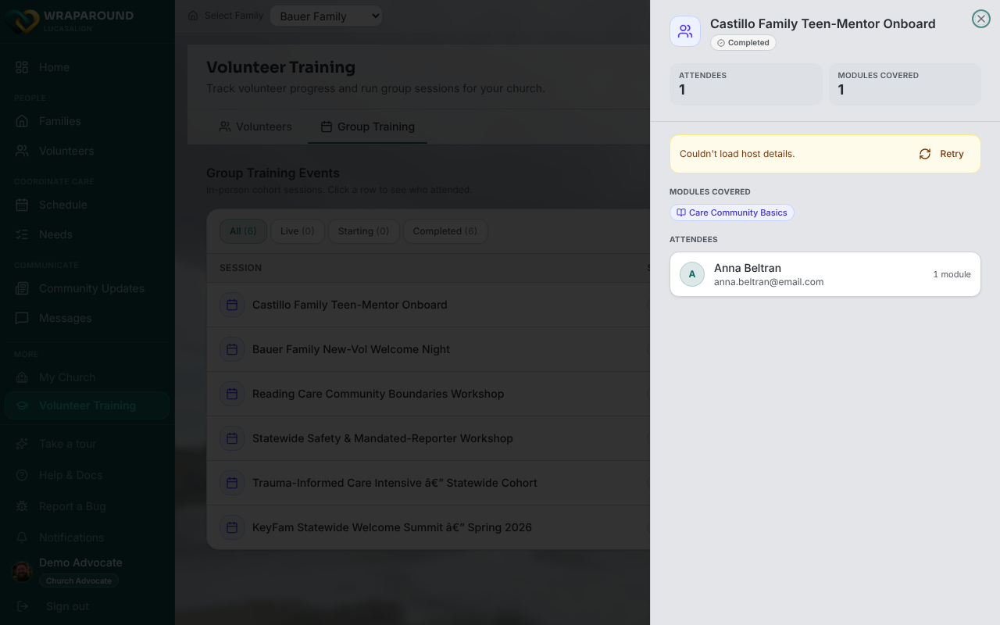
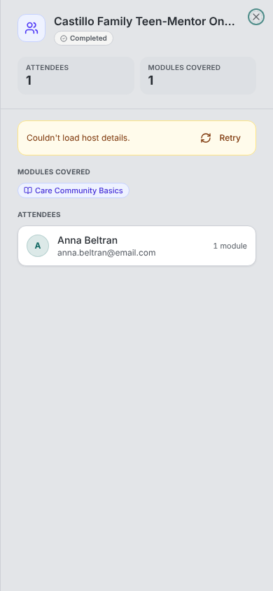

# View attendees of a group training

**Who this is for:** Advocate
**When to use it:** To check who attended a group training session, and to remove someone who joined a live session by mistake.
**Before you start:** Nothing — past and live sessions are both listed.

<!-- @backend: confirm which group sessions an advocate sees on the Group Training tab
     (all sessions for their church's families, or only ones they hosted). -->

## Steps

1. Go to **Volunteer Training** (under **More** in the menu) and open the **Group Training** tab.
2. Find the session in the list. Use the **All**, **Live**, **Starting** and **Completed** filters or **Search by name…** to narrow it down. The **Attendees** column shows how many people joined.

    

    

3. Click the session's row. A panel opens with the session's details.
4. Look under **Attendees**. Each person shows their email and the number of modules they were credited with in this session, or **joined** if none yet.

    

    

5. If the session is still live and someone joined by mistake, click the remove icon next to their name (**Remove from session**).

## What you'll see

The **Attendees** list for the session, with **Modules covered** above it listing the modules the group completed. Anyone you remove from a live session drops off the roster and won't get credit for modules completed after that.

!!! tip "Hosting right now?"
    The page you host from also shows a **Joined** list. Click the **×** next to a name, then **Remove**, to take someone out.

## Related

- [Start a group training session](start-group-training.md)
- [Join/manage a live group training](manage-group-training.md)
