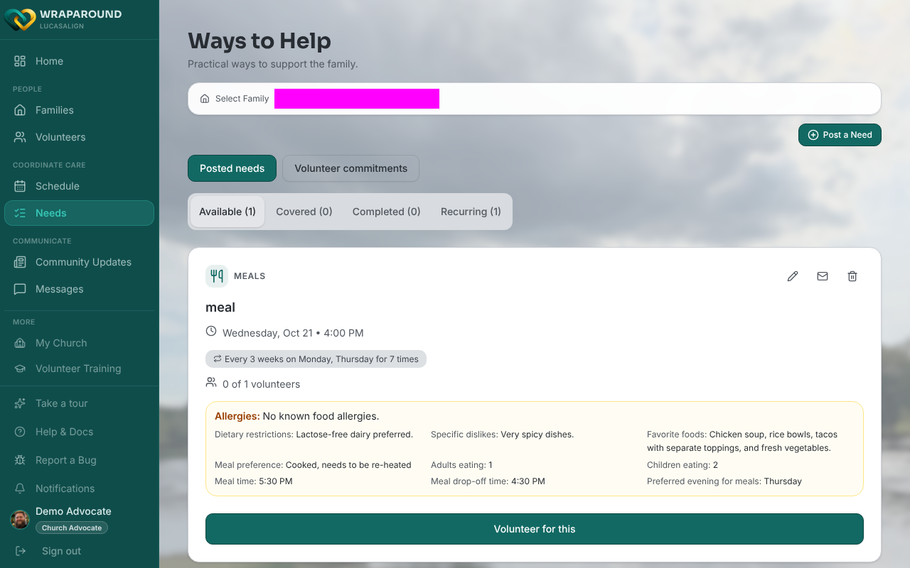
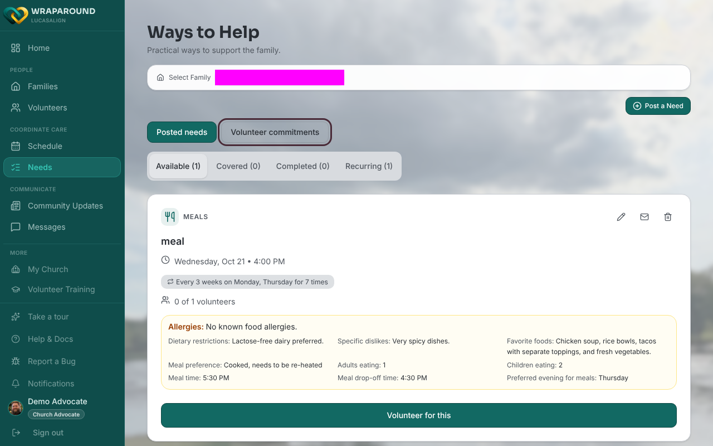
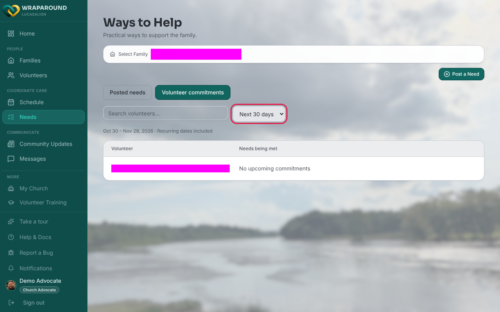

# See what each volunteer has committed to

**Who this is for:** Advocates and program staff
**When to use it:** To see, for one family, which needs each care-team volunteer has signed up for over the next few weeks, including recurring dates.
**Before you start:** Pick the family you want to look at in **Select Family** on the **Needs** page.

## Steps

1. Open **Needs** from the navigation.

    

2. Above the board, click **Volunteer commitments**. (**Posted needs** switches back to the normal board.)

    

3. To narrow the list, type a name in **Search volunteers…**.
4. To change the window, use the **Date range** menu and choose **Next 7 days**, **Next 30 days** or **Next 90 days**. The default is **Next 30 days**.

    

5. Click any need under a volunteer to open its details.

## What you'll see

A two-column list with **Volunteer** and **Needs being met**. Each need shows its title, date and time, and, for a recurring need, a plain-language description of the repeat. The line under the filters shows the date range and "Recurring dates included". A volunteer with nothing coming up shows "No upcoming commitments". If the family has no volunteers yet, the list says "No volunteers on this care team yet."

Dates a volunteer was excused from, and dates a cover volunteer took over, are already accounted for. Cancelled and closed needs are left out. A volunteer who has left the care team but still holds a commitment stays in the list. Volunteers whose status is paused or disabled are not listed unless they still hold a commitment.

!!! note
    The details window opened from this view is read-only. Use **Posted needs** to edit or reassign a need.

## Related

- [Assign a volunteer to a need](assign-a-volunteer-to-a-need.md)
- [Cover a single day of a recurring need](cover-a-single-day.md)
- [View the schedule](view-schedule.md)
