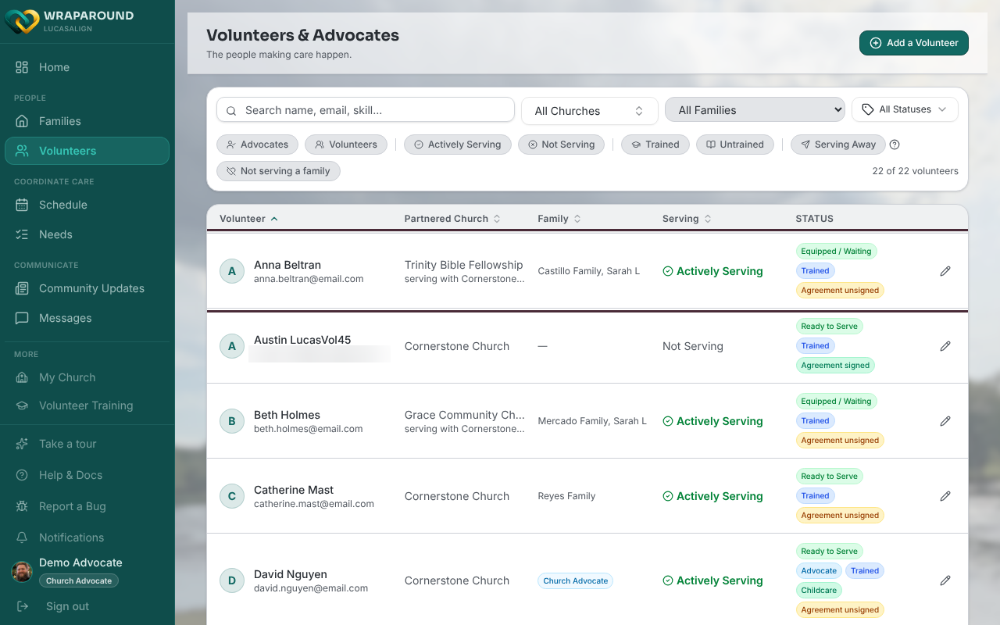
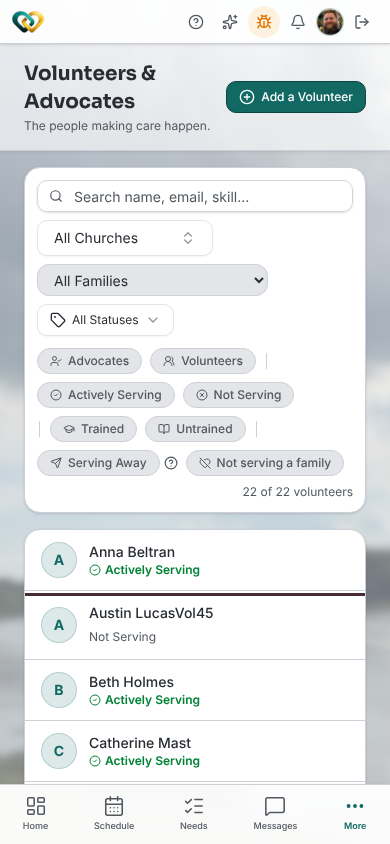
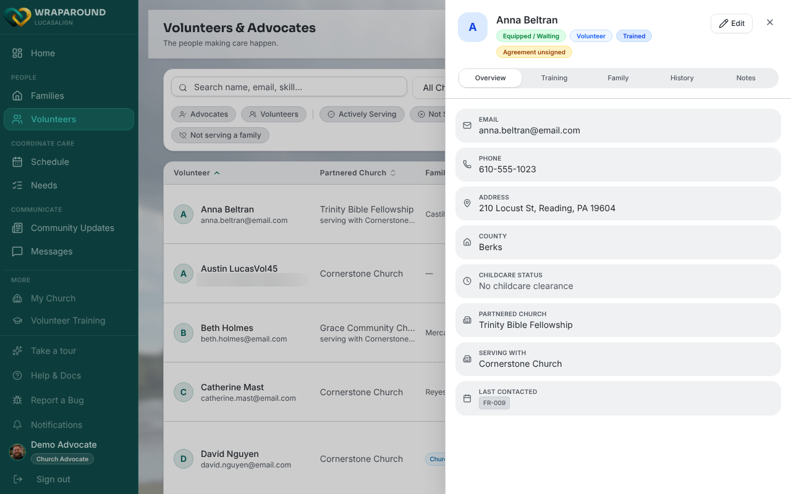
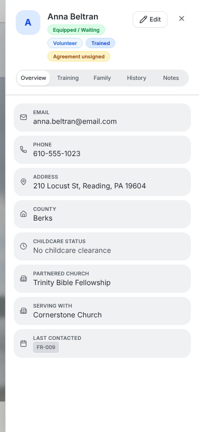
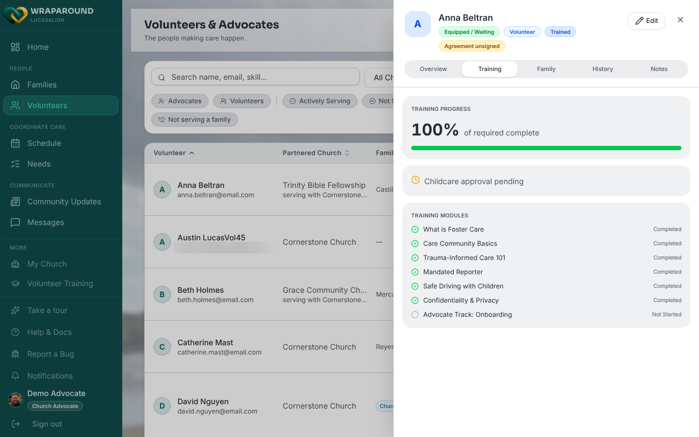
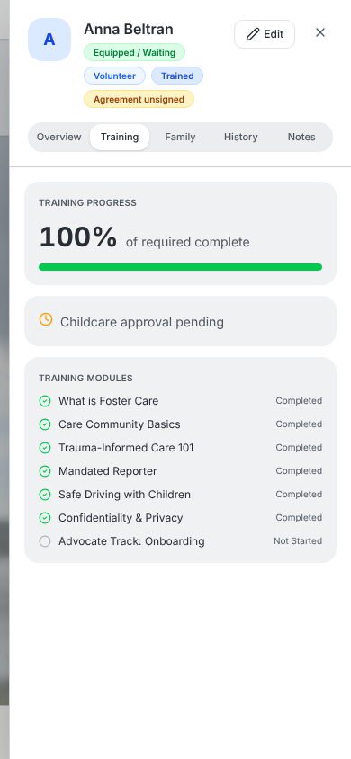

# View volunteer details

**Who this is for:** Advocate
**When to use it:** To check a volunteer's contact details, training progress, childcare clearance, or which family/families they're assigned to.
**Before you start:** Nothing — the **Volunteers** page lists the volunteers you can see.

<!-- @backend: confirm the advocate's scope on the Volunteers page (which volunteers an
     advocate sees — their church's, per CLAUDE.md scoping). -->

## Steps

1. Go to **Volunteers** (under **People** in the menu).
2. Click a volunteer's row. Their profile opens in a panel on the side of the page.

    

    

3. Read the badges under their name: their volunteer status, **Trained** or **Untrained**, whether they've signed the volunteer agreement, and their childcare clearance if they have one.
4. Use the tabs to see more:
    - **Overview** — email, phone, address, county, **Childcare Status**, **Partnered Church**, **Attending Church**, and **Serving With** (other churches whose families they serve).
    - **Training** — **Training Progress** (the percentage of required modules complete), childcare clearance, and **Training Modules**, with each module's status.
    - **Family** — the family or families they're assigned to.
    - **History** — sample data only for now. Contact history isn't tracked yet.
    - **Notes** — free-text notes about this volunteer. See [Add notes to a volunteer's profile](add-notes-to-a-volunteer.md).

    

    

    

    

## What you'll see

On the **Training** tab, each module shows as **Completed**, **In Progress**, or **Not Started**. **Trained** means every required module is complete.

Childcare clearance shows as **Childcare approved**, **Childcare expiring soon**, **Childcare clearance expired**, or **Childcare approval pending**. A volunteer whose clearance has expired can't claim or be assigned childcare needs.

## Related

- [How to onboard a new volunteer](onboard-a-volunteer.md)
- [Add notes to a volunteer's profile](add-notes-to-a-volunteer.md)
- [Roles & who sees what](../../concepts/roles-and-visibility.md)
