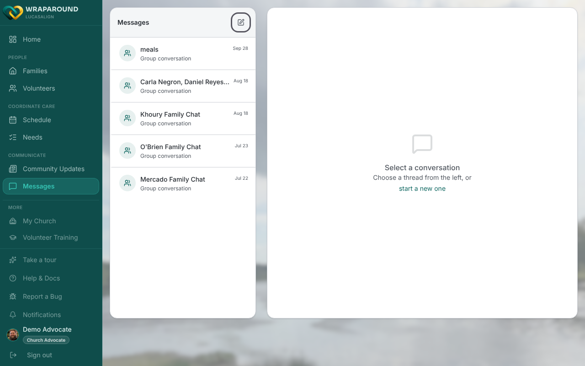
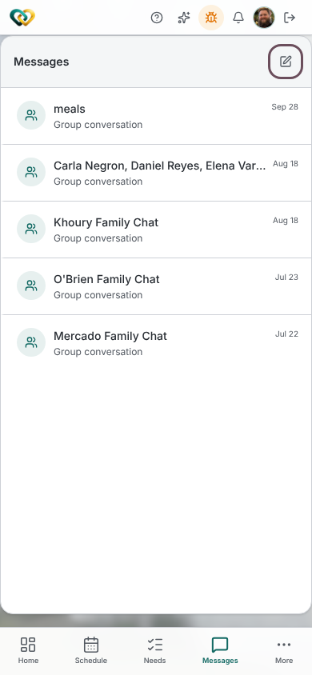
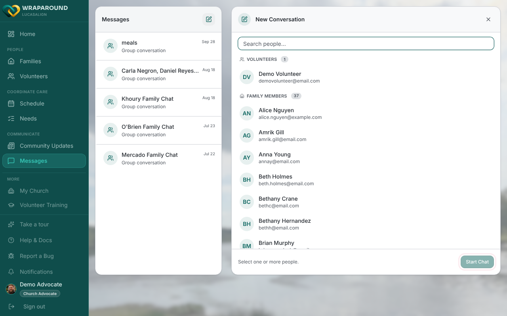
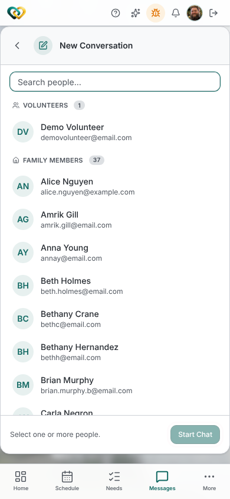

# Start a thread

**Who this is for:** Volunteers, advocates, and program staff.
**When to use it:** When you want to talk with your care circle — ask a question,
coordinate a hand-off, or introduce yourself.
**Before you start:** You've [accepted your invite and signed in](../account/accept-invite.md),
and you're part of a family's circle.

## What a thread is

A **thread** is a conversation within your care circle. Pick **one** person for a direct
message, or **several** people for a group thread (which you can give a name).

## Steps

1. From the main menu, open **Messages**.
2. Select the **New conversation** button (the pencil icon) at the top of the thread list.

    

    { width="320" }

3. In the **New Conversation** panel, find people with **Search people…** or pick them from
   the **Volunteers** and **Family Members** lists. Select **one** person for a direct
   message, or **several** for a group chat.
4. For a group, you can type a name in **Group name (optional)…**. The name **"Family Chat"**
   is reserved and can't be used.
5. Select **Start Chat**.

    

    { width="320" }

6. Type your message and **send**.

## What you'll see

Your new thread appears in the messages list, and everyone you included can read and reply.

!!! tip "Keep it in the circle"
    Messages are private to the people in the conversation. Share family details only with
    your circle, never outside it.

!!! note "Paused accounts can't message"
    If your volunteer status is paused or disabled, you can't use WrapAround, including
    Messages, until your advocate or coordinator moves you out of that status.

## Related

- [Replies & read receipts](reply-read-receipts.md)
- [Notifications](notifications.md)
