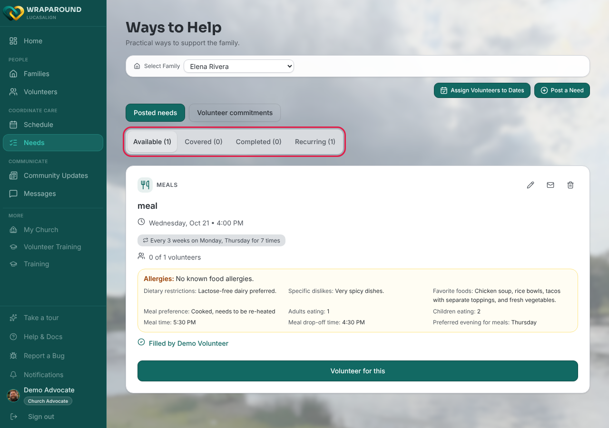
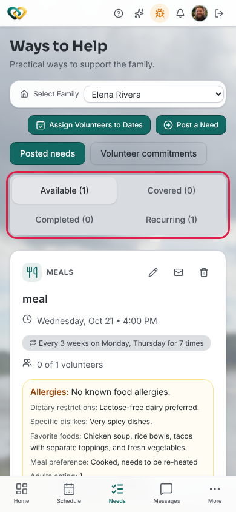

<!-- @frontend verified 2026-11-11 against Align-FrontEnd main (701b73b): pages/needs.tsx,
lib/volunteer-labels.ts (#622 volunteer vocabulary), components/layout.tsx (per-role nav),
and live on dev as the demo advocate. Non-staff viewers see "Ways to Help" and the tabs
Available / Covered / Completed / Recurring; admins and coordinators keep Needs Board and
Open / Filled / Closed. -->

<!-- @backend: confirm the scope sentence in step 1 — a volunteer sees needs only for the
families they're assigned to (volunteer_families, #180), switching between them with the
family picker. -->

# Browse open needs

**Who this is for:** Volunteers (advocates, families, and program staff can do this too).
**When to use it:** When you want to see what your family needs help with and find
something to sign up for.
**Before you start:** You've [accepted your invite and signed in](../account/accept-invite.md),
and you're assigned to a family.

## Steps

1. Open **Ways to Help** from the main menu. (Lead volunteers, advocates, and families see
   this menu item as **Needs**. It opens the same page, titled **Ways to Help**.)
   You see the needs of the family you're working with. If you serve more than one family,
   pick a family from **Select Family** at the top of the page. You never see needs for
   families you aren't assigned to.
2. Needs are sorted into four tabs. Start with **Available**.
    - **Available**: nobody has signed up yet, or more volunteers are still needed.
    - **Covered**: enough volunteers have signed up.
    - **Completed**: the help is no longer needed.
    - **Recurring**: a list of the repeating needs and who has signed up for each. It
      lists the series themselves, so it isn't a status of its own.

    

    

3. Read each need's card. It shows the **type** (such as Meals), the title and description,
   **when** it's needed, how often it repeats, and how many volunteers have signed up
   (for example **0 of 1 volunteers**). Meal needs also show the family's allergies and
   food preferences. Your program sets the list of types, so yours may differ.

## What you'll see

A list of your family's needs, with the ones that still need help on the **Available**
tab. When you find one you can do, [claim it](claim-a-need.md).

!!! note "Program staff see different labels"
    Admins and coordinators open a family's **Needs** tab from **Families**. The page is
    called **Needs Board** there, and the tabs read **Open**, **Filled**, **Closed**, and
    **Recurring**. They mean the same thing as **Available**, **Covered**, and **Completed**.

!!! tip "No filters yet"
    You can't filter needs by type or date yet. Use the tabs to find the ones you can still
    pick up.

## Related

- [Claim a need](claim-a-need.md)
- [What is WrapAround?](../../concepts/what-is-wraparound.md)
- [Statuses explained](../../reference/statuses.md)
