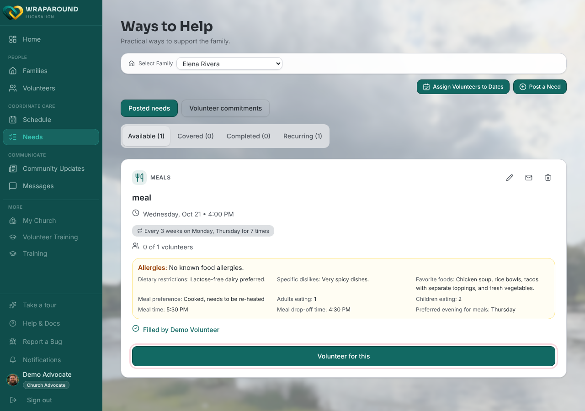
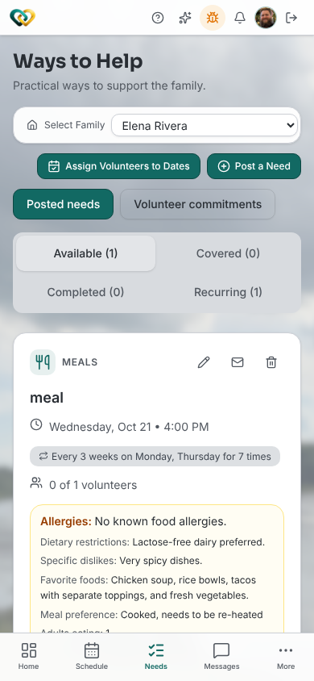

<!-- @backend verified 2026-11-11 against Align-Core main (aa05130),
     src/apps/wraparound/handlers/care: claiming creates a need_claim; a whole-need claim
     flips the need to 'filled' once volunteers_needed is reached, while a single-date
     claim on a recurring need leaves the series status alone (occurrence status is
     computed on read). Don't change these assertions without backend review. -->

<!-- @frontend verified 2026-11-11 against Align-FrontEnd main (701b73b): pages/needs.tsx
     (one-off review dialog #623, CTA from lib/volunteer-labels.ts), and
     components/recurring-claim-dialog.tsx. Button shot captured live on dev as the demo
     advocate. The demo volunteer account is paused in dev, so its view wasn't captured. -->

# Claim a need

**Who this is for:** Volunteers (lead volunteers and advocates can do this too).
**When to use it:** When you want to sign up to take care of something your family needs, such as a meal, a ride, supplies, or a helping hand.
**Before you start:** You've [accepted your invite and signed in](../account/accept-invite.md), and you're assigned to a family.

## What is a "need"?

A **need** is a specific task a family has asked for help with, for example *"Dinner
for the family on Friday"* or *"Ride to a doctor's appointment Tuesday at 2pm."* When
you **claim** a need, you're telling everyone *"I've got this one."* Other volunteers
can then see it's covered and pick up something else.

## Steps

1. Open **Ways to Help** from the main menu (**Needs** for lead volunteers and advocates)
   and stay on the **Available** tab.
2. Read a need's details: **what's needed**, **when**, and any notes from the family or advocate.
3. Make sure you can commit to it. If anything's unclear, ask in
   [the message thread](../messaging/start-thread.md) before you claim.
4. On the need's card, tap **Volunteer for this**.

    

    

5. Confirm what you're signing up for:
    - **One-time need:** a **Volunteer for this?** summary shows the family, the task, and the
      date. Tap **Yes, sign me up**, or **Not yet** to back out.
    - **Recurring need:** a list of upcoming dates opens. Tap **I can help** next to a date,
      then **Confirm commitment**. To take every date, tap **I can help with every date**,
      then **Claim series**. For the full steps, see
      [Sign up for a slot](../schedules/sign-up-slot.md).

## What you'll see

- A **Thank you for volunteering!** message.
- Your name appears under **Filled by** on the card. Once enough volunteers have signed up,
  the need moves from **Available** to **Covered**.
- The need appears on your [Schedule](../schedules/view-calendar.md) so you can find it again.

!!! note "Childcare needs"
    If a need is for childcare and you haven't been approved for childcare, the button reads
    **Childcare approval required** and you can't claim it. Ask your coordinator about approval.

!!! tip "Plans change"
    If you can't make it after all, open the date on your Schedule and use
    [**Request coverage**](request-coverage.md) as early as you can. That asks the care
    community to find someone else. You can't remove yourself from a need.

## When you're done

After you've taken care of it, tell your lead volunteer or advocate. They
[mark the need complete](mark-complete.md) so the family and your team know it's finished.

## Related

- [Browse open needs](browse-needs.md)
- [Request coverage on a need you've claimed](request-coverage.md)
- [Mark a need complete](mark-complete.md)
- [What is WrapAround?](../../concepts/what-is-wraparound.md)
