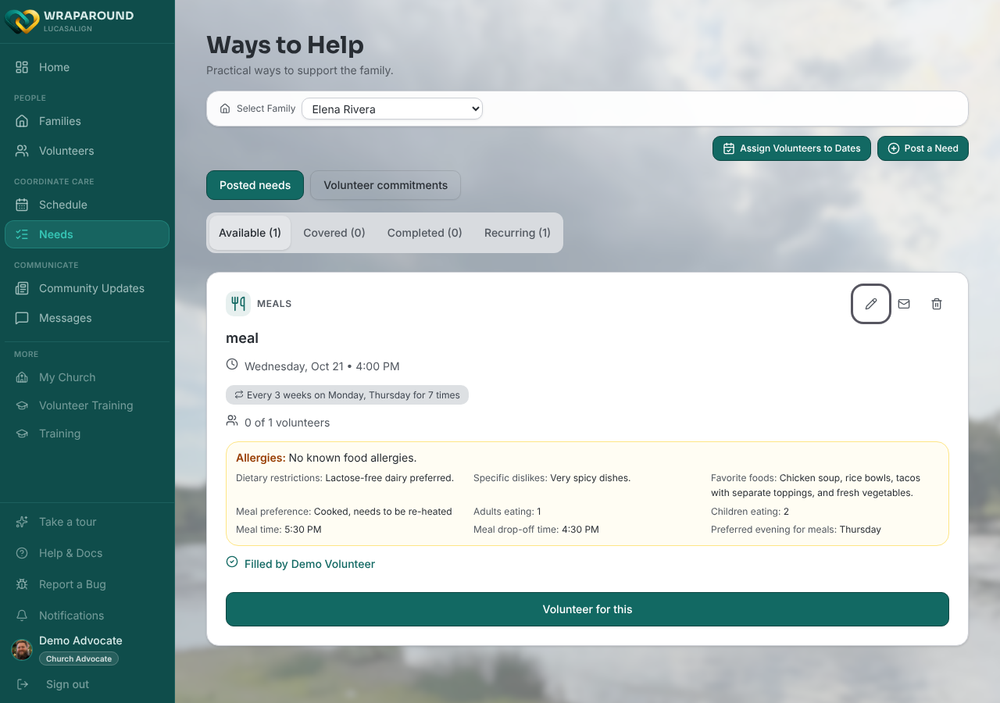
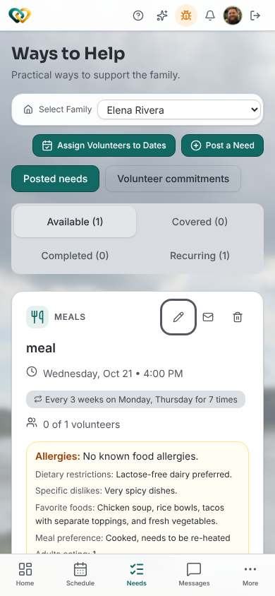
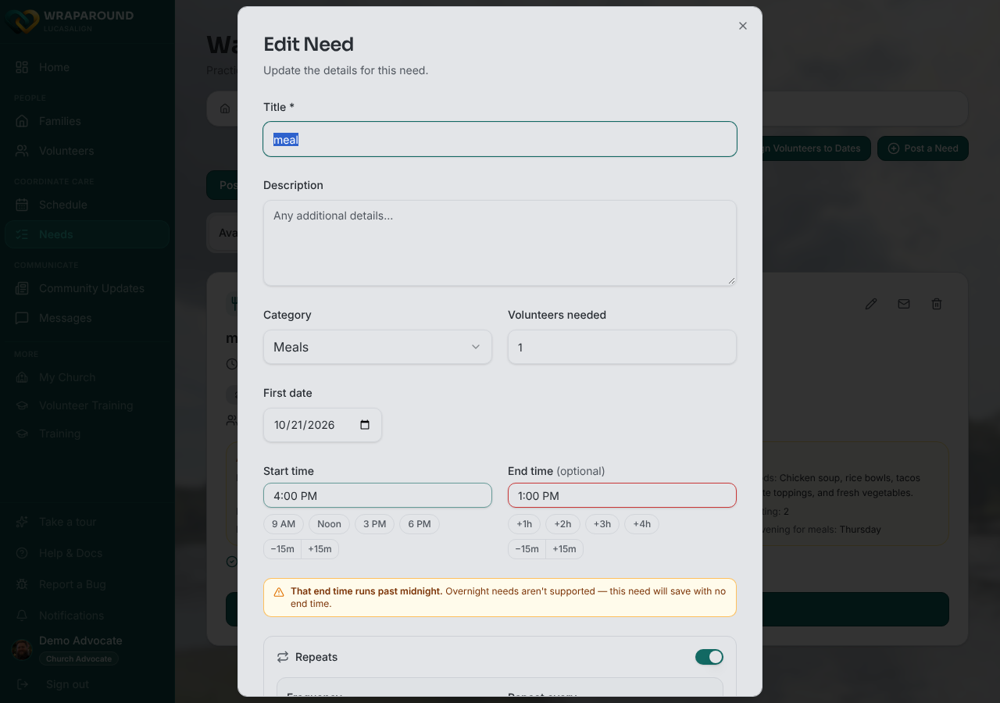
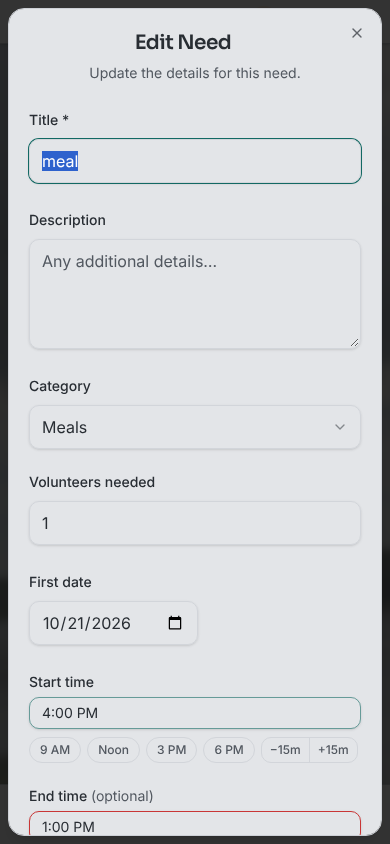

<!-- @frontend verified 2026-11-11 against Align-FrontEnd main (701b73b): there is no
     "Mark complete" button. Closing out a need goes through the Edit Need modal
     (components/need-modal.tsx): a Status dropdown with Open / Filled / Closed, then
     Save Changes. The pencil ("Edit need") icon shows only when useCanManageCareItems()
     is true (admins, coordinators, advocates, lead volunteers). Tab labels follow
     lib/volunteer-labels.ts: Covered / Completed for non-staff, Filled / Closed for
     admins and coordinators. Screenshots captured live on dev as the demo advocate. -->

# Mark a need complete

**Who this is for:** Lead volunteers, advocates, and program staff, the people who can
update a need.
**When to use it:** Once a need has been taken care of, so the family and team know it's done.
**Before you start:** The task has been handled. (A support volunteer who finished a task
lets a lead volunteer or advocate know so they can close it out.)

## Steps

1. Open **Needs** from the main menu and find the need, usually on the **Covered** tab.
   (Program staff: open the family from **Families**, then its **Needs** tab. The tab is
   called **Filled** there.)
2. Click the **pencil** icon (**Edit need**) on the card. **Edit Need** opens.

    

    

    

    

3. Scroll to the bottom, to **Status**, and change it to **Closed**. (**Filled** means
   enough volunteers are assigned. **Closed** means help is no longer needed.)
4. Click **Save Changes**. A **Need updated** message confirms it.

## What you'll see

The need moves to the **Completed** tab (**Closed** for program staff). It no longer
appears on the **Available** or **Covered** tabs, so the family and team can see the task
is finished.

!!! note "Who can do this"
    The pencil icon, and the ability to change a need's status at all, only shows up for
    **lead volunteers, advocates, and program staff**. A support volunteer who completed
    a task asks one of them to close it out.

!!! tip "Add a quick note"
    If there's anything the family should know, such as leftovers in the fridge or where you
    left a package, share it in [the message thread](../messaging/start-thread.md).

## Related

- [Claim a need](claim-a-need.md)
- [Withdraw a claim](withdraw-a-claim.md)
- [Statuses explained](../../reference/statuses.md)
