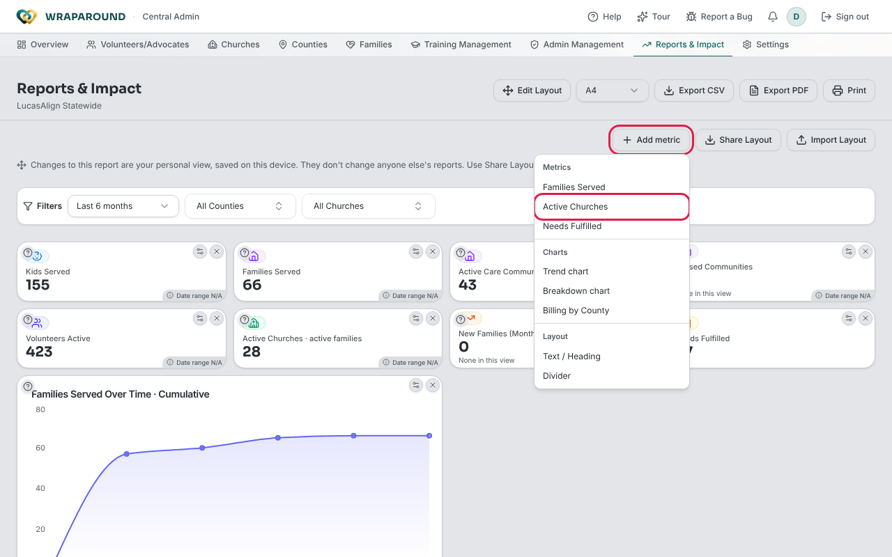
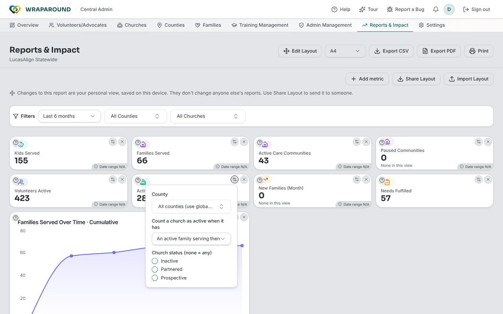

# Active Churches

**Who this is for:** Program staff (Admins and Coordinators).
**When to use it:** When you want to know how many partner churches are actively involved, across your whole network or one county at a time.
**Before you start:** You can open **Reports & Impact**.

**Active Churches** is a counter tile on the **Reports & Impact** page. It counts the distinct churches that are active within the current filters. By default, a church counts as active when at least one family with an active status is served by it.

## Add the tile

Every new report already includes one Active Churches tile. To add another (for example, one per county):

1. Open **Reports & Impact**.
2. Select **Add metric**.
3. Under **Metrics**, select **Active Churches**. The tile is added at the bottom of the report.

## Change what counts as active

Select **Options** (the gear icon) in the top-right corner of the tile. You don't need to turn on **Edit Layout** first.

- **County** — pin this tile to one county. The default, **All counties (use global filter)**, follows the page's **County** filter. A county picked here overrides the page filter for this tile only.
- **Count a church as active when it has** — choose what makes a church active:
    - **An active family serving there** (the default) — at least one family with an active status is served by the church.
    - **A serving volunteer** — at least one volunteer belongs to the church.
    - **Either** — a church that meets either rule. A church that meets both is counted once.
- **Require the volunteer's onboarding complete** — shown when you choose **A serving volunteer** or **Either**. On by default, so only volunteers who have finished onboarding make their church count.
- **Church status (none = any)** — tick one or more church statuses to count only churches with those statuses (for example, only partnered churches). Leave them all unticked to count churches of any status.

The tile's name updates to describe your choices, for example *Active Churches · active families*.

## Which filters affect it

- **County** and **Church** apply, unless the tile has its own **County** set, which takes the place of the page's County filter.
- **Date range does not apply.** The tile counts which churches are active right now, and the app doesn't keep a history of church activity. The tile shows a small **"Date range N/A"** badge in its bottom-right corner to make this clear.

!!! tip "One tile per county"
    You can add this tile more than once. Keep one tile on **All counties (use global filter)** for a network-wide count, then add one tile for each county with its own **County** option set. You'll see every county's number side by side without changing the page filter.

## Related

- [Build a Reports & Impact report](../admin/reports-and-impact.md)
- [Families Served](families-served.md)
- [Volunteers Active](volunteers-active.md)
