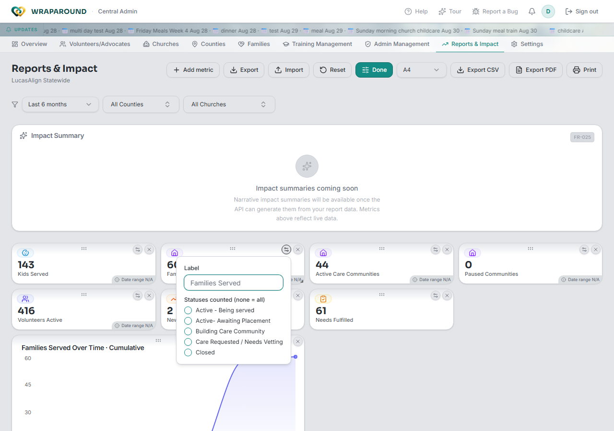

# Families Served

**Who this is for:** Program staff (Admins and Coordinators).
**What it is:** A counter tile on the **Reports & Impact** page.

## What it shows

This tile counts families in your records. By default it counts **every** family, whatever its status, giving you a quick total of the care communities your program supports. You can also point it at a specific group of statuses to count just those. You can add the tile **more than once** to show several counts side by side (for example, a total, an "active" count, and a "paused" count).

!!! note "This replaces the old Active / Paused tiles"
    The separate **Active Care Communities** and **Paused Communities** tiles are now preset versions of this one. A new report still starts with both of them. They're Families Served tiles set to the matching statuses, and you can adjust, rename, or remove them like any other tile.

## Options you can change

Select **Options** (the gear icon) in the top-right corner of the tile to change what gets counted. You don't need to turn on **Edit Layout** first.

- **Label** — give the tile your own name (for example, "Active Care Communities"). Leave it blank to let the tile name itself from the statuses you pick, or "Families Served" when you pick none.
- **Statuses counted (none = all)** — tick one or more family statuses to count. The list shows every family status your program has set up. **Leave them all unticked to count every family.** Ticking the active statuses makes an "active communities" tile; ticking a paused status makes a "paused" tile.

!!! tip "Add it several times"
    Because you can add this tile more than once, you can build a row of status counts (total served, active, paused, building, and so on), each its own tile.

## Which filters affect it

- **County** and **Church** apply. They narrow the tile to the families in that county or served by that church.
- **Date range does not apply.** The tile reflects each family's current status, and the app doesn't keep a history of when a status changed, so there's no past window to count. The tile shows a small **"Date range N/A"** badge in its bottom-right corner to make this clear.

## Related

- [Build a Reports & Impact report](../admin/reports-and-impact.md)
- [Active Churches](active-churches.md)
- [Statuses explained](../../reference/statuses.md)
